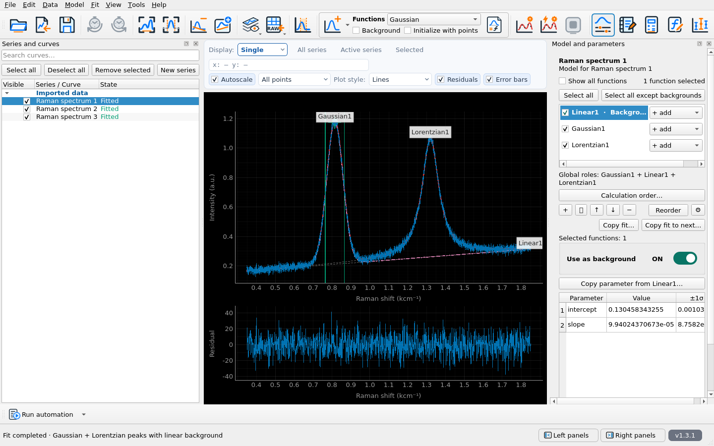
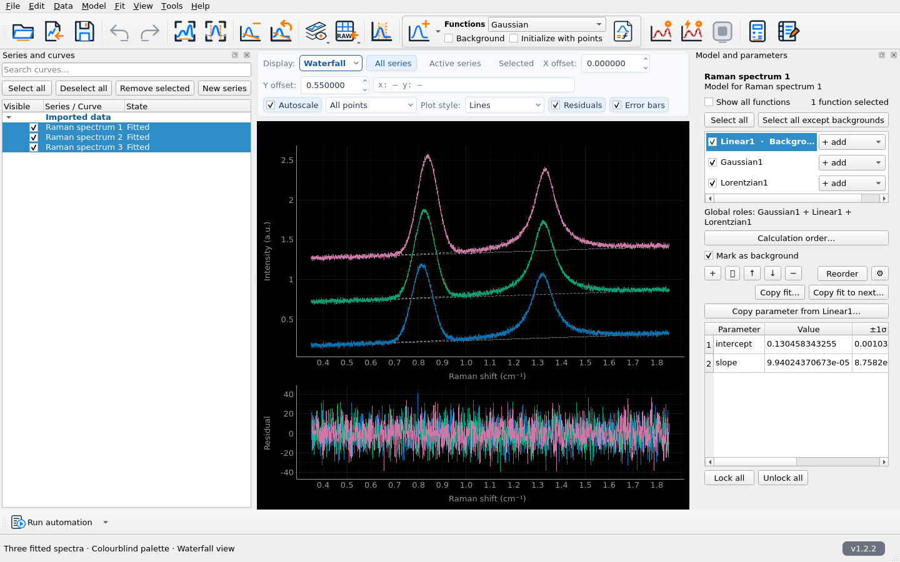

# CurveMole

**Interactive curve fitting. Extensible scientific analysis.**

  
  

CurveMole brings model building, fitting, diagnostics, and visualisation into one modular desktop application. Start with a single curve, analyse a full experimental series, and automate recurring tasks as your workflow grows.

For spectroscopy, diffraction, kinetics, and other experimental x–y data.

[**Download CurveMole**](https://github.com/SebRoLENS/curvemole/releases/latest) · [Quick start](docs/quick-start.md) · [Graphical workflow example](https://sebrolens.github.io/curvemole/quick-start.html) · [Website](https://sebrolens.github.io/curvemole/)

Free and open source. Available for **Windows, Linux, and macOS**.

*A Raman-like example: inspect the data, individual model components, total fit, and residuals in the same workspace.*

## From data to results, in one workspace

Import your data, build a model directly on the plot, run the fit, and inspect the results.

- **Build models visually.** Place and adjust peaks with the mouse, add background components, and inspect their contributions.
- **Control the fit.** Set parameter bounds, fix values, and define relationships within or across curves.
- **Preserve your original data.** Apply reversible masks and transformations while retaining the imported values.
- **Keep the analysis together.** Save data, models, fit results, and laboratory notes in a portable project. Export numerical data, parameters, figures, and reports in an analysis bundle.

## From a single curve to an experimental series

**Model overlapping peaks.** Combine Gaussian, Lorentzian, Voigt, or pseudo-Voigt peaks with background functions. Inspect individual components and residuals, or define custom formulas when you need a different model.

**Follow changes with temperature, pressure, or time.** Compare spectra in Overlay or Waterfall view. Fit curves independently, propagate a model through a sequence, or fit several curves simultaneously with shared parameters.

**Assess parameter uncertainty.** Examine parameter correlations and confidence intervals. Explore uncertainty with Monte Carlo simulations, residual or block bootstrap, and profile likelihood.

*Waterfall view uses vertical offsets to help compare peak positions and shapes across a series.*

## Extend and automate your analysis

Use the graphical interface without writing code. Add custom tools and repeatable procedures when your analysis calls for them:

- **Custom formulas and function libraries** for your models.
- **Plugins** for additional analysis tools, fitting algorithms, and exporters.
- **YAML workflows** for repeatable import, preprocessing, fitting, and export.
- **Python API and command-line tools** for scripts and integration with other software.

The graphical interface, Python API, command line, and YAML workflows share the same scientific engine.

**AI-assisted automation.** Give an AI assistant the [Python API audit](docs/ai-python-audit.md) or [YAML workflow audit](docs/ai-yaml-audit.md) to help write scripts and workflows. These self-contained interface references avoid loading the entire codebase into the AI’s context, saving tokens. Use the audit matching your installed version, and review the scientific assumptions.

Find and install community plugins from **File > Plugin Manager > Browse validated plugins…**.

[**Community plugins**](custom_plugins/README.md#find-and-install-validated-plugins) · [Plugin guide](docs/plugins.md) · [Python API](docs/python-api.md) · [YAML workflows](docs/workflows.md)

## Start with your data

1. [**Download the package for your system.**](https://github.com/SebRoLENS/curvemole/releases/latest)
2. Import a spectrum or curve and add your model.
3. Run the fit, inspect residuals and parameter estimates, and save your project.

The [quick start](docs/quick-start.md) walks through a first analysis. For an illustrated step-by-step tutorial, see the [graphical workflow example](https://sebrolens.github.io/curvemole/quick-start.html). The [user manual](docs/manual.md) covers installation, scientific conventions, advanced tools, and current limitations.

*Windows and macOS packages are unsigned; your operating system may require approval on first launch. See the [installation instructions](docs/manual.md#3-installation-and-first-launch).*

## Contribute

CurveMole grew out of experimental research. [Report an issue or suggest a feature](https://github.com/SebRoLENS/curvemole/issues), or [share a plugin](custom_plugins/README.md#submit-a-plugin).

Developed by **Sebastiano Romi**, LENS — University of Florence, with extensive use of AI tools under human direction. Development includes manual and automated testing.

## How to cite

Using CurveMole in your research? [Cite the exact version used](docs/citing.md) and include [**RRID:SCR_029214**](https://scicrunch.org/resolver/RRID:SCR_029214) in your methods.

[Version 1.3.0](https://github.com/SebRoLENS/curvemole/releases/tag/v1.3.0) · [Project DOI (all versions)](https://doi.org/10.5281/zenodo.22113854) · [Citation guide](docs/citing.md)

## License

Free software released under **GPL-3.0-or-later**. See [LICENSE](LICENSE).
