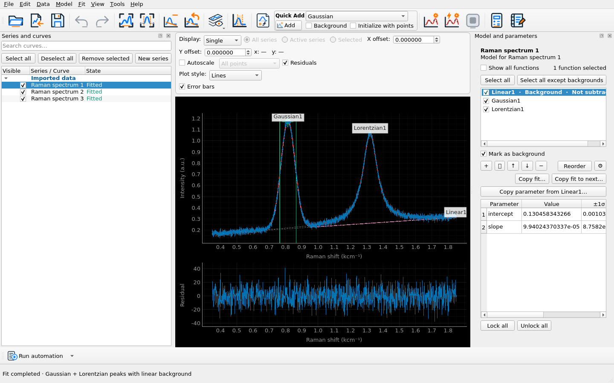
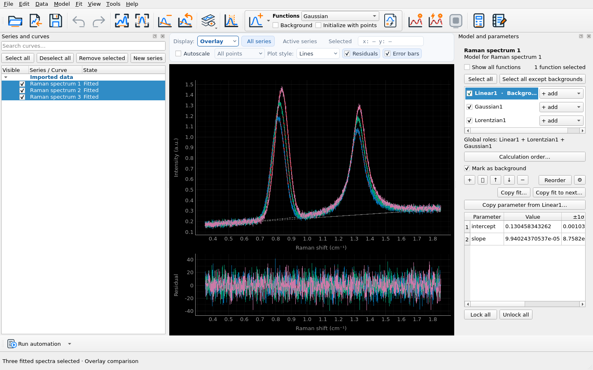
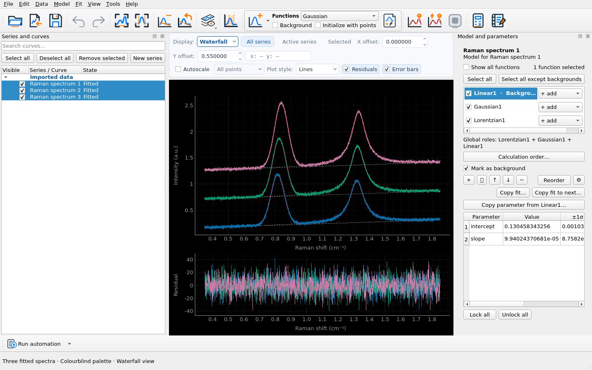
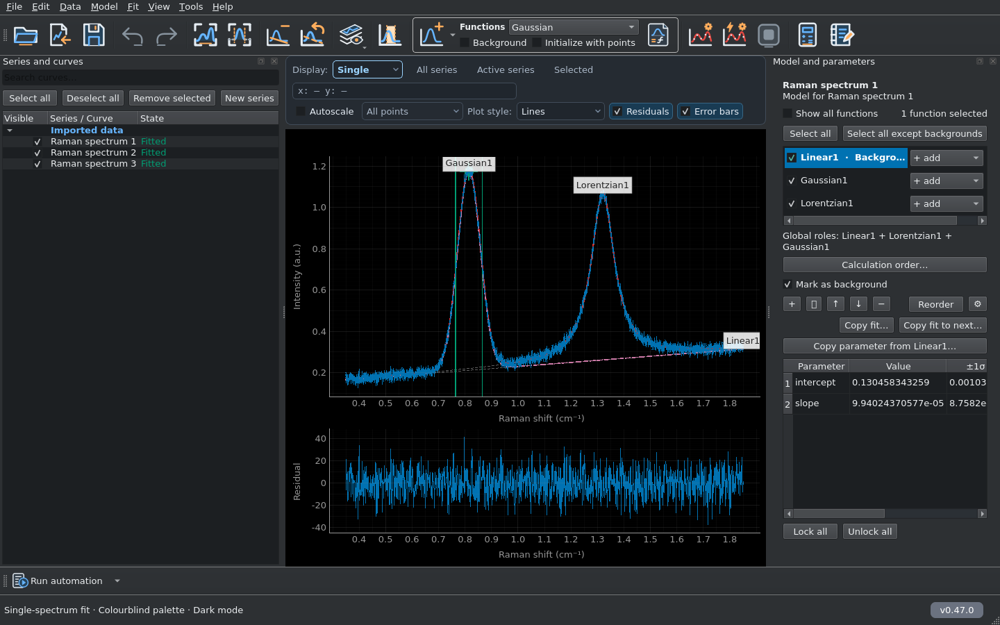

<p align="center">
  
</p>

<h1 align="center">CurveMole</h1>

<p align="center"><strong><a href="https://sebrolens.github.io/curvemole/">Official CurveMole website</a> · <a href="https://github.com/SebRoLENS/curvemole/releases/latest">Download the latest release</a> · <a href="docs/manual.md">User manual</a></strong><br>Desktop downloads for Linux, Windows and macOS.</p>

<p align="center">
  <a href="https://github.com/SebRoLENS/curvemole/releases/latest"></a>
  <a href="https://github.com/SebRoLENS/curvemole/releases/latest"></a>
  <a href="https://github.com/SebRoLENS/curvemole/releases/latest"></a>
  <a href="https://github.com/SebRoLENS/curvemole/releases/latest"></a>
  <a href="https://doi.org/10.5281/zenodo.23730744"></a>
  <a href="https://doi.org/10.5281/zenodo.22113854"></a>
  <a href="https://scicrunch.org/resolver/RRID:SCR_029214"></a>
  <a href="https://github.com/SebRoLENS/curvemole/actions/workflows/ci.yml"></a>
</p>

<p align="center"><strong>Scientific curve and peak fitting for spectroscopy, diffraction, kinetics, and general x-y data.</strong></p>

CurveMole is a desktop-first, scriptable scientific data-analysis application for
one-dimensional spectra and curves. It provides interactive curve fitting, peak fitting,
baseline/background modelling, and nonlinear least-squares analysis for IR and Raman
spectra, powder diffraction and XRD patterns, kinetic traces, and general x-y data.
The same scientific engine is shared by the graphical interface, Python API, command
line, and reproducible YAML workflows.

> **Status:** Version **1.1.0 Stable**.

**AI-assisted development:** CurveMole is developed with extensive use of AI tools,
under human direction. The software undergoes extensive hands-on human testing,
complemented by automated tests. The author remains responsible for its scientific
design and development decisions.

## Download

**[Download the latest release](https://github.com/SebRoLENS/curvemole/releases/latest)**
· [Browse previous releases](https://github.com/SebRoLENS/curvemole/releases)

Available packages are built automatically for:

- Linux x86_64: AppImage with optional per-user desktop integration
- Windows x86_64: installer (recommended) or portable `.zip`
- macOS Apple Silicon: `.dmg`
- macOS Intel x86_64: `.dmg`
- Python 3.12+: wheel and source distribution

The installed desktop applications register CurveMole projects (`.fitproj`) with
the operating system, so they can be opened by double-clicking or with **Open with
CurveMole**. Linux AppImage users can choose **Tools > Integrate CurveMole with the
desktop**; an existing manual launcher is adopted and backed up instead of duplicated.

> [!CAUTION]
> **Windows and macOS downloads are unsigned.**
>
> CurveMole is a nonprofit project. To avoid developer-paid signing/certification costs, these packages are unsigned. Windows SmartScreen or macOS Gatekeeper may ask you to approve the app.

**First launch after an official download**

Only approve a download from this repository's official release page that you trust; verify `SHA256SUMS.txt`.

- **Windows:** Open the installer or extracted app. If SmartScreen shows 'Windows protected your PC', choose **More info → Run anyway**.
- **macOS (unsigned downloads):** Open the DMG, drag CurveMole to Applications, and try opening it once. If blocked, open **System Settings → Privacy & Security**, choose **Open Anyway**, then **Open**, and authenticate if asked.

The Linux AppImage is cryptographically signed using the free, open-source Sigstore
infrastructure through GitHub Actions. Every release includes a detached
`.sigstore.json` signature bundle. With the [GitHub CLI](https://cli.github.com/):

```bash
gh attestation verify CurveMole-VERSION-linux-x86_64.AppImage \
  --repo SebRoLENS/curvemole
```

The clickable status-bar version badge checks for application updates at startup
and hourly. **Help > Check for updates** checks again. Linux AppImage and Windows
installed/portable packages support **Update now**, with SHA-256 verification of the
matching download; save your project before restarting. macOS, Python and source
installations are updated manually from the release page or their source checkout.
Update notifications show the available version and its release type: **bugfix**
when the patch number changes, **feature release** when the minor number changes,
or **major update** when the major number changes.

**Help > Update channel…** selects **Stable** or **Beta** and saves the preference.
Stable receives approved releases. Beta receives fixes and features earlier, may
update very frequently, and may introduce new bugs. You can change channels at any
time. Selecting Stable from a beta keeps the installed version until an equal or
newer stable release is available; it never downgrades automatically. Installed beta
packages always show **Beta** in the status-bar version badge, regardless of the
selected update channel. Older versions are not recommended, but advanced users who
know what they are doing can download and install any version from the GitHub repository.

Development takes place on `testing`; `main` is the stable publication branch.
The initial beta is available as an Actions build download and creates no release.
Subsequent testing builds can be published as prereleases without replacing the
latest stable release or changing the public website. See [release workflow](docs/releasing.md).

## Custom plugins: install or share yours

Open **File > Plugin Manager > Browse validated plugins…** to view the online catalog,
choose a permanent storage folder, and install selected plugins after reviewing and
trusting them. The catalog includes plugins maintained by the main developer and
community contributions, validated on Linux, Windows and macOS.

**[Download latest Community Plugins](https://github.com/SebRoLENS/curvemole/releases/download/community-plugins-latest/validated-community-plugins.zip)**

For a manual download, extract the ZIP, choose an individual plugin folder in
**File > Plugin Manager > Choose plugin folder…**, then review and trust it.
No GitHub account is needed. The link serves the latest published, validated bundle.

**[Share a plugin you created](custom_plugins/README.md#submit-a-plugin)** ·
[Browse the community folder](custom_plugins) ·
[Plugin author guide](docs/plugins.md)

- **Use it on your PC:** open **File > Plugin manager > Choose plugin folder…**,
  select the folder containing your manifest and Python module, then **Review and trust**.
- **Share it with other users:** submit a folder at **`custom_plugins/by_community/your_plugin/`**
  through a GitHub pull request. Follow the upload steps linked above. GitHub tests
  the submission; only successful main runs produce the validated catalog bundle.

The Plugin Manager also includes **Share my plugin on GitHub…**, which opens these
submission instructions. Loading a plugin locally does not upload it publicly.

Loaded community plugins are checked for updates at startup and hourly. Use the
**Plugins** status badge or **Plugin updates…** to update selected plugins, then restart
CurveMole to activate them. Plugins execute Python code; validation and source review
help you decide which plugins to trust. See the [plugin guide](docs/plugins.md) for
local installations, dependencies, API compatibility, and removal.

## Why CurveMole?

CurveMole is designed for experimental scientists who want the convenience of an
interactive desktop GUI without giving up reproducibility or scriptability. A fit can
be explored graphically and then reproduced through the Python API, CLI, or YAML
workflow using the same fitting engine and scientific conventions.

It is intended as a general-purpose open-source tool for spectroscopy, diffraction,
kinetics, peak analysis, and other one-dimensional scientific datasets rather than a
workflow tied to a single experimental technique.

## Documentation

- **[Detailed user manual (Markdown)](docs/manual.md)** - authoritative source,
  with the supported CurveMole version declared at the top
- **[User manual (PDF)](docs/CurveMole_User_Manual.pdf)** - generated automatically
  from the Markdown source
- **[User manual (LaTeX)](docs/CurveMole_User_Manual.tex)** - generated source used
  to compile the PDF
- **[Quick Start](docs/quick-start.md)** - compact first-workflow guide
- **[Python scripting reference](docs/python-api.md)** and
  **[YAML workflow reference](docs/workflows.md)** - detailed contracts, also included
  in Appendices F and G of the main manual

The documentation workflow verifies the declared software version, local links,
LaTeX conversion, and PDF compilation. Versioned PDF and LaTeX manuals are attached
to releases. Documentation corrections for the current stable version are published
here without a new software release; the PDF and LaTeX links above open the revised
editions.

### Create scripts and automations with an AI

Two self-contained **automation audits** describe the interfaces checked against
CurveMole **1.1.0**. They contain the function names, import paths, signatures,
configuration keys, defaults, examples and limitations an AI needs to create a
Python script or YAML workflow without reading the CurveMole source code.

| Task | Read the audit | Download the Markdown file |
|---|---|---|
| Write a Python script | [Python API audit](docs/ai-python-audit.md) | [Download Python audit](https://raw.githubusercontent.com/SebRoLENS/curvemole/main/docs/ai-python-audit.md) |
| Write a YAML automation | [YAML workflow audit](docs/ai-yaml-audit.md) | [Download YAML audit](https://raw.githubusercontent.com/SebRoLENS/curvemole/main/docs/ai-yaml-audit.md) |

Open a download link and save the page as `.md`, or open the file on GitHub and use
**Download raw file**. Attach the relevant file to your AI conversation; attach both
when choosing between Python and YAML. These are interface references, not security
certifications or executable automations. Check their declared CurveMole version
against `curvemole --version`; keep the matching documents with your analysis.

Describe the input files and column names, units, desired model, initial values and
bounds, fit mode, and required outputs. For example:

```text
Using only the attached CurveMole automation audit, create a workflow for
CurveMole 1.1.0. My comma-separated file spectrum.csv has columns x, y, sigma_y
(sigma_y is one standard deviation). Fit a constant background and a Gaussian
with positive width. Save a .fitproj and an analysis bundle in new paths.
Ask me for missing scientific choices. Include the exact command to run it,
check fit convergence, and flag anything the documented interface cannot do.
Do not invent API names or YAML keys.
```

Review the generated code and scientific assumptions. For YAML, first run
`curvemole validate workflow.yml`, then execute it on a small copy of your data
with `curvemole run workflow.yml --json`. Validation checks only the basic workflow
structure; execution is needed to check imports, models and fitting. Python scripts
run in your CurveMole Python environment with `python script.py`. YAML can also be
run from the desktop's **Run automation** button; it creates its own project.
Inspect convergence and output files before processing a full dataset. Appendix H
of the [manual](docs/manual.md#appendix-h-using-the-automation-audits-with-an-ai)
explains this process and the choice between Python and YAML.

### 1.1.1 beta: folder workflows and batch preparation

The `testing` edition adds folder and glob imports with natural ordering,
exclusions and recursion, automatic curve naming/identities, one model definition
for a selected batch, and masks/fit ranges/scalar or formula preprocessing. It
also reports invalid workflow keys earlier, preserves safe custom formulas in
saved projects, supports per-spectrum column layouts and can refuse replacement
of an existing project. New fields require **1.1.1 beta** and
`schema_version: 3`; older executables reject that schema instead of ignoring the
requested processing. Legacy schemas 1 and 2 remain supported for their older
fields. Stable 1.1.0 does not implement these additions.

Use the [beta workflow reference](https://github.com/SebRoLENS/curvemole/blob/testing/docs/workflows.md),
[beta Python audit](https://raw.githubusercontent.com/SebRoLENS/curvemole/testing/docs/ai-python-audit.md)
and [beta YAML audit](https://raw.githubusercontent.com/SebRoLENS/curvemole/testing/docs/ai-yaml-audit.md)
when generating beta automations. Each published beta also attaches a versioned
PDF/LaTeX manual and both AI audits to its release, alongside the installers.
Keep those documents with the exact beta build used. The stable documentation
links above continue to describe the published stable release.

## Highlights

- **Copy fit to next** opens the next spectrum automatically after copying. Function
  deletion preserves a valid starting operator and reports dependent parameter links;
  Undo restores the original composition.

- Gaussian, Lorentzian, Voigt, and pseudo-Voigt peaks parameterised by signed area
- constant, linear, arbitrary-order polynomial, and cubic-spline backgrounds
- content-aware import of valid numeric text files regardless of extension, with
  automatic/manual leading-row skipping, reusable batch mappings, and live previews
- calibrated, one-dimensional, single-ROI WinSpec SPE 2.x import with a wavelength axis
- opt-in automatic folder import of new acquisition files, with filename filtering,
  stable-file checks, and optional processing by a trusted plugin
- fixed values, lower/upper bounds, intervals, and expression links across spectra
- readable multi-parameter links: insert references with **Add** or type names such
  as `Gaussian2.center` directly in an expression with an explicit target value;
  unknown and ambiguous names are reported before applying the link
- series-grouped source choices: **Same spectrum as this parameter** follows copied
  functions by default; specific spectra stay fixed, with copy behavior retained
  separately for each inserted reference
- quick equality, **At least**, **At most**, and **Similar** relationships; the latter
  three keep the target free within hard source-dependent bounds, combined with its
  static bounds and updated throughout fitting
- independent, propagating sequential, and global simultaneous least-squares
  fitting, with configurable safeguards and durable pause/resume; independent
  multicore fitting supports built-in functions and custom formulas
- local least-squares methods, differential evolution with local refinement,
  Nelder-Mead, Powell, L-BFGS-B, and explicit solver-specific controls
- reversible transformations and graphical masks with immutable original data
- **Data > Edit data points...** to drag individual measured points in X, Y or
  both axes, or delete them, with Undo/Redo and preserved original data
- function-aware Quick Add, selectable automatic peak shapes, click-drag peak
  placement, live spline backgrounds, and direct right-drag interval masking
- project-wide function editing with **Select all** / **Select all except backgrounds**
  controls and separate enable/disable checkboxes
- undoable **Reorder** sorts the function list by X position and renumbers automatic
  names without changing the fit or mathematical composition; custom names are
  retained and advanced rules choose another sorting parameter. Exported parameter
  rows and component columns follow the displayed order and current names
- function selection stays at the same list position when switching spectra in the
  active-spectrum Functions view; shorter models select their last function
- explicit, undoable parameter copying between compatible functions, including
  optional bounds, fixed state, and links
- reusable user-defined function libraries with explicit peak parameter roles for
  reliable graphical and automatic initialisation
- live fit refresh, adaptive rendering for dense spectra, background-subtracted
  inspection, and non-destructive viewport navigation during fitting
- Overlay and Waterfall comparison with **All series / Active series / Selected**
  display controls, Ctrl/Shift selection, themes, and a colourblind-safe palette
- hidden spectra have muted names; Up/Down navigation in the list and plot skips
  them until their visibility checkbox is checked again
- a **Data Calculator** with advanced formulas across all imported columns,
  including unplotted columns, and single-spectrum or grouped selection scopes
- covariance statistics, confidence intervals, profile likelihood, Monte Carlo,
  residual bootstrap, and block bootstrap
- optional adaptive resampling checks interval stability after blocks of successful
  replicas, with configurable tolerance and a hard attempt limit; custom formulas
  support parallel uncertainty analysis across selected or all fitted spectra
- configurable timeout for each Monte Carlo/bootstrap replica (60 seconds by
  default), stopping stalled analyses while preserving the fit and completed results
- spectrum analysis tags follow the currently selected uncertainty method, with
  saved results retained separately for each method
- portable, versioned `.fitproj` projects without pickle, recent-project access,
  Undo/Redo for fits and model edits, and recovery after an abnormal exit
- a **Laboratory notebook** for project notes and descriptions of series, spectra,
  and functions, saved in the project and exportable as TXT
- a complete **Export analysis bundle** in its own named folder, with a readable
  file guide, numeric spectra, parameters, uncertainty, reports, reusable models,
  and a portable project copy; related export choices are grouped together
- styled Matplotlib figures saved separately for every spectrum, with PNG, SVG,
  and PDF in their own subfolders, plus a combined PDF report
- **Quick export** commands for numeric spectra, function parameters, and the
  current plot view, also available in the complete bundle
- wide CSV tables for direct inspection, plus keyed Python observation, component,
  and curve-metadata tables with a ready-to-run `replot.py` script
- a separate **Run automation** button with a remembered YAML workflow
- Python API, CLI, YAML workflows, custom formulas, and trusted additive plugins
- **File > Plugin Manager** for catalog browsing, persistent loading, selected updates,
  removal, and crash recovery; [write exporters, fit algorithms and other extensions](docs/plugins.md)

**Quick Fit** always uses **Single/Independent** fitting for the selected spectra,
or the active spectrum when nothing is selected. Its first use takes the default
solver settings; later runs reuse the current settings. While a sequential fit is
paused, Quick Fit fits only the active spectrum and keeps the saved sequence suspended.

**Sequential** fitting starts from a prepared source spectrum without refitting it.
The fitted model propagates to later selected spectra while preserving functions
already on each target. Background functions are excluded from copying by default;
the dialog lets you choose copy exclusions and which constraints and function states
to propagate. Residual or parameter-change safeguards can pause the sequence for
inspection. **Continue sequential fit**, **Terminate sequential fit**, and
**Last pause reason** remain available for managing the pause. The pause-reason
button disappears when the sequence finishes or is terminated. For shared parameters
across spectra in one optimization, choose **Global simultaneous** fitting.

In the Functions panel, highlighted rows select functions for editing; checked boxes
include them in the model and fit. Selecting rows does not enable or disable functions.
Changing a checkbox on a selected row applies that state to every selected function.

## Interface and real usage examples

### Multi-peak fit with background and residuals



A deterministic Raman-like dataset fitted with a linear background, a Gaussian peak,
and a Lorentzian peak. The complete interface shows the measured curve, individual
components, model sum, residuals, fitted parameters, uncertainties, and curve state.

### Comparing a fitted series



Three related spectra are fitted independently and inspected together in Overlay view.
All spectrum colours use CurveMole's built-in **Colourblind** palette.

### Waterfall view



The same fitted series displayed with a vertical offset in Waterfall view, while
preserving the model components and residual information.

### Dark mode



The single-spectrum fit shown with CurveMole's dark interface theme and the same
colourblind-safe spectrum palette.

All four screenshots are generated from the real application by
[`scripts/generate_screenshots.py`](scripts/generate_screenshots.py) and refreshed
automatically whenever the graphical interface changes.

## Install and run from source

Python 3.12 or newer is required.

```bash
git clone https://github.com/SebRoLENS/curvemole.git
cd curvemole
python -m venv .venv
source .venv/bin/activate          # Windows: .venv\Scripts\activate
python -m pip install -e .
curvemole gui
```

Try the complete example:

```bash
curvemole run examples/gaussian_workflow.yml
```

Run tests:

```bash
uv sync --locked --group dev
uv run pytest
```

The manual, Quick Start, and [plugin guide](docs/plugins.md) are included offline.
Maintainers can consult the [automated release guide](docs/releasing.md).

## Scientific conventions

Built-in peak amplitude is the signed integrated area. Widths are strictly positive;
pseudo-Voigt mixing is bounded to `[0, 1]`. Original data are never overwritten.
Masks and transformations remain visible, reversible, and serialised. CurveMole never
silently changes the solver, excludes points, or normalises global contributions.

Experimental errors appear as bars in the import preview and main plot. Import either
one confidence-interval error column or select **Asymmetric error** and map positive
upper/lower half-widths. Declare their confidence (95% by default); `sigma_y` retains
its existing one-standard-deviation meaning. **Fit > Advanced algorithm options >
Use data errors / weights in the fit** controls weighting independently of the bars.
Asymmetric fitting and Monte Carlo use a Gaussian approximation on each side;
bootstrap resamples standardized residuals when data errors are supplied.
Imported `sigma_x` is displayed but is not used in optimization.
No solver guarantees a global optimum for an arbitrary nonlinear
model. Inspect residuals, parameter correlations, constraints, and uncertainty results;
see the [manual](docs/manual.md) for scientific conventions and current limitations.

## Author and contact

Sebastiano Romi  
European Laboratory for Non-Linear Spectroscopy (LENS)  
University of Florence (UNIFI)  
[romi@lens.unifi.it](mailto:romi@lens.unifi.it)

## Version

Current public version: **1.1.0**

## How to cite

If CurveMole contributes to published research, please cite the exact version used.
GitHub also provides a **Cite this repository** entry from [`CITATION.cff`](CITATION.cff).

> Romi, S. (2026). *CurveMole: Modular Scientific Curve Fitting* (Version 1.1.0)
> [Computer software]. Zenodo. https://doi.org/10.5281/zenodo.23730744

Version DOI: [**10.5281/zenodo.23730744**](https://doi.org/10.5281/zenodo.23730744)

**All versions (Concept DOI):**

> Romi, S. (2026). *CurveMole: Modular Scientific Curve Fitting*
> [Computer software]. Zenodo. https://doi.org/10.5281/zenodo.22113854

Concept DOI: [**10.5281/zenodo.22113854**](https://doi.org/10.5281/zenodo.22113854)


SciCrunch: [**RRID:SCR_029214**](https://scicrunch.org/resolver/RRID:SCR_029214) identifies CurveMole independently of the release-specific DOI.

## License

CurveMole is free software released under **GPL-3.0-or-later**. User data, projects,
results, private formulas, and unpublished private extensions remain under the user's
control. Citation metadata are provided in `CITATION.cff`.
