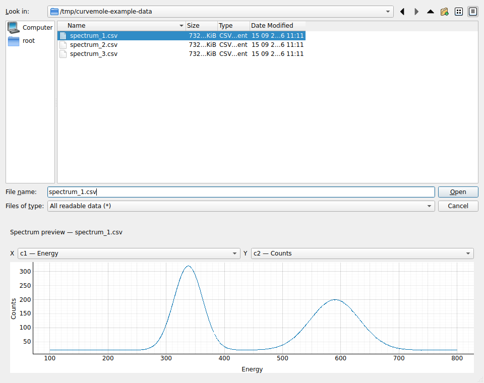
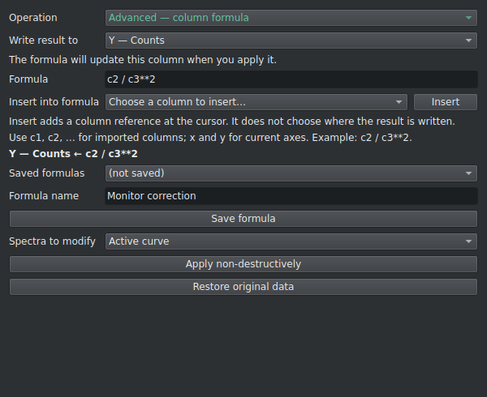

# CurveMole User Manual - 1.1.0

**Current manual version: 1.1.0**

CurveMole is a desktop-first, scriptable application for fitting one-dimensional
scientific curves. This manual describes the behavior of CurveMole 1.1.0 Stable.
The Markdown file is the authoritative source. The LaTeX source and PDF edition are
generated automatically from it and must carry the same version number.

**Testing edition for CurveMole 1.1.1 beta.** The title retains the stable API
baseline, 1.1.0. Marked beta sections and Appendices F/G describe the additional
workflow capabilities in 1.1.1 beta; they are not implemented by the 1.1.0 stable
executable. Use the manual and AI audits attached to your exact beta download.

Useful links:

- [CurveMole repository](https://github.com/SebRoLENS/curvemole)
- [Latest release and desktop downloads](https://github.com/SebRoLENS/curvemole/releases/latest)
- [Issue tracker](https://github.com/SebRoLENS/curvemole/issues)
- [Version DOI, Concept DOI, RRID and citation](https://github.com/SebRoLENS/curvemole#how-to-cite)
- [Quick Start](quick-start.md)
- [Python automation audit](ai-python-audit.md)
- [YAML automation audit](ai-yaml-audit.md)

## 1. About this manual

### 1.1 Intended audience

This manual is for researchers and technical users who need to fit spectra or
other x-y data while retaining control over data preparation, model construction,
constraints, uncertainty, and export. Typical data include:

- infrared and Raman spectra;
- powder diffraction patterns;
- kinetic traces;
- chromatographic profiles;
- temperature, pressure, or field-dependent signals;
- any other one-dimensional curve that can be represented by numeric x and y
  columns.

No programming knowledge is required for the graphical workflow. Separate chapters
cover the command-line interface, YAML workflows, Python API, formula builder, and
plugins.

### 1.2 Version policy for the manual

The version in the title and in the line at the top of this file identifies the
CurveMole release whose behavior is documented. It is not an independent document
version. For example, a manual marked 1.1.0 describes CurveMole 1.1.0.

Testing editions retain this stable baseline in the title. A testing notice and
explicit minimum-version labels distinguish upcoming beta additions; the beta
release assets identify the exact package build containing them.

The release automation performs four checks:

1. the application version and both manual version declarations must agree;
2. all local links in the Markdown source must resolve;
3. Pandoc must generate a standalone LaTeX document without warnings;
4. XeLaTeX must compile the generated source into a valid PDF.

The release assets use versioned names so that a downloaded manual can always be
associated with the correct executable.

### 1.3 Terminology and notation

Menu commands are written as **File > Import data**. Buttons and field names are
shown in **bold**. Commands, filenames, identifiers, and parameter paths use
`monospace` text.

CurveMole uses the following residual convention in displays and exports:

$$
r_i = y_i - f(x_i).
$$

The optimizer minimizes the opposite sign, $f(x_i)-y_i$, after applying uncertainty
and spectrum scaling. The sign has no effect on a least-squares minimum but matters
when reading exported residuals.

### 1.4 Scientific responsibility

CurveMole can optimize a mathematically defined model, but it cannot decide whether
that model is physically appropriate. A small residual or a high descriptive
$R^2$ does not by itself establish uniqueness, chemical meaning, or predictive
validity. In particular:

- do not add components solely to improve a scalar fit statistic;
- use bounds only when they have a defensible meaning;
- inspect correlations and active bounds;
- check whether residuals contain structure;
- report the exact CurveMole version, model, constraints, weighting, and uncertainty
  method used.

## 2. Core concepts

CurveMole keeps the scientific engine independent from the graphical interface.
The desktop application, command-line interface, YAML workflows, and Python API all
operate on the same domain objects.

### 2.1 Project

A project is the complete analysis workspace. It can contain data, models, masks,
transformations, fit results, custom formulas, history, and interface state. Projects
are saved as `.fitproj` files.

### 2.2 Series and curves

A **series** groups related curves. A **curve** contains one x array and one y array,
with optional `sigma_x`, `sigma_y`, or point weights. Importing multiple y columns
from a common file produces multiple curves in one imported series.

Original numeric arrays are stored as immutable 64-bit floating-point values. Data
Calculator operations create reversible transformations instead of overwriting the
original arrays.

### 2.3 Model, component, and parameter

Each curve has its own model. A model is an ordered sequence of components such as a
background and several peaks. Every component has:

- a function, for example `gaussian` or `linear`;
- a user-facing name;
- a composition operator;
- a set of parameters;
- an enabled or disabled state;
- optional metadata, such as polynomial order or spline x nodes.

A parameter has a current value, optional lower and upper bounds, a fixed state, and
an optional expression link. Standard errors and confidence limits are populated
after a successful fit when they are available.

### 2.4 Active, selected, and visible curves

These states are deliberately distinct:

- **Active curve:** the single curve whose model and handles are being edited.
- **Selected curves:** one or more curves chosen for multi-curve operations.
- **Visible curves:** curves drawn in Overlay or Waterfall display modes.

Activating a curve does not automatically select every visible curve. Before a fit,
mask transfer, or multi-curve calculation, check the target shown in the relevant
dialog.

### 2.5 Fit plan and result

A fit plan specifies the curves, fit mode, solver settings, per-spectrum weights,
and whether numerical contributions should be equalized. A fit result records the
optimized parameters, statistics, residual arrays, covariance, correlation,
warnings, timestamp, and solver status.

## 3. Installation and first launch

### 3.1 Reference requirements

The current reference configuration is:

| Item | Minimum or supported target |
|---|---|
| Processor | x86-64 or Apple Silicon on macOS; 4 CPU cores recommended |
| Memory | 8 GB RAM |
| Storage | SSD recommended |
| Display | 1920 x 1080 recommended |
| Windows | Windows 10 22H2 legacy compatibility or Windows 11, 64-bit |
| macOS | macOS 13 Ventura or newer, Intel or Apple Silicon |
| Linux | Ubuntu 22.04 LTS, Debian 12, or a comparable newer distribution |
| Python | Python 3.12 or newer for Python installations |

A dedicated GPU is not required. Large multi-curve fits and resampling analyses may
require more memory and time than the reference configuration.

### 3.2 Desktop packages

Open the [latest release](https://github.com/SebRoLENS/curvemole/releases/latest)
and select the package for your system.

| Platform | Release asset | Normal launch method |
|---|---|---|
| Linux x86-64 | `CurveMole-VERSION-linux-x86_64.AppImage` | Mark executable and run |
| Windows x86-64 | `CurveMole-VERSION-windows-x86_64-setup.exe` | Run the per-user installer |
| Windows portable | `CurveMole-VERSION-windows-x86_64-portable.zip` | Extract and run `CurveMole.exe` |
| macOS Apple Silicon | `CurveMole-VERSION-macos-arm64.dmg` | Drag CurveMole to Applications |
| macOS Intel | `CurveMole-VERSION-macos-x86_64.dmg` | Drag CurveMole to Applications |

> [!CAUTION]
> **Windows and macOS packages are unsigned.** CurveMole is a nonprofit project;
> these packages do not use developer-paid signing or notarization. The operating
> system may require approval on first launch.

Download from the official GitHub release page and verify `SHA256SUMS.txt`.
On Windows, if SmartScreen displays **Windows protected your PC**, choose
**More info > Run anyway**. On macOS, drag CurveMole from the DMG to Applications
and try opening it once. If blocked, open **System Settings > Privacy & Security**,
choose **Open Anyway**, then **Open**, and authenticate if asked.

### 3.3 Linux AppImage

In a terminal opened in the download directory:

```bash
chmod +x CurveMole-1.1.0-linux-x86_64.AppImage
./CurveMole-1.1.0-linux-x86_64.AppImage
```

If the system cannot mount AppImages through FUSE, use extraction mode:

```bash
APPIMAGE_EXTRACT_AND_RUN=1 ./CurveMole-1.1.0-linux-x86_64.AppImage
```

Some minimal Linux installations may need graphical runtime libraries supplied by
the distribution. On Debian or Ubuntu, the commonly required packages are:

```bash
sudo apt install libegl1 libgl1 libxkbcommon-x11-0 libxcb-cursor0
```

Choose **Tools > Integrate CurveMole with the desktop** to copy a new AppImage to a
stable per-user location, add CurveMole to the application menu, install its icon,
and register `.fitproj` projects. No administrator privileges are required. If a
working manual `curvemole.desktop` launcher already exists, CurveMole backs it up
once and adopts its command rather than creating a duplicate application entry.

The Windows installer similarly creates a Start-menu entry, offers an optional
desktop shortcut, and registers `.fitproj`. On macOS the application appears in
Applications and Launchpad. On every platform, a registered project can be opened
by double-clicking it or choosing **Open with CurveMole**.

### 3.4 Verifying SHA-256 checksums

Every release includes `SHA256SUMS.txt`. On Linux:

```bash
sha256sum -c SHA256SUMS.txt --ignore-missing
```

On macOS:

```bash
shasum -a 256 CurveMole-1.1.0-macos-arm64.dmg
```

On Windows PowerShell:

```powershell
Get-FileHash .\CurveMole-1.1.0-windows-x86_64-setup.exe -Algorithm SHA256
```

Compare the reported value with the corresponding line in `SHA256SUMS.txt`.

### 3.5 Installing the Python package

Use an isolated environment. From a downloaded wheel:

```bash
python3 -m venv ~/.venv/curvemole
source ~/.venv/curvemole/bin/activate
python -m pip install ./curvemole-1.1.0-py3-none-any.whl
curvemole gui
```

On Windows PowerShell, activation is:

```powershell
py -m venv $env:USERPROFILE\.venv\curvemole
& $env:USERPROFILE\.venv\curvemole\Scripts\Activate.ps1
python -m pip install .\curvemole-1.1.0-py3-none-any.whl
curvemole gui
```

### 3.6 Running from a source checkout

Clone the repository and install its locked development environment:

```bash
git clone https://github.com/SebRoLENS/curvemole.git
cd curvemole
uv sync --locked --group dev
uv run curvemole gui
```

For an editable installation using `pip`:

```bash
python3 -m venv .venv
source .venv/bin/activate
python -m pip install -e .
curvemole gui
```

### 3.7 Confirming the installed version

```bash
curvemole --version
```

The About dialog also displays the version. A project stores the application version
that created it, and exports include the application version in machine-readable
metadata.

### 3.8 Version badge and updates

Choose **Help > Update channel…** to select **Stable** (approved releases for normal
use) or **Beta** (the `testing` branch). Beta receives bug fixes sooner and may receive
new features earlier. It may update very frequently and introduce new bugs. The
selection is saved and can be changed at any time. A new beta installation defaults
to Beta unless a channel preference was already saved; stable installations default
to Stable.

Switching from Beta to Stable stops beta updates. CurveMole keeps the installed
version until an equal or newer stable release is available; it does not downgrade.
Going back to an older version is not recommended, but advanced users who know what
they are doing can download and install any version from the GitHub repository. The
channel dialog includes a link to the download page. The badge continues to show
**Beta** while a beta package is installed, even when the selected channel is Stable.

The status bar contains a clickable version badge. CurveMole checks the latest GitHub
release for the selected channel at startup and once per hour while the application
remains open. Stable checks exclude prereleases; Beta checks consider both stable
and beta releases in version order. The badge is:

- green when the installed release is current;
- yellow when a bug-fix update (`x.x.y`) is available;
- red when a feature (`x.y.x`) or major (`y.x.x`) update is available;
- grey while checking or when the check cannot be completed.

An automatic notification is shown only once for each newly detected release. Click
the badge or choose **Help > Check for updates** to check again, inspect the release
notes, or reopen the update dialog.

The notification identifies the available version and its release type. For a
version written as `major.minor.patch`, the first changed number determines the type:

| First changed number | Release type | Example |
|---|---|---|
| Patch (third) | Bugfix | `1.0.0` to `1.0.1` |
| Minor (second) | Feature release | `1.0.1` to `1.1.0` |
| Major (first) | Major update | `1.1.0` to `2.0.0` |

Linux AppImage and Windows desktop packages can normally use **Update now**.
CurveMole downloads the matching release asset and verifies the SHA-256 digest supplied
by GitHub. Linux replaces the AppImage, Windows portable installations update from the
portable ZIP, and installed Windows applications launch the verified installer. The
application directory must be writable and no fit or uncertainty task may be running.
Existing Windows portable users are offered a one-time migration to the installer;
projects, settings and plugins remain in their existing user directories. Python,
source, macOS, unsupported architectures, and protected installations must be updated
manually from the release page.

## 4. A complete first fit

This tutorial uses `examples/gaussian.csv` from the source archive. It contains x,
y, and `sigma_y` columns.

### 4.1 Import the example

1. Start CurveMole.
2. Choose **File > Import data** or press **Ctrl+I**.
3. Select `examples/gaussian.csv`.
4. In the mapping dialog, confirm comma delimiter, decimal point, and header.
5. Select `x` as **X column** and check `y` under **Y column(s)**.
6. Select `sigma_y` as the uncertainty type and column.
7. Press **OK**.

The curve appears in the left tree and becomes active. The central plot displays the
data, and the model panel on the right identifies the active curve.

### 4.2 Add a background

1. Press the **+** button in **Model and parameters**, or press **Ctrl++**.
2. Select **Constant** and enable **Add as background**.
3. Keep composition set to `add`.
4. Press **OK**.
5. In the parameter table, enter an initial `offset` near the visual baseline.

### 4.3 Add a Gaussian peak graphically

1. Add another component and select **Gaussian**. Leave **Add as background** and
   **Initialize from manually selected points on the graph** unchecked.
2. Press **OK**. The pointer changes to a crosshair.
3. Click at the approximate peak center.
4. Keep the mouse button pressed and drag horizontally from the center to either
   half-height edge.
5. Release the mouse button.

CurveMole uses twice the dragged distance as the initial FWHM. It estimates a
positive peak height from the data minus the existing model, converts this height to
the area parameterization, and adds the component as one undoable action.

If placement is incorrect, press **Ctrl+Z** and repeat. Press **Esc** during placement
to cancel without adding the component.

### 4.4 Adjust the model before fitting

Select the Gaussian in the component list. Three green handles appear:

- drag the central target to change center and height;
- drag either vertical side handle to change FWHM;
- edit exact values or bounds in the parameter table.

For this example, a positive lower bound on `sigma` already exists intrinsically.
You may enter a tighter scientifically motivated range, but it is not required.

### 4.5 Mask an interval if needed

Mask editing is active only while the graphical **Mask** toolbar button is enabled:

1. click **Mask**; the button becomes grey while masking is active;
2. in Single view it acts on the displayed spectrum; in Overlay/Waterfall choose
   the active spectrum or all visible spectra in the scope prompt;
3. right-drag to mask an interval, left-drag to restore it;
4. click **Mask** again to return to normal navigation.

The example does not normally require masking.

### 4.6 Run the fit

1. Press **Ctrl+F** or choose **Fit > Fit**.
2. Use **Single / independent** mode.
3. Check that the example curve is enabled in the table.
4. Keep **Local least squares (automatic)** and `linear` loss.
5. Press **OK**.

After a successful fit, CurveMole commits the optimized parameter values back into
the displayed model and immediately redraws the model sum, individual components, and
residual panel. Parameter standard errors appear in the `±1 sigma` column when covariance
is available. Open
**View > Diagnostics** to inspect residual warnings.

### 4.7 Save and export

Save the complete workspace with **File > Save project as**. Use a `.fitproj`
extension.

Then choose **File > Export analysis bundle**. All available output types are
selected by default, and the dialog can create a named subfolder to keep the complete
export together. The bundle includes numeric spectra, function parameters, figures,
reports, Python analysis tables, reusable models, a project copy, and a README that
describes the saved files. Clear individual output choices when a smaller bundle is
needed. The **File** menu also offers clearly labelled **Quick export** commands for
spectra, function parameters, and a Matplotlib figure of the current plot view;
these focused exports are also included in the complete bundle.

## 5. Main window and controls

### 5.1 Series and curves tree

The left dock contains a search field and a tree with **Visible**, **Series / Curve**,
and **State** columns.

- Click a curve to activate it.
- When switching spectra, the function selected in Model & Parameters stays at
  the same position in the function list, regardless of its name or type. If the
  new spectrum has fewer functions, its last function is selected; an empty model
  clears the parameter table. Show all functions retains its project-wide selection.
- Use Ctrl-click or Shift-click for a multi-selection, or use **Select all** and **Deselect all** above the tree.
- Use **Remove selected** to delete one or more accidentally imported curves. Removal is undoable.
- Use **New series** to create an empty named series. Empty series are retained when the project is saved.
- Right-click one or more selected spectra and choose **Move selected to series** to reorganize them.
- Right-click selected spectra and choose **Move selected up/down** to change their order inside a series. Multiple adjacent spectra move as a stable group.
- Right-click a series and choose **Merge series into** to append all its spectra to another series and remove the source series.
- Moving, merging, creating, and reordering series are all Undo/Redo operations and do not invalidate fitted parameters.
- Use the visibility checkbox to include or exclude it from Overlay and Waterfall
  displays. Hover over the checkbox for an explanation. Hiding a spectrum retains
  its data and fit; hidden spectra are excluded from fit plans. Highlighting rows
  separately selects spectra for operations. Hidden spectrum names appear muted;
  Up/Down navigation skips them. Click a hidden spectrum to inspect it, or check
  its visibility box to include it in navigation again.
- Double-click an editable name, or right-click and choose **Rename data…** or
  **Rename series…**. Series names must remain unique.
- Right-click a series and choose **Delete series…** to remove it together with all
  its curves, models and results. A populated series requires confirmation; Undo
  restores the complete series. Original files on disk are retained.
- Right-click a **curve** and choose **Choose data colour…** to set its colour. Red is
  reserved for the fitted Model sum and cannot be assigned to a spectrum.
- Right-click a **series** and choose **Series palette** to recolour the complete series
  with one of the built-in non-red palettes. Palette and individual colours are saved in
  the project.
- Use the search field to filter curves by name without removing them.

Curve states are:

| State | Meaning |
|---|---|
| Not fitted | No successful fit is associated with the current curve state |
| Ready | The curve is prepared for fitting |
| Running | A fit involving the curve is in progress |
| Fitted | The last fit completed successfully |
| Modified/outdated | Data or model changed after the last successful fit |
| Failed | The latest fit attempt failed |

Uncertainty tags are added to the fit state for the method currently selected in
**Uncertainty Analysis > Method**. A failed replica, an adaptive stability limit or
a timeout adds a warning icon beside the spectrum and an amber status. Hover over
the State column for the reason and counts. Switching the method updates these tags
without refitting or deleting results. It is the same universal method selected
through the **Analysis - / +** header in **Model and parameters**: changing either
control updates both panels and the spectrum tags. See Section 12.

### 5.2 Plot workspace

The central workspace contains the data/model plot and an optional residual plot.
The controls use two compact rows with palette-aware selection states. They wrap
when dock resizing leaves less width; long coordinate readings stay on one line
with the complete reading available in a tooltip.

Controls above it provide:

- **Display:** Single, Overlay, or Waterfall;
- **All series / Active series / Selected:** one-click scope for Overlay and Waterfall;
- **X offset** and **Y offset:** display-only spacing, shown only in Waterfall;
- **Residuals:** show or hide the linked residual panel;
- **Autoscale:** automatically frame the experimental data when the active spectrum changes;
- **All points / Unmasked points:** choose whether automatic framing includes masked data;
- **Plot style:** draw imported data as Lines, Points, or Lines + points;
- **View options (display only):** a separate toolbar group between background commands and Mask.
  Open its menu to inspect original data, change background display, or include/exclude
  recorded operations in the preview for the current spectrum or all spectra.
  It changes only the graph: data are not modified and operations are not undone.

Choose **View > Plot appearance…** for separate data, function and residual styles,
line widths, symbols, colours and grid settings. These display settings are stored
with the project.

With Autoscale off, switching spectra preserves the view. **View all** and
**View unmasked** explicitly frame the corresponding experimental points; model
extrapolations, labels and handles do not affect these limits.

The main toolbar contains the graphical **Mask** button. Its scope is chosen on
entry in Overlay/Waterfall; mouse buttons determine the operation.

Offsets never modify data and are removed when converting pointer positions back to
scientific coordinates. Fitting and export use the original numeric coordinates,
not screen offsets.

The compact coordinate readout displays the pointer position on one line. Hover
over it to see the full values and the nearest finite point from the active curve. Overlay and Waterfall views use adaptive peak-preserving
downsampling and clip drawing to the visible range for dense spectra. Single view
keeps the full display resolution. Descending x arrays may be reversed only in the
temporary display copy so that fast clipping remains available. Fitting, project
storage, and export always use the complete original arrays.

Model functions initially receive names such as **Voigt1**, **Voigt2**, and
**Gaussian1**. Right-click a function and choose **Rename function...** to assign
any non-empty name, including Unicode. The name belongs to that component of that
spectrum; internal identifiers and parameter links do not change. Renaming supports
Undo/Redo, preserves fitted status, and survives saving/reopening, duplication and
copying. Plot labels, notebook entries, uncertainty tables and exports use the name. Their labels are shown above each function maximum by default and are
shifted vertically when necessary to avoid overlap. Right-click the main plot and
toggle **Show component labels** to hide or show these labels. After every completed
fit, CurveMole explicitly applies the returned optimized parameters to the displayed
model and redraws the plot while preserving the current zoom.
The **Model sum is always red**; imported spectra and selectable series palettes exclude red
so a data curve can never be confused with the fitted sum.

### 5.3 Navigation and axes

Normal plot navigation is available when neither placement nor Mask mode is active.
Left double-click frames all experimental data, including masked points. Right
double-click frames only unmasked experimental points. Hold the right button and
drag to pan the spectrum; a single right-click opens the plot context menu after
the double-click interval. Display controls wrap onto
additional rows when dock resizing narrows the plot.
Axes always retain the original data units. Numeric tick labels switch to
scientific notation only when their decimal representation is too wide for the
available space; this never changes spectrum values or adds an SI unit prefix.
The mouse wheel remains available during peak placement, spline placement,
Quick Fit, and live fit refreshes. A refresh preserves the current viewport instead
of resetting a zoom chosen by the user. When the plot has keyboard focus, Up and Down
activate the previous or next checked spectrum in project order. Up/Down in the
curve tree also skips unchecked spectra.

Use **View > Axes** for:

- automatic range;
- logarithmic x or y;
- reversed x or y;
- locked plot view.

Reversing an axis is only a view setting. Logarithmic axes do not transform the data
used by the fit. Values incompatible with a log display may not be visible even
though they remain stored.

### 5.4 Model and parameters dock

The right dock normally lists components for the active curve. Enable **Show all
functions** to list every model function in the project, grouped by series and
spectrum. Group headings cannot be selected as functions. The list supports
Ctrl-click and Shift-click multi-selection, including selections across spectra.
Each function has an inline composition menu beside its name: **add**, **subtract**,
**multiply**, **divide** or **convolve**. Click it to change that function's role;
the change is undoable and marks only its spectrum's fitted result as outdated.
For every model, insertion and list order do not determine the calculation.
**Calculation order** explicitly orders factors and convolutions and previews the
resulting expression. **Reorder** sorts only the displayed list and automatic names.
The Up/Down list controls change presentation only.
Exported parameter rows and component trace columns follow this displayed order
and use the current function names. Their values and uncertainties remain associated
with the same functions, including models with multiplication, division or convolution.

**Select all** selects every displayed function. **Select all except backgrounds**
selects only functions that are not marked as background and clears any previous
background selection. In Show all functions mode these actions span the project.
Selection is separate from enabling: a checked function contributes to the model
and fit; an unchecked function remains stored but is excluded. Hover directly over
its checkbox for an explanation. Changing a checkbox on a selected function applies
the enabled state to the whole selection. **Mark as background** classifies the
selected functions; it does not subtract them from the data.

The controls below the list are:

| Control | Action |
|---|---|
| `+` | Add a component |
| Duplicate | Duplicate the selected component and its settings |
| Up / Down | Change component order |
| Delete | Delete the component after confirmation |
| Reorder | Sort the function list and renumber automatic names using a parameter value |
| Advanced reorder rules | Choose the numbering parameter separately for each function type |
| Copy fit | Copy selected model information to other curves |
| Copy fit to next | Copy to the next curve in the source series, then open it |
| Copy parameter | Copy one parameter from one source function to chosen project-wide targets |

Click the **Analysis - / +** column heading to open **Displayed uncertainty**, a
menu of methods recorded for at least one spectrum. The checked entry is the method
currently displayed. There is no separate selector above the parameter table. The
sole available method is selected automatically. With several methods, choose the
one to show for every spectrum: spectra without it show a dash instead of another
method's errors. The choice survives switching spectra, Show all functions, saving
and reopening. With no recorded analysis, clicking the selector explains how to run
one and offers a link to **Uncertainty Analysis**. It remains available when several
functions are selected, even while the parameter table is hidden.

Bulk actions on selected functions can delete, duplicate, reorder, enable or disable,
mark or unmark backgrounds, and fix or free their parameters as applicable. Each bulk
edit is one Undo/Redo operation. Uncheck a component in the list to disable it without
deleting it. Disabled components are not evaluated or fitted.

Deleting a function preserves the roles and parameter values of surviving functions,
including Multiply, Divide and Convolve. Undo restores the original functions and
composition. If remaining parameters link to a function
being deleted, deletion is cancelled and the affected links are listed; remove
those links or constraints before deleting the function.

**Copy parameter** is enabled only when exactly one source function is selected. Select
a row in the parameter table to make that parameter the default, open the copy window,
and explicitly check the target functions. The window shows the source spectrum,
function, parameter, and numeric value. By default only the value is copied; optional
controls also copy bounds, fixed/free state, and the parameter link/relation. Targets
without the parameter or whose retained bounds reject the source value are skipped and
reported. Choose **All** in the parameter list to copy every source parameter in one edit,
using the selected value, bounds, fixed/free and link fields. A target must contain
every source parameter; extra target parameters stay unchanged. A missing parameter
or a bounds conflict skips the entire target function. The complete copy is undoable.

### 5.5 Quick actions

The main toolbar includes a bordered **Functions** group with a shared title,
a full-size **Add function** icon button, a function selector, the **Background**
and **Initialize with points** options, and a full-size **Function details**
button. All these controls sit inside the same frame. Both icon buttons use the
same icon size as the other toolbar buttons; the two-row controls keep the group compact.
The selector contains the complete current registry: built-ins, project formulas,
reusable user formulas, and loaded plugin functions. CurveMole remembers the last
selection across sessions and also updates it when a function is added through the
ordinary Add dialog.

The **Background** and **Initialize with points** checkboxes below the selector
configure the next function insertion. The choices are remembered for each
function only after explicitly changing them here. Both start off, including
for Linear and Cubic spline; the regular Add dialog's choices are independent.
With **Initialize with points** checked, peaks use centre/FWHM click-drag
placement. With it cleared, each **Add** click inserts one automatically estimated
peak. Other functions whose point initialization is off are added immediately. During point placement, right-click or
press Return/Enter to finish, just
like **Finish**. Point placement still requires its minimum number of points.
Section 8 describes point placement, initial locking and graphical controls.

The toolbar also provides the most common project, model, fitting, background, and
calculator actions as icons. Hover over an icon to see its action name.

### 5.6 Dockable tools

The **View** and **Tools** menus show or hide these docks:

- **Worksheet:** read-only view of current x, y, uncertainty, weight, and mask state;
- **Diagnostics:** residual summary and warnings;
- **Log:** operational messages and errors;
- **Data Calculator:** reversible scalar and curve-to-curve transformations;
- **Function Builder:** safe mathematical custom functions;
- **Uncertainty Analysis:** Monte Carlo, bootstrap, and profile calculations;
- **Laboratory notebook:** project notes and searchable object descriptions;
- plugin panels contributed by installed plugins.

Opening a tool places it in the shared tab group beside **Model and parameters** and
selects its tab. Closing or hiding a tab preserves the panel and its current state;
opening it again returns to the same panel. Tabs can still be moved or floated.
When many tabs are open, use the arrows to scroll through their titles. Titles longer
than 25 characters end in an ellipsis; hover over one to read its full title.
CurveMole remembers window geometry, dock arrangement, and theme. Use **View > Reset
layout** to restore the standard tabbed layout.

### 5.7 Themes

**View > Theme** provides System, Light, and Dark themes. Theme choice affects only
presentation. It does not change plot data, exported numeric values, or fitting.

### 5.8 Drag and drop

Drop a `.fitproj` file onto the window to open it. Drop any other local file to begin
content-aware data import, regardless of its extension. If a drop contains both a
project and data files, the first project is opened.

## 6. Importing data

### 6.1 Supported text formats

The graphical importer shows `.txt`, `.dat`, `.csv`, and `.tsv` as common choices but
can open any text-based file whose contents form a valid numeric table. For example,
spectrometer files named `.xy`, `.xye`, or with a vendor-specific suffix can be
selected through **All files** or dropped onto the window. The extension is not used
as proof of validity. Files must contain at least two columns and at least two rows
after parsing.

CurveMole detects common delimiters:

- whitespace;
- comma;
- semicolon;
- tab;
- vertical bar.

It also proposes decimal point or decimal comma and whether the first data row is a
header. Always inspect the preview before accepting the mapping.

### 6.2 Comments, blank lines, and encoding

Blank lines are ignored. Lines whose first non-space character is `#`, `;`, `%`, or
`!` are treated as comments by the default importer. UTF-8 with an optional byte
order mark is the default encoding.

CurveMole also detects leading instrument metadata or preamble lines before the
rectangular table. **Ignore first rows** shows the proposed number of physical lines
to skip and can be changed from 0 to 1,000,000. Skipping occurs before delimiter,
decimal, and header interpretation; therefore a column-name row after the preamble
can still be used as the first data-row header. The accepted value is stored in the
curve import metadata for reproducibility.

The semicolon can therefore be ambiguous: a line beginning with semicolon is a
comment, while semicolons inside table rows can be delimiters. Check the preview for
locale-specific exports.

Before confirming files, the file chooser already includes a small spectrum graph.
Highlight a file to preview it; select X and Y from the adjacent dropdowns (first and
second column by default). Reading happens in the background. The graph uses the
same peak-preserving adaptive renderer as the main plot and full-data axis limits.
Choices are remembered per file and proposed in the subsequent import mapping dialog.
With multiple files, Apply this mapping to all files deliberately uses the mapping
confirmed for the first file. Files requiring custom parsing can still be opened
when the quick preview is unavailable, then configured in the mapping dialog.



### 6.3 Column mapping

**Destination** lets you create a new series or select an existing series by name.
A new series requires a unique non-empty name. Selecting an existing series appends
new spectra there while preserving its identity, existing spectra, notes and palette.
The destination applies to every selected file in that import; later per-file mapping
dialogs keep it fixed. Cancelling a later mapping or failing to parse any file leaves
the destination unchanged. All files are parsed before any are added.

Ordinary imports select one X and one active Y. All original columns remain
available in the imported curve. For files with more than two columns, the
**as separated files** checkbox appears directly below the Y selection. Hover
over it for an explanation. Enabling it imports independent spectra in the same
series, named after their Y headers (or `Y - column N` without headers); it does
not create files on disk.

Choose the structure explicitly:

- **Shared X:** check multiple Y columns, all using the selected X. **Select all
  Y columns** selects every column except X; deselect any error or auxiliary
  columns before importing.
- **Repeated groups:** choose the first column, number of Ys per X, and error
  type per Y, then click **Apply pattern**. One Y per X produces `XYXY...`; two
  produces `XYYXYY...`. With symmetric errors these become `XYE...` or
  `XYEYE...`; asymmetric errors use `YE+E-` for each Y. Review or edit the
  resulting associations. Incomplete trailing spectra are excluded, and the
  unassigned column numbers are shown below the table.
- **Custom:** add or remove spectrum rows and choose any X/Y associations,
  including nonadjacent columns and irregular groups. Switching from repeated
  groups to Custom retains the generated rows for editing.

Column names never infer the structure, axes, or error columns. Each table row
has its own error/weight type, error columns, and confidence level. When an
error type is enabled, its selector initially uses the column immediately
to the right of Y; asymmetric errors select the next two columns as error +
and error -, respectively. These defaults can be changed. Missing columns or
errors overlapping an assigned X/Y must be resolved before importing. Error
types initially remain **None**. The same adjacent-column defaults apply to
ordinary imports when errors are enabled.

Optional columns are:

- `sigma_x`;
- `sigma_y`;
- Y error (confidence interval), or a pair of asymmetric Y error columns;
- generic weight;
- variance;
- inverse variance.

Only one of `sigma_y`, confidence-interval errors, generic weight, variance, or inverse variance can be selected
for a given spectrum. Variance is converted to `sigma_y` by square root. `sigma_x` is
stored in the project but is not used by the version 1.1.0 optimizer.

For confidence intervals, choose **Y error (confidence interval)** and one symmetric
half-width column, or check **Asymmetric error** and select **Y error +** and
**Y error -** separately. Both columns contain positive magnitudes, not signed
errors or interval endpoints: the interval is `[y - error -, y + error +]`.
**Data error confidence** declares its central coverage (default 95%). This is
independent of the confidence selected for fitted parameter intervals. Existing
`sigma_y` imports continue to mean one standard deviation, regardless of this field.
The import preview shows the supplied errors at their original confidence.

The spectrum preview below the numeric table updates as you change X/Y columns,
uncertainty mappings, delimiter, decimal separator, header or skipped rows. It plots
the complete file, reusing the main graph's peak-preserving downsampling and clipping
rules. Parsed data are cached while changing columns. Descending X is reversed for
display; nonmonotonic X is not clipped/downsampled. The view bounds always come from
full-resolution finite X/Y pairs. With no selected Y or an invalid mapping, the
preview clears and explains the problem. For batch import, it previews the file
named in the mapping dialog.

### 6.4 Batch import

When importing multiple files, **Apply this mapping to all files in this batch**
reuses the first file's parsing and column mapping. Enable it only if all files truly
share a layout. CurveMole does not silently guess a new mapping for an incompatible
file in the same batch.

Separated-spectrum mappings reuse column positions, so files with the same
layout can have different headers. Each spectrum keeps the Y name from its
own file. Ordinary batch mappings continue to use the selected column names.

Files are imported in natural filename order: `scan_2` precedes `scan_10`, regardless
of the order returned by the file chooser.

#### Calibrated WinSpec SPE files

CurveMole also reads binary WinSpec SPE 2.x files containing calibrated
one-dimensional acquisitions. The first column is wavelength in nm, followed by
one intensity column per frame. Select the frame through the Y-column mapping.
SPE 3.x, uncalibrated axes, images and multiple-ROI acquisitions are unsupported;
export those acquisitions to calibrated x-y text before importing.

#### Automatic folder import

Choose **File > Automatic folder import…** to add arriving files to the current
project. Select an existing folder, an optional case-insensitive **Filename
contains** filter, the one-based X/Y columns and a **Wait for stable file** delay
(2 seconds by default). Monitoring starts only when you press **Start**.

- **Also import matching files already in the folder** includes existing files;
  otherwise the session starts with newly arriving files.
- **Import changed files again as NEW spectra** retains the previous acquisition
  and adds a new one when file contents change.
- **Show newest imported spectrum** controls whether successful imports take focus;
  it can be changed while monitoring runs.
- **Automatic workflow** selects Import only or a loaded plugin's import processor.
  Configure the plugin first; processing runs on the new acquisition in the
  background before it is added to the live project.

Only files directly in the folder are scanned. Symlinks, hidden/temporary files and
projects are ignored, and automatic inputs are limited to 256 MiB. Identical content
at the same path is not imported twice within a session. Each successful acquisition
is one Undo operation. Failed files appear in the log; correct them or the settings
and choose **Retry failed files**. Imports wait while fitting, a desktop automation
or a modal dialog is active. Closing the monitor panel leaves it running; choose
**Stop** or **File > Stop automatic import** to stop. Changing projects ends the
session, and reopening CurveMole does not start monitoring automatically.

### 6.5 Invalid numeric cells

Non-numeric cells are converted to missing numeric values. Rows are retained in the
stored arrays but excluded from fitting when x or y is not finite. A row is also
excluded if:

- `sigma_y` is non-finite or not strictly positive;
- a point weight is non-finite or negative;
- it is masked;
- it lies outside active fit ranges defined through the core API.

CurveMole does not reorder rows, average duplicate x values, or interpolate missing
values during import.

### 6.6 Uncertainties and weights

If absolute `sigma_y` values are supplied, point residuals are scaled as:

$$
r_i^{(w)} = \frac{f(x_i)-y_i}{\sigma_{y,i}}.
$$

If inverse variances $w_i=1/\sigma_i^2$ are supplied, CurveMole multiplies residuals
by $\sqrt{w_i}$. A generic weight column directly multiplies residuals by its value.
This distinction is intentional and is recorded in the curve metadata.

Zero generic weight is allowed and gives a point zero numerical influence. A zero or
negative `sigma_y` is invalid and excludes the row.

For a confidence level $C$, interval half-widths are converted to approximate
Gaussian scales by dividing each side by $z=\Phi^{-1}((1+C)/2)$.
At every evaluation, a prediction above the measured value uses the upper scale;
a prediction below uses the lower scale. Equal half-widths reproduce symmetric
Gaussian weighting. The error arrays and confidence are saved and exported;
plotted bars keep the supplied half-widths, rather than these converted scales.

**Fit > Advanced algorithm options > Use data errors / weights in the fit** is on
by default. Turn it off to fit without imported Y errors or point weights. Masks,
fit ranges and spectrum-level weights remain in effect. Rows invalid only because
of their error or point weight can then participate. The display of bars and the
noise model of Monte Carlo remain independent of this choice.

This is an approximation: two interval half-widths and a confidence level do not
specify the full measurement distribution. The scales describe a Gaussian side
on each side of the reported value; Monte Carlo assigns equal probability to
the two sides, reproducing the supplied central interval. Covariance is a local
Jacobian approximation, and asymmetrical parameter intervals should be assessed
using resampling or a suitably calibrated profile. Correlation between measured
points and X uncertainty are not incorporated into this Y-residual fit.

Use **Error bars** above the main graph to show or hide the bars. Autoscaling
includes their endpoints, and bars follow logarithmic, waterfall and background
views. Scalar and curve scaling propagate widths and exchange upper/lower sides
for negative factors. Custom and column formulas use local derivative propagation;
for strongly nonlinear transformations this is only a local approximation.

## 7. Curves, masks, and transformations

### 7.1 Immutable originals

CurveMole preserves imported x, y, uncertainty, and weight arrays. Displayed working
arrays are reconstructed by applying a transformation history to the originals.
This design makes data preparation reversible and auditable.

### 7.2 Masking points and intervals

Masked points remain stored but are excluded from fitting. They are drawn as faded
markers, and masked intervals are shaded.

Enable the graphical **Mask** button: right-drag masks an interval and left-drag
unmasks it. A right/left click performs the equivalent operation on a point.
The button becomes grey while active. Turn it off to navigate without changing
exclusions. Changing display mode also exits masking.

### 7.3 Mask targets

| Target | Effect |
|---|---|
| Active | Changes only the active curve |
| All visible | Changes every currently visible curve |

Single view always uses the active spectrum. Overlay and Waterfall prompt for
Active or All visible when entering Mask mode; cancelling leaves masking off.

For interval masks, the same numeric x interval is applied to every target. For a
single-point mask transferred from the active curve, CurveMole locates the nearest x
value on other targets and applies it only if it lies within the configured tolerance.

Set this tolerance through **Data > Mask transfer tolerance**. A value of zero
requires an exact matching x value on transferred point masks.

### 7.4 Undo and mask history

A graphical mask action is placed on the application Undo stack. Press **Ctrl+Z** to
undo it or **Ctrl+Y** to redo it. The
project also stores mask arrays and numeric mask intervals.

Fits, including Quick Fit and sequential fitting, also support Undo/Redo. Undo
restores the pre-fit models, parameter values, fit results, and sequential pause
state; Redo restores the completed fit without running the solver again. Cancelled
or failed worker operations restore the previous state. The Undo stack retains
the latest 20 operations (fits and other edits combined); input data arrays are not
duplicated for fit history. Undo/Redo are disabled while a worker is running.

Quick Fit is available before opening Fit…: its first run uses the default
independent-fit settings on the selected curves, falling back to the active
curve. Later runs retain the configured solver, loss and algorithm settings but
always use **Single/Independent**, even after a sequential or global fit.
Open Fit… to use another fitting mode.

### 7.5 Data Calculator

Open **Tools > Data Calculator**. The following scalar operations are available:

- add to or subtract from y;
- multiply or divide y;
- shift x;
- scale x;
- normalize y by maximum absolute value;
- normalize y by signed integrated area.

Every calculator operation (including restoring data) offers **Active curve** or
**Choose multiple spectra...**. The picker initially shows the active series;
**All series** shows every spectrum grouped under colored series headings. Use
checkboxes or Select all shown. Hidden spectra are excluded. Cancel changes nothing.
A batch is checked in full before any spectrum is modified; one Undo restores the
whole batch. Normalization also scales `sigma_y` consistently. Dividing by zero and normalizing a zero or invalid
signal are rejected.

#### Advanced column formulas

The note below Formula reminds you to use Python syntax for mathematical operators.

The green **Advanced - column formula** entry is first in the operation list,
followed by the green **Custom formula** for a single plotted axis.
New imports retain every source column as numeric data in the project, including
columns not plotted. Original column order and row alignment are preserved.
`c1`, `c2`, `c3`, etc. refer to one-based source columns; `x` and `y` refer to the
current plotted axes. **Insert into formula** lists the available codes with original
column names; choose an entry, then press **Insert** to add its code at the cursor. **Write result to** chooses X, Y or any retained column for the result. The hint below it explains
that Apply writes the formula result into this column. Merely selecting an input
column does not edit the formula or change its destination. A live summary such as
`Y - Counts <- c2 / c3**2` makes the direction explicit. **Spectra to modify**
separately chooses which spectra receive the operation.



For a file with Energy, Counts and Monitor columns, plotting c1 against c2:

1. choose **Advanced - column formula**;
2. choose **Y - Counts** as the destination;
3. insert `c2` and `c3` from the dropdown to enter `c2 / c3**2`;
4. choose Active curve or multiple spectra, then Apply non-destructively.

You can also enter `y / c3^2` (`^` and `**` both mean exponentiation in Advanced),
`c2 - c4`, or `sqrt(c5)`. A header may be referenced as `${Monitor counts}`;
codes remain unambiguous for unusual names. Only restricted mathematical expressions
are accepted, never Python execution. Scalar results are broadcast to every row;
missing columns and non-finite output (including division by zero) reject the batch.
Masks do not change row alignment: formulas operate on all rows.

Writing to a plotted source column updates that axis. Writing to an unplotted
column leaves the graph unchanged and makes the new values available to later
formulas. Normal calculator operations on X/Y are also reflected in their mapped
columns. Calculations are local to each spectrum, even when spectra originated in
the same file. In a multi-spectrum batch `cN` always means position N in each file;
check that the files have compatible layouts. Uncertainty propagation is not
inferred for custom formulas; changing an auxiliary uncertainty column does not
remap the uncertainty arrays originally selected for fitting.

Name and **Save formula** to retain the expression and destination in the project,
then recall it through Saved formulas. Retained columns, formulas and their
Undo/Redo history survive `.fitproj` saving without the original source file.
Projects created before this feature contain only their previously stored axes:
re-import the source to recover additional columns.

### 7.6 Curve-to-curve calculations

The calculator can add, subtract, multiply, or divide by another curve. The operand
is aligned to the target x grid by:

- linear interpolation;
- nearest-neighbor interpolation;
- cubic spline interpolation.

Extrapolation is disabled by default. Outside the operand range, aligned values become
missing and will therefore be excluded from later fitting. Enabling extrapolation is
an explicit advanced choice. Cubic interpolation requires at least four unique finite
operand x values.

The aligned operand array is stored with the transformation so that reopening the
project does not depend on a later change to the source curve.

### 7.7 Restoring original data

**Restore original data** removes all currently applied transformations from the
selected target while retaining them on the redo stack. The imported arrays are not
re-read from disk. The whole action is also integrated with application Undo.

### 7.8 Worksheet

The Worksheet is a read-only inspection view. It shows up to 100,000 rows for the
active curve with columns for x, y, `sigma_y`, weight, and mask state. It is not a
spreadsheet editor and does not modify source arrays.

### 7.9 Editing individual data points

Choose **Data > Edit data points...** to edit measured points directly in the graph.
The editing controls appear above the plot. Only the active, displayed dataset is
edited; the original source coordinates remain immutable.

1. Click a point to select it. Its current X/Y coordinates appear in the editing bar.
2. Choose **X**, **Y**, or **XY** to constrain the data coordinates that may change.
3. Drag the point and release to commit one undoable move. During dragging, the
   graph previews the new position without changing the saved dataset.
4. Use **Delete selected point**, **Delete**, or **Backspace** to remove it. At least
   two points must remain. Deletion removes the row from current data, fitting,
   worksheets and numeric exports, keeping associated errors, weights, masks and
   auxiliary columns aligned.
5. Choose **Done** or press **Esc** to leave editing. Esc also discards an unfinished
   drag; previously completed moves and deletions remain applied.

Right-drag pans and the wheel zooms while editing. Point selection uses the actual
samples, including in dense plots. Logarithmic axes, Waterfall offsets and visual
background subtraction are accounted for; the editing bar shows the underlying
data coordinates. X/Y constraints refer to those data coordinates.

Moves and deletions use the global **Undo/Redo** commands. They are stored in the
project as reversible transformations and can also be removed with **Restore
original data** in the Data Calculator. A changed fitted dataset is marked as
modified, so refit it to update results and uncertainties. Entering function
placement, changing the active dataset or starting a calculation ends point
editing. Read-only projects cannot be edited.

## 8. Building models

All entries in the function library are fitting functions. Constant, linear, polynomial,
cubic-spline, peak-shaped, and custom formulas are not separated into a special
background-function class. Background is instead a property of a model component.
Select a component in **Model and parameters** and enable **Mark as background** when
that component represents the experimental baseline or background.

**Data > Subtract background...** uses these component-level marks. If no component is
marked, CurveMole first asks which model functions should be designated as background.
If background components already exist, it asks which of the marked components should
be subtracted. The subtraction uses the current resolved/fitted parameter values, is
reversible with Undo, applies over the complete data array, and disables the subtracted
components afterwards to prevent double-counting.

The **Subtracted** / **Not subtracted** labels follow the subtraction history of
each spectrum. Copying a fit preserves the destination's existing subtraction;
it does not subtract the source background from the destination's data. The saved
subtraction retains the parameter values used at that time. Editing or copying
later parameter values does not recalculate it. A duplicated function starts with
its own history and is not marked as subtracted merely because its source was.
On opening older projects, CurveMole can reconnect a recorded subtraction to a
uniquely identified builtin background whose internal ID changed. This restores
the label and function-state restoration without changing the measured data,
the stored subtraction array or the current fitted parameter values. If the old
history is ambiguous, the label reads **Subtraction recorded - function uncertain**;
**Revert background** still uses the actual recorded array. Confirming Revert
removes the subtraction, so **Not subtracted** is then the expected status.

The same dialog can apply the operation to every eligible spectrum, using the enabled
functions already marked as background in each model. **Data > Revert background...**
lists only spectra changed by this dedicated subtraction command and restores the
selected ones, including the relevant function states. **View options > Background >
Remove fitted background in this view** instead removes the enabled marked background
only from the plot; it never changes curve arrays, fit inputs, or exported values.

The **View options (display only)** toolbar button opens a menu with **Current spectrum** and
**All spectra** scopes. The menu explicitly states that data are not modified and
operations are not undone. Scope selects the targets for the next display change;
it does not change views by itself. All spectra includes hidden spectra, which use
the chosen view when displayed later. Per-spectrum choices follow spectrum navigation.

- **Preview stored data - all operations included** closes display filters for the scope.
- **Preview original data - without processing or masks** shows the imported X/Y values,
  including visually deleted points, without displaying the effects of masks or processing.
  The stored data, masks and processing history remain unchanged.
- **Show data before background subtraction** omits recorded background subtractions
  and replays the remaining operations in order. It also works after the background
  functions have been disabled by a real subtraction.
- **Operations included in preview** allows individual display exclusions on the current spectrum.
  In All spectra scope, entries are grouped by operation type with a count such as
  **Y multiplication - 3/5 spectra**. Unchecking a type excludes every occurrence
  on spectra that contain it; spectra without that type are unaffected. Different
  numeric parameters do not prevent grouping. Mixed inclusion states are labelled.
  Unchecking an operation only hides its effect in the preview; it does not undo it.

All exclusions replay the retained recorded operations in their original order,
using their recorded parameters and array operands. A later operation can depend
on rows removed by an earlier one. An incompatible combination is rejected for
the entire scope, with an explanation; the last valid view remains visible.
Recorded Y replacements remain absolute replacements when replayed.

Models, residuals and plugin annotations are hidden for reconstructed/original data
because their fits refer to the stored processed data. Error bars and framing use
the displayed arrays. The banner always states **Display only** and **Data unchanged;
no operations undone**. **Close all previews** returns every spectrum to its stored
display; **Close preview for this scope** affects only the chosen scope. Starting an
edit, mask operation, graphical placement or fit closes reconstructed previews and
uses the stored data and processing. Background-only visual subtraction remains compatible with
the normal fit overlay. These preview choices are temporary and do not modify
processing history, Undo/Redo, exports or the saved project's scientific data.

During graphical cubic-spline placement, nodes may be placed anywhere in plot
coordinates, including outside the x/y extent of the measured data. Adding nodes does
not auto-range the graph. Left-drag continues to pan and the mouse wheel continues to
zoom while placement is active.

### 8.1 Component composition

New models use **global function roles**, independent of insertion and display order.

| Operator | Global role |
|---|---|
| `add` | Include the function in the starting sum |
| `subtract` | Subtract the function from the starting sum |
| `multiply` | Multiply the whole intermediate model by the function |
| `divide` | Divide the whole intermediate model by the function |
| `convolve` | Convolve the whole intermediate model with the function |

For example, two Add peaks G1 and G2 plus a Multiply function M produce
`(G1 + G2) * M`, regardless of which function was added first. Additive peaks and
backgrounds normally use Add. Background marking requires Add or Subtract; unmark a
background before changing it to a factor or kernel.

**Calculation order** lists individual Multiply, Divide and Convolve functions.
Move them up/down or drag them to choose application order, from top to bottom.
Its expression preview distinguishes `convolve((G1 + G2) * M, R)` from
`convolve(G1 + G2, R) * M`; those calculations can give different results. Only OK
applies the choice; Cancel discards it. Changes support Undo/Redo and persist in
projects, model files and copied structures. Without an explicit choice the default
is multiplication, then division, then convolution, independent of insertion order.

With no Add/Subtract terms, multiplication and division start from 1; a convolution
without a preceding signal starts with its first kernel. One Multiply function is
therefore itself, one Divide function is its reciprocal, and one Convolve function
is itself. An empty or fully disabled model is zero. Consecutive convolutions use
full FFT convolution with uniform x-spacing scaling and crop once back to the input
length, so inserting the same kernels in another order does not change edge handling.
FFT convolution requires a finite, uniformly spaced, strictly monotonic X axis;
resample irregular data onto a regular grid first. Ascending and descending grids
are supported. Masks and fit ranges select residuals after evaluation on the full
current data grid: excluding points does not change the convolved model itself.
Marked additive backgrounds receive the same global factors and convolutions as the
full model when their contribution is evaluated.

The same global roles apply to every project, model file and workflow, including
files saved by earlier versions. There is no separate ordered-composition mode or
first-function restriction. A model previously calculated in insertion order can
produce a different result with global roles: review its expression in Calculation
order and refit after opening it.

Division by a component that reaches zero and other non-finite model evaluations are
rejected by the fitter.

### 8.2 Built-in peak parameterization

Every built-in peak uses signed integrated `area`, not peak height, as its intensity
parameter. Negative areas produce negative peaks. This common parameterization makes
areas comparable between different line shapes.

#### Gaussian

Parameters: `area`, `center`, `sigma`.

$$
G(x)=\frac{A}{\sigma\sqrt{2\pi}}
\exp\left[-\frac{1}{2}\left(\frac{x-x_0}{\sigma}\right)^2\right].
$$

The derived FWHM is $2.354820045\,\sigma$. `sigma` is intrinsically positive.

#### Lorentzian

Parameters: `area`, `center`, `gamma`.

$$
L(x)=\frac{A\gamma}{\pi[(x-x_0)^2+\gamma^2]}.
$$

`gamma` is the half width at half maximum, so FWHM is $2\gamma$. `gamma` is
intrinsically positive.

#### Voigt

Parameters: `area`, `center`, `sigma`, `gamma`.

The Voigt component is the area-normalized convolution of a Gaussian with standard
deviation `sigma` and a Lorentzian with HWHM `gamma`. CurveMole evaluates it with the
SciPy Voigt profile. Both width parameters are intrinsically positive.

The displayed FWHM is the approximation:

$$
\mathrm{FWHM}\approx 0.5346(2\gamma)+
\sqrt{0.2166(2\gamma)^2+(2.354820045\,\sigma)^2}.
$$

#### Pseudo-Voigt

Parameters: `area`, `center`, `fwhm`, `eta`.

The profile is an area-normalized linear mixture with a common FWHM:

$$
pV(x) = A[(1-\eta)G_{\mathrm{unit}}(x)+\eta L_{\mathrm{unit}}(x)].
$$

`fwhm` is intrinsically positive and `eta` is intrinsically bounded to $[0,1]$.
`eta=0` is Gaussian and `eta=1` is Lorentzian.

### 8.3 Built-in functions commonly used as backgrounds

The library names are **Constant**, **Linear**, **Polynomial** and **Cubic spline**.
They become background components only when **Add as background** in the Add dialog
or **Mark as background** in the model panel is enabled.

#### Constant

Parameter: `offset`.

$$
B(x)=c.
$$

#### Linear

Parameters: `intercept`, `slope`.

$$
B(x)=c_0+c_1x.
$$

#### Polynomial

Choose an order from 0 to 50 when adding the component. Parameters are `c0`, `c1`,
and so on through the chosen order:

$$
B(x)=\sum_{k=0}^{n}c_kx^k.
$$

High polynomial orders are numerically sensitive when x values are large or poorly
scaled. Prefer a low order or rescale x with the Data Calculator when scientifically
appropriate.

#### Cubic spline

Spline x nodes are metadata, rather than optimizer parameters. Their y values (`y0`, `y1`, and so on) are normal
parameters that may be fitted, fixed, bounded, or linked. Two nodes produce linear
interpolation. Three or more nodes produce a natural cubic spline, with extrapolation
outside the node range.

New graphically placed spline y nodes are fixed by default so an intentionally drawn
baseline does not move when fitting begins. Uncheck **Fixed** for individual nodes, or
use **Lock all** / **Unlock all** below the parameter table for every parameter in the
selected function. The spline remains continuous through masked intervals even though
masked measurements do not contribute to the objective function.

### 8.4 Functions: selection, insertion and details

Choose a registered function from the selector inside the **Functions** toolbar
group and press its **Add** button. The list includes built-in peaks and backgrounds, generic functions,
project-contained formulas, reusable formulas, and trusted plugin functions. The last
choice is remembered. Below the selector, check **Background** to mark the added
function as background and **Initialize with points** to initialize it from graph
points. Both options default to off.

- a peak with **Initialize with points** checked allows repeated centre/FWHM
  click-drags until **Finish**, right-click or Return/Enter ends placement;
  its parameters remain free for fitting;
- a peak with that option cleared is added immediately, one per **Add** click.
  CurveMole estimates centre, height and width from the most prominent positive
  or negative peak in the finite, unmasked data minus the current model. Repeated
  clicks estimate the remaining residual peaks. Short or flat data use a finite
  fallback estimate; all estimates can be edited before fitting;
- a cubic spline with **Initialize with points** enabled opens point-by-point
  node placement;
- Linear and other functions use manual-point placement only when explicitly
  enabled using **Initialize with points**;
- non-peak functions with point initialization off are added with their initial parameters;
  a spline in this mode uses an initial node grid with free y parameters.

The arrow beside **Add function** chooses how the new function combines with the
existing model: **Add (+)**, **Subtract (-)**, **Multiply (x)**, **Divide (/)**, or
**Convolve (*)**. The orange symbol on the insertion icon shows the current choice;
clicking the main part of the button inserts with that composition. The same choice
is available in Function details and the advanced Add dialog and is remembered.
All roles are available in every model, including for the first function.
Background marking is available for Add and Subtract only.
For automatic or graphical peak initialization, Add uses data minus the existing
model, Subtract uses model minus data, Multiply uses data/model, and Divide uses
model/data. Non-finite ratios are excluded. Automatic convolution inserts a kernel
centred on the sampled domain; built-in area-normalized peaks start with unit area.
All initial estimates remain editable.

The Functions group uses the shared function registry and peak parameter roles, including
roles supplied by user formulas and plugins. Selecting a function in the normal Add dialog also makes it the next toolbar
choice. The Functions group remembers its own manual-point and background options separately
for each function. It does not inherit options from the normal Add dialog or its
older shared preferences.
Changing the point option during peak placement cancels the pending peak without
adding anything; already completed peaks remain. Switching to an automatic peak
in the selector also waits for the next **Add** click.

The **Function details** button (a function card with a curve and formula), inside the Functions group,
replaces the old toolbar Add component button. It follows the selected function
and opens a reference with its formula, description, default parameters, bounds,
units, derived quantities and initialization instructions. Its **Function** selector
also lets you choose any other registered function, including formulas and plugin
functions. This selector and the toolbar selector stay synchronized; the reference
updates immediately. Browsing does not add a component and cancels unfinished
graphical placement without removing components already added. **Copy formula** copies
the displayed expression; **Add function** opens the advanced Add component
dialog with that function selected. The Model menu and Ctrl++ still open that
dialog directly. Plugin formulas are displayed when supplied by the provider.

In the Functions group's point placement, right-click and Return/Enter commit the same points
as **Finish**, provided the minimum has been reached; otherwise placement stays
active. **Undo point** removes the most recent point. In the regular Add dialog's
point placement, right-click continues to remove the nearest point.

### 8.5 Adding a peak with the pointer

In the toolbar Functions group, choose a peak, enable **Initialize with points**,
and press **Add function**:

1. click the intended center;
2. drag horizontally to either half-height edge;
3. release to set the initial full width.

A green region previews the width. If no horizontal width is selected, CurveMole
uses a default based on 5 percent of the x span, local point spacing, and floating
point precision.

For built-in peaks, CurveMole converts the graphical height and FWHM into the native
area and width parameters. New custom peaks should declare explicit semantic roles for
their position, intensity, and width parameters in Function Builder. Older custom
functions without role metadata retain compatibility through conventional names such
as `center`, `x0`, `fwhm`, `sigma`, `gamma`, `area`, `amplitude`, or `height`.

#### Construction options and initial parameters

**Add function** asks for construction options when the selected function declares
them. For **Polynomial**, choose its degree (0-50) before adding it when
**Initialize with points** is disabled. In point mode, options declared as derivable
from points are not requested beforehand: N distinct polynomial points define degree
N-1. The current degree appears in the placement instructions. Removing a point
reduces the degree, and moving a point recalculates the coefficients. Cancel leaves
the model unchanged. The last confirmed construction options are remembered per
function and shared with the advanced Add dialog. Background and point-initialization
choices still apply. Functions without construction options retain immediate insertion.

In the advanced **Add component** dialog, the parameter table provides **Initial
value**, **Minimum**, **Maximum**, and **Fixed** for every parameter. Construction
options update the table; changing polynomial degree preserves edits to coefficients
that remain present. Limits apply to the subsequent fit as well as initialization.
Use `-inf` and `inf` for unbounded limits within the function's allowed domain.
Invalid values are highlighted and prevent insertion until corrected.

**Restore defaults** restores the selected configuration's parameter values, bounds,
and fixed states. **Estimate from data** estimates values using usable, unmasked
points of the active spectrum, respecting bounds and leaving fixed parameters
unchanged. This is a standalone component estimate against the spectrum, not a
fit of the complete composed model. Inspect and edit the estimate before adding.
With manual-point initialization disabled, **OK** inserts exactly the displayed
configuration, including for peaks and splines; no later automatic or graphical
estimate replaces it. Enabling manual-point initialization disables the table and
its estimation controls because the selected graph points determine those values.

Developers and plugin authors can declare `FunctionDefinition.configuration_specs`
using `FunctionOptionSpec` (integer, number, boolean, text, or choice). An option's
`from_points(x, y)` callback declares how graph points determine it. Only options
without that callback are requested in point mode. `FunctionDefinition` can also
declare `point_initializer(x, y, metadata)` and `minimum_points`; the same rules are
used for previews and insertion, including custom and plugin functions. The same
controls, validation and component metadata are used by quick and advanced insertion.
Polynomial initialization solves on a scaled domain, then converts to the existing
`c0 + c1*x + ...` coefficient convention. Numerically unreliable point sets block
Finish with an explanation; previews of inferred functions stay within the selected
point interval to avoid misleading extrapolation.

### 8.6 Initializing any function from manually selected points

In Add component, enable **Initialize from manually selected points on the graph**.
This is selected by default for Linear and Cubic spline and can be used for other
built-in, custom or plugin functions. For a custom formula, Function Builder can
set **Use manual-point initialization by default**.

Click explicit points representing the function you want to create. A live green
function preview updates as points are added or removed; it is an initial estimate,
not a fit to the measured spectrum. Linear requires at least two points. Other
non-spline functions normally require at least two points and at least as many
points as parameters. Point-derived configurations can declare their own minimum;
Polynomial starts with two distinct x positions and adapts its degree as points are
added or removed. Cubic spline requires at least two distinct x positions.

The placement bar offers **Add points**, **Delete points** and **Move points**.
Delete points removes the point you click; clicking empty space does nothing.
Move points lets you click and drag a point to a new x/y position, with a live
function preview. Drag empty space to pan and use the mouse wheel to zoom.
**Undo point** reverses the last addition, deletion or completed move. These edits
affect the function's initialization points, leaving the experimental data unchanged.

Use **Finish** (or double-click in Add points mode) to commit after the minimum
number of points. Deleting below that minimum disables Finish until enough points
are restored or added. In Quick Add, right-click or Enter also finishes; in the
advanced Add component flow, right-click removes the nearest point. **Esc** cancels
the whole insertion. The resulting parameters are fixed by default.
Use **Unlock all** or individual **Fixed** checkboxes before optimizing them.
Points and the corresponding controls are stored with the component and project.

#### Reopening a function's control points

Right-click a function in **Model and parameters** and choose **Edit function points**
(the same command is in **Model**). Saved control points reopen in the placement
bar, initially in **Move points** mode. Switch to **Add points** or **Delete points**
as needed; **Undo point**, pan, zoom and the live preview remain available.
Polynomial degree follows the current point count. This works for every function
with saved manual points, including custom and plugin functions. Older graphical
peaks without stored points can reconstruct controls from their current shape;
normal peak centre/width handles remain available outside this editor. Peak controls
follow the current shape after fitting or dragging, and finishing without moving
points leaves the function unchanged. Peak edits use the same estimate in the live
preview and on Finish.

For a function marked **Background**, the active spectrum temporarily displays
without background subtraction, including a display reconstruction of recorded
subtractions. Other spectra retain their display options. Non-background functions
keep the current background display. Opening the editor or cancelling changes only
the view. On **Finish**, a background that was already subtracted is recalculated
with its new function, replacing its existing subtraction rather than subtracting
it twice. Grouped backgrounds and later processing are replayed together. The
function change and updated subtraction form one **Undo**/**Redo** operation;
original imported arrays remain unchanged. A background that has not yet been
subtracted is only updated as a model function.

**Finish** updates the selected function in place, preserving its identity, name,
composition and background role, as one **Undo**/**Redo** operation. Existing
bounds, fixed states and links for retained parameter names are preserved; deleting a
parameter referenced by another function is rejected. **Cancel** or **Esc** discards
the draft; changing spectrum/function or starting another edit also cancels it.
The previous display options and viewport return when the editor closes. Control
points are saved with the project and remain editable after reopening it.

#### Drawing a cubic-spline background

After choosing **Cubic spline**, enable **Add as background** and keep manual-point
initialization enabled:

1. left-click background nodes on the plot;
2. inspect the live green preview, which updates after each click;
3. use **Undo point** if necessary;
4. finish with **Finish** or double-click after at least two nodes; right-click
   removes the nearest node;
5. press **Esc** to cancel the entire placement.

Nodes are sorted by x. Clicking again at effectively the same x updates that node
instead of creating a duplicate. Exact duplicate x positions are not permitted.

### 8.7 Graphical editing after placement

Select a peak component to display its handles. Drag the central target to change
center and area-derived height. Drag a side line to change FWHM. For a Voigt peak,
changing FWHM graphically scales `sigma` and `gamma` by the same ratio, preserving
their current relative contribution.

For a function created from manual points, selecting it displays its original
control points. Unlock the relevant parameters before dragging a point in x and y.
For a spline, unlock that node's y parameter: dragging also updates its stored x
position and keeps nodes sorted. For other functions, at least one parameter must
be free; CurveMole refines those free values against the moved control points while
retaining fixed and linked values. Each completed drag is undoable. Exact numeric
parameter edits are available in the table.

For normal peak centre/width handles, fixed values cannot normally be changed by
a drag. Hold **Ctrl** while dragging to change the stored value while leaving the
parameter fixed. Manual-point handles instead require unlocking the relevant
parameters. Linked values cannot be dragged independently because an expression
controls them.

### 8.8 Automatic peak suggestions

Choose **Model > Find positive peaks…**. Despite the menu label, the first dialog
can search positive, negative, or both
signs. The next dialog selects any registered function classified as a peak, initially
preferring the peak selected in the Functions group. CurveMole then:

- subtracts the median as an initial baseline;
- estimates noise through a robust median absolute deviation;
- uses a default prominence of the larger of three noise estimates or 1 percent of
  the y range;
- estimates width at half prominence;
- sorts suggestions by prominence.

Choose how many suggestions to add. Every suggestion is initialized using the selected
peak function's explicit parameter roles or, for legacy functions, recognized parameter
names. Suggestions are initial estimates, not a scientific decision about the number,
identity, or line shape of peaks.

### 8.9 Duplicating, disabling, deleting, and reordering

Duplicate a component to create an adjacent copy with a new internal identifier.
Disable a component to compare models without losing its settings. Deletion and
reordering are undoable. In global models the function list order is independent of
the mathematical order; use Calculation order to change precedence explicitly.

The **Reorder** button sorts the function list in ascending parameter order
(peak `center`, or X position, by default), including peaks of different types.
It also renumbers automatically named functions within each type to match that
order. IDs, links and custom names are preserved; custom-named functions are
sorted too. Functions without a finite value for their sorting parameter keep
their list positions, and equal values retain their relative order.
The adjacent **Advanced reorder rules…** button selects another sorting and
numbering parameter for each function type and remembers those rules. Both the
list order and automatic names are restored by Undo and reapplied by Redo.
**Reorder changes presentation only:** parameter values, links, fit results and
the mathematical composition order remain unchanged, including multiplication,
division and convolution. The display order is saved with the project and copied
with the model. Use Calculation order to change precedence in every model.

### 8.10 Copying a fit to other curves

**Model > Copy fit** copies selected information from the active curve. Use **Select all**
or **Deselect all** when choosing many target curves. The dialog initially shows
**Active series**; **All series** exposes the entire project, grouped under colored
series headings. Only targets in the displayed scope are copied.

**Copy fit to next**, beside Copy fit, opens the same options with the next spectrum
in the source series already checked. After a successful copy, that spectrum opens
automatically in the plot and parameter panel. Cancelling the dialog leaves the
active spectrum unchanged. The action is unavailable at the end of the series.
Copying remains undoable. **Functions to copy** lists every source function with
its role; check only those you want, or use Select all functions / Clear functions.
Disabled functions can also be copied and retain their disabled state. Turning off
Background hides and excludes background functions without forgetting their checks.

With **Component structure** checked, each target model is replaced by the checked
functions, preserving their composition mode and calculation order. With structure
off, only their original corresponding target positions are updated; skipping a
source function does not shift another function into its place. Other target
functions remain unchanged. Relative links to omitted functions must still resolve;
otherwise the entire copy is rejected, including masks and ranges. Include the
referenced function or disable Internal links. Undo restores the complete target
state, including copied masks and ranges. Options include:

- component structure;
- current or best values;
- bounds and fixed states;
- internal links;
- background components;
- masks;
- fit ranges.

Masks and fit ranges are excluded by default because x grids and excluded regions may
not correspond scientifically. When copying masks, point transfer uses the configured
x tolerance. Review every target model after copying.

## 9. Parameters, constraints, and links

### 9.1 Parameter table

The table columns are:

| Column | Meaning |
|---|---|
| Parameter | Parameter name; parameters with a relation show its indicator |
| Value | Current value or successful fitted value |
| ±1 sigma | Covariance-based standard error when available |
| Analysis - / + | Lower/upper distances from this spectrum's saved result for the project-wide display method; click this heading to choose a method, with a dash if its interval is unavailable |
| Fixed | Exclude the parameter from optimization |
| Lower | Lower bound; blank means negative infinity |
| Upper | Upper bound; blank means positive infinity |
| Link | Graphical **Set link…** control; the relation and its source are shown in readable form |

Press **Set link…** for the target parameter. Its name appears beside the expression:
for a centre link, the dialog shows `center =` followed by the expression field.
**Equal to source** is the default. The field shows the selected source explicitly
and is read-only for quick relationships; **Advanced expression** makes it editable.
Use **Remove link** to remove the relation and make the parameter independent again.

An **Equal to source** link determines the value instead of fitting it independently.
Its Fixed cell shows **Linked**, and attempting to fix it explains that you must
remove the link first, then set the value and select **Fixed**. Lock all and parameter
copying enforce the same rule. Clear Fixed before adding an equality link to a fixed
parameter. Numeric Lower/Upper limits and inequality links can still constrain a
fixed value. These rules apply to every project.

#### Choose a source spectrum

The **Source spectrum** menu starts with **Same spectrum as this parameter**.
Below it, **Specific spectrum (fixed when copied)** groups spectra under the same
series headings and in the same order as the project's spectrum list. Each choice
explains what happens when the functions are copied:

| Source spectrum choice | After copying to another spectrum |
| --- | --- |
| **Same spectrum as this parameter** (default) | Use the corresponding source function in the destination spectrum |
| A spectrum under **Specific spectrum (fixed when copied)** | Keep referring to that exact spectrum, even if it is the current spectrum |

For example, link Gaussian2's `center` to Gaussian1's `center` in Spectrum 1.
After copying the functions to Spectrum 2, **Same spectrum as this parameter**
uses Gaussian1 in Spectrum 2. Selecting Spectrum 1 explicitly under the fixed
spectra instead keeps Gaussian2 in Spectrum 2 linked to Gaussian1 in Spectrum 1.
Copy behavior is saved for each inserted reference, so one advanced expression can
combine relative and fixed references without losing their meaning. Undo/Redo,
parameter copying and sequential model propagation preserve those choices.

#### Build an expression from several parameters

In **Advanced expression**, **Source function** and **Source parameter** select a
parameter to insert. Click **Add** to insert its readable reference at the expression
cursor, then type arithmetic operators, numbers and parentheses as needed. You can
insert any number of references and use the same parameter more than once. Selecting
another spectrum, function or parameter does not change references already inserted;
click **Add** to insert the new selection.

You can also type `(Gaussian2.center + Gaussian3.center) / 2` directly, with or
without `${...}` around individual references. New names use the selected
**Source spectrum**; once recognized, each reference keeps that spectrum and copy
behavior when the selectors change. Use `${Left peak.center}` for function names
with spaces, or `${Series / Spectrum / Function.parameter}` for a fixed spectrum
reference. Unknown names and duplicate matching names are rejected with a readable
message; use **Add** to choose the exact source when names are ambiguous. Typed
references are saved with stable identities, just like references inserted with Add.

To set Gaussian1's `center` to the mean of Gaussian2's and Gaussian3's centres:

1. open **Set link…** for Gaussian1's `center` and choose **Advanced expression**;
2. keep **Same spectrum as this parameter** and type `(` in the expression;
3. select Gaussian2, select `center`, and click **Add**;
4. type `+`, select Gaussian3 and `center`, and click **Add** again;
5. type `) / 2` and check the displayed `center =` relation before accepting.

The resulting relation reads `(Gaussian2.center + Gaussian3.center) / 2`, with each
parameter shown as an inserted reference. CurveMole retains its stable identity even
if the function is later renamed or the list is reordered. References to other
spectra also show their spectrum context, so equal names in different spectra remain
distinguishable. Existing expressions using `${source}` remain supported, but **Add**
lets you build a multi-parameter expression without typing internal identifiers.

#### Choose a quick relationship

Quick relationships use the selected source parameter and show the resulting
relation explicitly:

| Relationship | Meaning for the target parameter |
| --- | --- |
| **Equal to source** | `target = source`; the target is derived from the source |
| **At least source** | `target >= source`; the target remains a free fitted parameter |
| **At most source** | `target <= source`; the target remains a free fitted parameter |
| **Similar to source** | `source - tolerance <= target <= source + tolerance`; the target remains free within this interval |
| **Advanced expression** | `target = expression`; the target is derived from all references in the expression |

For **Similar to source**, enter a positive tolerance in parameter units or as a
percentage. An absolute tolerance of `2` means an interval from `source - 2` to
`source + 2`. A percentage tolerance of `5` uses `0.05 * abs(source)`, including
when the source value is negative. Percentage tolerances must be positive and less
than 100.

The source-dependent bounds in **At least**, **At most**, and **Similar** are hard
constraints, recalculated throughout fitting as the source changes. They are
combined with the target's ordinary Lower/Upper cells and intrinsic function bounds;
they do not replace these static limits or impose a soft penalty. The target remains
an independent optimizer variable within the allowed interval, while **Equal to
source** and **Advanced expression** remove it from the free parameter count.
If the allowed interval collapses to a single value, mark the parameter **Fixed**
or use **Equal to source**. This also applies to a percentage tolerance around a
source fixed at zero, whose allowed interval is `[0, 0]`.

Relations between different spectra require **Global simultaneous** fitting with
all referenced spectra included. CurveMole rejects dependency cycles, including
cycles involving source-dependent bounds. An edit is validated immediately: invalid
expressions, missing parameters, inconsistent bounds and infeasible constraints are
reported explicitly. If a constraint becomes infeasible during fitting, the fit
reports an error rather than silently ignoring the relation.

### 9.2 Parameter states

A parameter can be free to fit, fixed, or derived by an equality/expression link.
Free parameters can also have lower, upper or interval bounds. Source-dependent
**At least**, **At most**, and **Similar** relations add dynamic bounds while keeping
the target free; an equality or advanced expression instead derives its value and
removes it from the independent optimizer variables. Bounds can be combined with
these relationships, and all active limits must be satisfied.

Intrinsic function bounds always remain active. For example, clearing the visible
lower cell cannot make a Gaussian `sigma` negative because the function definition
sets a positive intrinsic minimum.

### 9.3 Parameter paths

The canonical path is:

```text
curve_id.component_id.parameter_name
```

A link refers to a path inside `${...}`. For example:

```text
${curve_ab12.component_cd34.center}
```

or a derived relation:

```text
${curve_ab12.component_cd34.center} + 12.5
```

The graphical **Set link…** dialog creates these paths automatically, so normal GUI
use does not require knowing curve or component identifiers. The canonical expression is
still shown as a tooltip and remains available to advanced workflows, Python code, and
machine-readable exports. For a link between different spectra, select both spectra and
use **Global simultaneous** mode; CurveMole blocks incompatible fit modes with an explicit
message.

### 9.4 Link evaluation

Expression links and source-dependent bounds form a directed dependency graph.
CurveMole resolves the graph before fitting, detects cycles, and reevaluates the
relations at each model evaluation. Equality and advanced-expression targets are
derived values rather than independent optimizer variables. If covariance is
available, their standard errors are propagated numerically from free parameters.
Targets with **At least**, **At most**, or **Similar** relations remain independent
optimizer variables constrained by their current allowed intervals.

### 9.5 Safe expression language

Formulas and links are parsed as a restricted expression tree. They are never passed
to unrestricted Python `eval` or `exec`.

Allowed arithmetic includes `+`, `-`, `*`, `/`, power `**`, remainder `%`, unary
signs, comparisons, boolean combinations, and conditional expressions. Constants
are `pi`, `e`, and `inf`.

Allowed functions are:

```text
abs, sqrt, exp, log, log10,
sin, cos, tan, arcsin, arccos, arctan,
sinh, cosh, tanh,
erf, erfc,
minimum, maximum, clip, where, heaviside
```

Attribute access, imports, indexing, comprehensions, arbitrary function calls, file
access, and network access are not part of the expression language.

## 10. Fitting

### 10.1 Pre-fit checklist

Before pressing **Ctrl+F**:

1. confirm the active and selected curves; use **Select all** / **Deselect all** when appropriate;
2. inspect invalid and masked points;
3. choose a physically defensible background and peak count;
4. provide reasonable initial values;
5. add justified bounds for poorly determined parameters;
6. inspect links for cycles or unintended dependencies;
7. check that each selected model contains at least one free parameter.

### 10.2 Fit modes

#### Single / independent

Each selected curve is fitted as an independent problem. Results are then combined
for reporting. Parameter links between different independently fitted curves cannot
act as a simultaneous cross-curve constraint; use Global mode for that purpose.

**CPU processes (independent fits)** in the advanced settings runs multiple spectra
in separate processes, up to the selected count and the available CPUs. Both built-in
functions and user-defined formulas support this, including mixed models. Formula
definitions are reconstructed in each worker; fitted parameters, covariance and
completed-spectrum results are returned to the main workspace. Executable plugin
functions and plugin solvers retain their single-process execution path.

#### Sequential

Sequential mode is a propagating refinement. Choose an **Initial source spectrum**
whose model and parameters have already been inspected and approved. The source is not
re-fitted. Its model is cloned to the next selected spectrum, fitted there, and the
result becomes the source for the following spectrum. Selected spectra before the
chosen source are excluded; target spectra do not need models in advance.

Use **Functions excluded from copying** to select any source functions to leave out.
Functions marked as background are excluded by default; uncheck one to copy it.
Functions already present on each target retain their values, metadata, constraints,
and order during copying; the fit still respects their fixed/free state. A function
with the same internal identity is kept rather than duplicated. Distinct functions
remain distinct even if their names match. Target-local functions are not carried
into later spectra. The selection is also preserved when resuming a paused sequence.
This is independent of ignoring functions in the parameter-change pause monitor.

For newly copied functions, parameter values and structure are propagated. The dialog
separately controls whether to preserve bounds, fixed/free state, internal links,
background tags, enabled/disabled state, and composition/grouping. References inserted
with **Same spectrum as this parameter** are remapped to corresponding target
parameters; explicitly selected fixed spectra keep their original references.
Cross-spectrum links and source-dependent bounds require Global simultaneous
fitting rather than independent or sequential fitting. Structural metadata required by the
function, such as spline nodes and custom-formula metadata, is always retained.

Two optional safeguards can pause a sequence:

- normalized residual RMSE worsens by both a selected factor and a minimum fraction of
  the signal scale; defaults are 2.5 times and 2 percent;
- a free parameter changes by more than a selected normalized amount; the default is
  75 percent.

Specific source functions can be excluded from the parameter-change trigger while
remaining fully copied, fitted, and included in the residual. If fitting or a safeguard
pauses the sequence, the affected spectrum becomes active and a persistent **Continue
sequential fit** button appears in the status bar. Inspect or edit that spectrum, then
continue; the accepted current model becomes the new propagation source. CurveMole
does not silently skip a paused spectrum.
The warning explains the affected spectrum, reason, measured change and threshold,
and next action. **Last pause reason**, beside the sequential controls, reopens the
latest warning while the sequence is paused, including after a manual fit used to
correct the paused spectrum. The button disappears when the sequence completes
or is terminated. The message is saved with the project and is replaced when a
later sequential fit pauses.

#### Global simultaneous

All selected residual arrays are concatenated into one optimization problem. Models
may differ between curves. Parameter links can connect curves and express shared,
offset, scaled, or otherwise related values. Source-dependent **At least**, **At
most**, and **Similar** bounds can also connect spectra; include every referenced
spectrum in the global fit.

### 10.3 Per-spectrum weights

The Fit dialog uses the same **Active series / All series** scope for independent,
sequential and global fits, with colored series headings. Hidden spectra are excluded
from the plan; the sequential source chooser follows the same scope. Weights and
checkbox choices are retained while switching scope. Function selection and
enabled/background checkboxes are described in Section 5.4.

The Fit dialog accepts a positive numeric spectrum weight for every selected curve.
If $s_j$ is the spectrum weight, all point residuals from spectrum $j$ are multiplied
by $\sqrt{s_j}$.

**Scale each spectrum to equal numerical contribution** additionally divides the
residual vector of each curve by the square root of its number of usable points. This
prevents a densely sampled curve from dominating only because it contains more rows.
It does not normalize signal amplitude or uncertainty and is never enabled silently.

### 10.4 Local least squares

The default is local nonlinear least squares using SciPy. CurveMole automatically
selects:

- Levenberg-Marquardt for an unbounded ordinary least-squares problem;
- trust-region reflective when bounds or a robust loss require it.

The graphical dialog exposes the maximum number of evaluations and confidence level.
New fit plans default to 1,000 evaluations and use a step tolerance that permits a
successful early stop when parameter changes become numerically negligible. During
local optimization, the status progress is updated and the plotted trial model is
refreshed every 20 evaluations. These refreshes preserve the user's current zoom and
do not replace the stored parameters unless the fit completes successfully.
Advanced algorithm options, the Python API and YAML settings expose tolerances,
scaling, local method, random seed and Differential Evolution controls.
The solver menu also offers explicit TRF, Dogbox, and LM, plus Nelder-Mead,
Powell, and L-BFGS-B. The latter three minimize the selected loss directly;
they can be useful for difficult models but may take more evaluations. LM needs
unbounded parameters and `linear` loss. Hover over a solver to see its intended use.

### 10.4.1 Advanced algorithm options and Reset default

The default remains **Local least squares (automatic)** with **linear** loss.
**Advanced algorithm options** shows only the controls relevant to the chosen solver.
It also contains **Use data errors / weights in the fit**, enabled by default;
this choice applies to independent, sequential and global fitting and replica refits.
Numeric fields accept scientific notation such as `1e-8`; tooltips explain each option.

| Algorithm | Configurable controls |
|---|---|
| Automatic, TRF, Dogbox, LM | `ftol`, `xtol`, `gtol`, `x_scale`; automatic mode also offers the local method |
| Differential Evolution | Generations, population multiplier, mutation minimum/maximum, recombination, relative/absolute tolerance, seed and automatic search limits; least-squares controls apply to local refinement |
| Nelder-Mead | Iteration limit, `xatol`, `fatol`, adaptive coefficients and optional initial simplex |
| Powell | Iteration limit, `xtol`, `ftol` |
| L-BFGS-B | Iteration limit, `ftol`, projected-gradient tolerance, line-search steps and correction history |

Maximum evaluations remains configurable for all built-in solvers. For Differential
Evolution it limits the local refinement; generations/population control the global
search. Numerical Jacobian probes and L-BFGS-B numerical gradients may require
additional model calls beyond the solver's reported evaluation budget.

An iteration limit of `0` retains the minimizer's automatic limit. An optional
Nelder-Mead simplex is a JSON matrix with N+1 rows and N columns in the fitter's
free-parameter order (selected curve, component and parameter order, including
referenced link dependencies). Leave it blank for normal automatic initialization.
Vertices must satisfy bounds. LM requires unbounded parameters and linear loss.

**Reset default** restores all algorithm/loss parameter fields, evaluation budget
and confidence level. It preserves the selected algorithm and loss, fit mode,
spectrum selection/weights and model parameters. Defaults include 1,000 evaluations,
`ftol=1e-10`, `xtol=1e-8`, `gtol=1e-10`, `x_scale=jac`, and loss scale 1.
DE defaults are 400 generations, population multiplier 15, mutation 0.5-1,
recombination 0.7, relative tolerance 0.01, absolute tolerance 0 and seed 1729.
Nelder-Mead and Powell tolerances default to `1e-4`; L-BFGS-B uses
`ftol=2.220446049250313e-9`, `gtol=1e-5`, 20 line-search steps and 10 corrections.
These are starting configurations, not guarantees for every dataset.

### 10.5 Robust losses

Available losses are:

- `linear` for ordinary least squares;
- `soft_l1`, which smoothly weakens the effect of large residuals;
- `huber`, squared near zero and nearly linear for large residuals;
- `cauchy`, which strongly suppresses very large residuals.

Hover over the loss options in the Fit dialog for short descriptions. Losses
alter the penalty assigned to residuals, not the mathematical peak shape.

Robust loss can reduce the influence of large residuals, but it is not a substitute
for understanding outliers, detector artifacts, or an incomplete model. AIC, AICc,
and BIC are reported only for the linear loss. Robust-loss covariance uses a sandwich
estimate, and CurveMole recommends explicit resampling.

For `soft_l1`, `huber` and `cauchy`, the **Loss scale (f_scale)** field appears.
It must be positive and sets the transition between small and large residuals.
It is hidden for `linear`, where it has no effect. The scale is expressed in the
residual units passed to the optimizer: signal units without uncertainty weighting,
standardized residual units with `sigma_y`, further modified by spectrum weights
and equal-contribution scaling. The default of 1 is not an automatic noise estimate;
choose a scale appropriate to the data. Reset default restores it to 1.

### 10.6 Differential Evolution initial search

Choose **Differential Evolution + local refinement** when a local initial estimate is
not sufficient. Differential Evolution searches globally, then passes its best point
to the local least-squares solver.

When a free parameter lacks a finite bound, CurveMole creates one around its current
value. By default, the search extends 50% of the absolute current value below and
50% above it. At zero, a scale based on the plotted data is used. Edit the separate
**Below** and **Above** percentages in the Fit dialog; existing explicit bounds
always take precedence. These temporary search limits do not change the parameter
table or the saved model. Inspect them conceptually before interpreting the result:
a global search cannot discover a solution outside its search interval. It is
usually much slower than a well-initialized local fit.

### 10.7 Cancellation and failed fits

Use **Fit > Cancel running task** to request cancellation. The request is checked
during residual evaluation and resampling. If a built-in fit or uncertainty task
does not respond within five seconds, CurveMole retires it and releases the
workspace. Calculations own detached inputs; late results from a retired task
are ignored. Previous valid results remain available.
An uncooperative executable plugin may continue computing in its detached daemon
thread, but cannot keep the project locked or prevent the application from closing.
Save and autosave can capture the current project while a calculation is active.
Finalization keeps progress below 100% until the task has actually finished.

If the solver raises an error or does not converge, CurveMole restores the last valid
parameter values instead of committing an incomplete optimizer vector. The curve is
marked Failed, the error is written to the Log, and the last successful result remains
separate from the failed attempt.

### 10.8 Common causes of failure

- no free parameters;
- fewer than two usable points;
- initial value outside bounds;
- non-finite model values;
- division by zero in a composed model;
- a missing or cyclic link;
- a linked value outside its bounds;
- incompatible static and source-dependent bounds, or an infeasible dynamic relation;
- an invalid or overly narrow Differential Evolution search interval;
- an underdetermined model;
- inadequate initial values or maximum evaluations.

## 11. Results, statistics, and diagnostics

### 11.1 Visual results

The main plot shows data, total model, individual component curves, and residuals.
The parameter table shows fitted values and standard errors. A curve state changes to
Fitted only after solver success.

The full numeric result is stored in the project and written to exports. The GUI
does not provide a single comprehensive on-screen results table; use the analysis
bundle for archival inspection.

### 11.2 Reported global statistics

Let $N$ be the number of usable observations and $k$ the number of independent free
parameters. CurveMole reports:

| Statistic | Definition or interpretation |
|---|---|
| Degrees of freedom | $N-k$ |
| RSS | $\sum_i(y_i-f_i)^2$ without point weighting |
| RMSE | $\sqrt{\mathrm{RSS}/N}$ |
| Chi-square | Sum of squared weighted residuals |
| Reduced chi-square | Chi-square divided by $N-k$ when positive |
| Descriptive $R^2$ | $1-\mathrm{RSS}/\mathrm{TSS}$ |
| AIC | Gaussian ordinary least-squares expression when applicable |
| AICc | Small-sample correction when $N>k+1$ |
| BIC | Gaussian ordinary least-squares expression when applicable |

The descriptive $R^2$ can be misleading for baselines, constrained fits, or models
without an intercept. It is included as a familiar descriptor, not a universal model
quality score.

### 11.3 Per-curve statistics

Each curve output records the original usable indices, x, observed y, fitted y,
residual, weighted residual, N, RSS, RMSE, and descriptive $R^2$. The global result
combines all curves in the plan.

### 11.4 Covariance and correlation

For ordinary least squares, covariance is derived from the fit Jacobian. If all
curves provide `sigma_y` or declared confidence-interval Y errors and weighting is
enabled, the uncertainty is treated as absolute by default and the
covariance is not rescaled by residual variance. Otherwise residual variance scales
the covariance.

CurveMole uses a pseudo-inverse when the Jacobian is rank deficient and reports a
warning. Covariance is unavailable when degrees of freedom are not positive. A
warning is also generated when at least one free-parameter correlation has absolute
value 0.95 or greater.

Symmetric normal intervals respect static bounds and any global limits implied by
the relations. For **At least**, **At most**, or **Similar** with a free source,
the source and target can move together: the target's marginal confidence interval
is not clipped to a neighborhood that freezes the source at its fitted value.
Reported effective lower/upper limits describe the allowed range at the optimum;
confidence intervals use the applicable static/global limits instead of these
conditional limits. A parameter at a bound is flagged because its true uncertainty
is generally asymmetric and not adequately summarized by a symmetric covariance
interval.

### 11.5 Residual diagnostics

Open **View > Diagnostics** after a fit. The summary reports:

- Durbin-Watson statistic;
- number of residuals with absolute standardized value at least 3;
- lag-1 autocorrelation;
- warnings for potential outliers and autocorrelation beyond an approximate 95
  percent white-noise band.

The analysis bundle exports the autocorrelation sequence for every fitted curve. A
structured residual pattern usually indicates that the model, background, weighting,
or data treatment deserves review.

## 12. Explicit uncertainty analyses

Open **Fit > Uncertainty Analysis** only after a successful fit. These calculations
run in the background, can be cancelled, and may be substantially slower than the
baseline fit. **Fit covariance** displays the uncertainty already calculated by
the fit without running replicas. Monte Carlo, residual bootstrap and block bootstrap
default to **Adaptive - stop when intervals stabilize**. **Fixed count** remains
available with an initial count of **200 replicates** (not optimizer iterations).
Selecting it shows a notice: fixed count does not check interval stability. Prefer
Adaptive; use fixed count for tests or when a quick analysis is needed.
The optimizer's default evaluation budget is unchanged.

**Replica timeout (seconds)** limits each Monte Carlo or bootstrap replica to
**60 seconds** by default and can be changed before running an analysis. The timer
starts when that replica begins calculating, excluding time waiting in the queue,
and resets for every replica. It applies in fixed and adaptive modes, with one or
multiple CPU processes. Built-in functions and custom formulas run in isolated
workers, allowing CurveMole to stop even an unresponsive replica. Executable
plugin functions and custom fitter subclasses use cooperative cancellation for
the replica deadline; the task cancellation safeguard described in section 10.7
also applies to these analyses.

If a replica exceeds the limit, the entire active analysis stops and is marked
**Uncertainty analysis failed (timeout)** for the selected method, with an amber
status and a warning icon beside the spectrum. The results panel also shows an
explicit timeout warning. The existing fit and
previous completed analyses remain available; spectra already completed in the
batch keep their results. A later successful analysis clears the failure tag.
The timeout is recorded under **Technical details** and saved with results.

Ordinary failed replicas produce one warning for the spectrum, showing failed
attempts and successful replicas used for the intervals. Even a single failure is
reported, since excluding unsuccessful fits may bias intervals. This warning does
not mark every parameter as **Attention**: parameter assessments retain their own
diagnostics and may remain **OK**, meaning that those checks flagged no local issue.
The spectrum warning still applies to the analysis as a whole. If the adaptive
limit is also reached, both warnings are shown. Too few successful samples and
parameter-specific diagnostic issues continue to be reported in assessments.

For Monte Carlo and both bootstrap methods, **Replicate mode** offers **Fixed count**
or **Adaptive - stop when intervals stabilize**. Adaptive mode defaults to:

- 500 successful replicates for the first interval estimate;
- 200 additional successful replicates per checkpoint;
- less than 5% endpoint change, measured against each interval's current width;
- three consecutive stable checks;
- a hard limit of 10,000 attempts, including failed fits.

All five settings are editable. Each checkpoint recomputes percentile intervals
using all successful replicates accumulated so far. Both endpoints of every free
parameter must satisfy the tolerance; an unstable check resets the consecutive
counter. With these defaults the earliest stable stop is at 1,100 successful
replicates. Failed fits do not count toward the initial sample or subsequent
blocks, but do count toward the maximum attempts. If the limit interrupts a block,
the final intervals still use all successful replicates, and the result explicitly
reports that stability was not reached. Identical zero-width intervals are treated
as numerically stable; changing to a zero-width interval is not a stable check.

The limit applies separately to each independent spectrum, or once to a joint global
fit. The report records the actual successes, failures, attempts, stopping reason,
settings and checkpoint history, including when the project is saved and reopened.
Reaching the limit before stability is flagged in the assessment, in a prominent
results warning, and beside the spectrum with an amber status and warning icon.
The intervals are retained, but the required stability has not been demonstrated.
Warnings follow the method selected in the analysis panel and survive save/reopen;
switching to another method shows that method's status. This is a numerical
stability criterion, not a guarantee of statistical accuracy or model validity.
Covariance and profile likelihood do not use adaptive replicate counts.

**Delete selected analysis from all spectra** removes the method currently chosen
in this panel's **Method** field from the entire project. It removes its reports,
saved samples and timeout warnings, updates the spectrum tags and available display
methods, and preserves all other methods, spectra and fitted parameters. **Undo**
and **Redo** restore or remove it. The button is disabled in read-only projects and
while a background task is running.
The panel scrolls when its controls and results exceed the available height.
The deletion applies to the shared selected method, independently of **Run on**.
Both the analysis panel and Model and parameters show this same method. Save the project to persist
the removal. Previously saved project files are not rewritten until saved; other
archives and exported files are not deleted by this button.

**CPU processes** sets the maximum number of independent spectra analyzed in
parallel, with remaining spectra queued. The default is up to four processes,
limited by the available CPU count. Built-in functions and custom formulas support
this parallelism for both selected spectra and all fitted spectra, in fixed and
adaptive modes. A single spectrum or joint global analysis can parallelize its
replicates instead; profile scans can parallelize their grid points. Analyses
involving executable plugin functions use one process. Raising the process count
can increase memory use, and it does not change the requested replicate count.
The actual worker process count is recorded under **Technical details**.

**Run on** selects the active spectrum, spectra selected in the project tree, or all
fitted spectra. Each independent spectrum uses its own last successful fit, even if
another spectrum was fitted more recently. Switching the active spectrum updates the
report shown in the panel. Results are saved separately for each spectrum and method.
The spectrum list's **Uncertainty analysed** tag refers to the method currently
chosen in **Method**. Switching from bootstrap to Monte Carlo removes the completed
tag from spectra without a saved Monte Carlo analysis; switching back restores the
bootstrap tag. A saved analysis of the selected method is marked outdated after
data/model changes. Hover over the state to see the selected method and all saved
analyses. Changing the method preserves the selection and does not rerun or delete
any analysis.
In **Model and parameters**, click **Analysis - / +** in the parameter-table header
to open the **Displayed uncertainty** menu. Its checked entry selects which saved
analysis supplies the coloured **Analysis − / +** column for every spectrum.
The choice is universal within the project: switching spectra or using **Show all
functions** does not change the selected method. The selector lists methods recorded
for at least one spectrum in the project. A spectrum without the selected analysis
shows a dash in the analysis column; it does not fall back to another method.
The sole available method is displayed automatically, including after reopening
older projects without a saved display preference. If several analyses are
available, the selector remembers one project-wide choice after saving and reopening.
Finishing a background analysis preserves a different method selected while it was running.
Older per-spectrum preferences migrate to the first available saved choice in spectrum
order. Fit covariance analyses use their recorded confidence limits.
When no analysis is available anywhere in the project, clicking the column heading explains that an analysis
must be run first and offers **Open Uncertainty Analysis**, which opens that panel.
The menu is attached directly to the error-column heading;
the uncertainty panel's **Method** control chooses the same method to show, inspect
or run. Changing either control updates the other and all spectrum tags. Selection
does not run an analysis: use **Run explicit uncertainty analysis** to calculate it.
If the chosen method has no recorded result, errors remain blank. The header menu
marks it as **no recorded result** when other saved methods are available; it does
not silently substitute another method. Available saved methods can still be selected.
With **Show all functions**, the empty-state link activates the spectrum owning the
displayed function before opening its analysis panel. The project-wide selector
remains available when several functions are selected and parameter rows are hidden.
The adjacent **±1σ** column always retains the original fit error. The analysis
column shows the distances below and above the fitted value separately. It shows
a dash when a parameter has no valid interval or the interval excludes the
original fitted value; inspect the assessment for details. The parameter CSV
retains `parameter_err` for the fit error and adds `parameter_analysis_err_minus`,
`parameter_analysis_err_plus`, and the selected method when applicable.
Saved analyses remain selectable after reopening, including reports from older
project formats and projects opened read-only. When data/model changes make an
analysis outdated, its intervals are shown in amber with **Recorded:**. They refer
to the earlier fitted value, given in the tooltip, and are not uncertainties of
the current parameter values. Refit and rerun the analysis to obtain current
intervals. Current-parameter CSV errors exclude outdated analyses; the uncertainty
report retains the historical results and their assessment.
In **File > Quick export: function parameters**, **Also export covariance matrices**
is off by default. When selected, a sibling `*_covariance` folder contains an
`index.csv` and labelled matrices: the fit covariance and, separately, sample
covariance for the selected bootstrap or Monte Carlo analysis when raw samples
are available. Global fits retain cross-spectrum terms in one joint matrix.
Profile likelihood provides intervals, not a sample covariance matrix. Running
an uncertainty analysis never changes the original fit covariance.
Older projects may need a new fit for spectra whose individual baselines were not
recorded. Profile likelihood accepts one active spectrum at a time; coupled global
fits are analyzed together when resampling is requested.

All methods display a table with spectrum/function names, parameter, original fitted
value, confidence interval endpoints and assessment. Click the assessment to read its
explicit reasons, including the
names and correlation coefficients of strongly correlated parameters. Intervals are
not symmetric +/- errors and their midpoint is not necessarily the original fitted
value. Technical paths, seed and the
baseline timestamp remain available under **Technical details**. The confidence
level is configurable for resampling/profile; covariance shows the recorded fit's
confidence level. Changing the method recalls its most recent recorded analysis.

| Assessment | Meaning |
|---|---|
| OK | No diagnostic issue is flagged by these checks; this does not establish practical adequacy |
| Attention | Bound contact, strong correlation, unstable interval endpoints, an open profile scan, outdated results, or another stated diagnostic caveat |
| Critical | No usable interval, too few successful replicas, rank-deficient covariance, or an interval spanning most of the allowed range |
| Fixed | Parameter was fixed; its uncertainty was not estimated |

These are deterministic diagnostic heuristics, not universal scientific thresholds:
strong correlation means absolute r >=0.95; coverage of at least 80% of a finite
allowed parameter range is flagged; fewer than 20 successful replicas is critical,
and fewer than 200 is flagged for unstable percentile endpoints. Correlations use
empirical samples for resampling when available, otherwise the fit covariance.
A parameter touching a bound is not necessarily physically wrong. Click the assessment
to see why it is flagged; no color certifies the correctness of the physical model.
Analyses describe their recorded baseline; editing data or models requires refitting
before resampling. Reports remain inspectable but are marked outdated when appropriate.
Failed-replica counts alone do not change a parameter's assessment. A parameter
can therefore be **OK** while its spectrum has a failed-replica warning. Read both
the parameter assessment and the spectrum-level warning before interpreting the
interval; **OK** does not mean that every replica succeeded or that the analysis
has been scientifically validated.

### 12.1 Parametric Monte Carlo

This method generates synthetic y values from the fitted model plus independent
normal noise using imported absolute `sigma_y`, or a two-sided Gaussian approximation
using the lower/upper Y error half-widths and their declared confidence. The latter
transforms negative/positive standard-normal draws with the respective scale; it
preserves the declared central interval and has its median at the fitted prediction.
Every selected curve must provide valid Y errors on the fitted rows. Noise is still
generated from these errors when weighting is turned off in the Fit dialog.
The chosen approximation and input confidence are recorded in the analysis settings.

Each synthetic data set is refitted using the local solver. The result records the
requested, completed, and failed replicates, seed, free parameter paths, samples,
empirical intervals, and failure messages.

### 12.2 Residual bootstrap

Residuals from fitted rows are centered, sampled independently with replacement,
added to the fitted model, and refitted. With Y errors, residuals are first
standardized using each observation's lower/upper scale, then reconstructed with
each destination row's appropriate scale. This accommodates the supplied relative
noise levels without adding measurement noise a second time. Masked rows do not
supply residuals. This assumes exchangeability of the standardized residuals and
can be inappropriate when residuals remain serially correlated or heteroscedastic.

### 12.3 Block bootstrap

The block bootstrap resamples contiguous circular residual blocks. With Y errors it
resamples standardized residuals and restores the destination row's noise scale,
as in residual bootstrap. Enter a block length or choose Automatic. The automatic estimate uses the first lag at which the
absolute residual autocorrelation falls below $e^{-1}$, subject to practical limits.

Block resampling is often preferable for spectra or kinetic traces with local
correlation, but the block length remains a scientific modeling decision.

### 12.4 Profile likelihood

Choose one free parameter that is not fixed or equality-linked. CurveMole fixes it across a finite grid,
refits all remaining free parameters, and compares chi-square with the baseline.
The default grid spans approximately three covariance standard errors on either side,
or a fallback span when no standard error is available, while respecting bounds.

The default uses 31 grid points and a one-parameter chi-square threshold. The grid
size, confidence level and lower/upper scan limits can be changed in the panel;
blank limits select the automatic range, and explicit limits must respect parameter
bounds. Failed grid points are counted. The desktop profile currently requires a
single-spectrum baseline; it does not profile a global multi-spectrum fit. A profile interval is more informative than a symmetric
standard error near bounds or in nonlinear problems, but grid resolution should be
considered when interpreting endpoints.

### 12.5 Reproducibility and failed replicates

The default seed is 1729 unless changed through programmatic settings. Resampling
outputs record configuration and up to the first 100 failure messages. Do not report
an empirical interval without also reporting how many replicates completed and
failed. Selecting **Intervals, assessments and matrices** in the export
dialog also writes `uncertainty/parameter_assessments.csv` for the recorded analyses,
including spectrum/function names, parameter paths, fitted values, interval endpoints,
confidence level, method and reasons. Covariance/correlation matrices remain available
in the same export option. This CSV contains parameter assessments, not the
spectrum-wide failed-replica counts. Keep the `.fitproj` project, or select a project
copy in the analysis bundle, to retain the recorded counts, failure messages and
adaptive configuration alongside the parameter assessments.

## 13. Projects, saving, and recovery

### 13.1 The `.fitproj` format

A `.fitproj` is a ZIP container with:

- a versioned JSON manifest;
- original arrays stored as NumPy `.npy` payloads;
- uncertainty and weight arrays when present;
- mask arrays;
- transformation operands;
- binary fit-output, covariance and raw uncertainty-sample arrays;
- models, links, custom functions, results, history, and UI/export state;
- SHA-256 checksums for every binary payload.

The current project schema is 4. Schema 3 introduced NumPy result payloads and a
separate streamed fit history; schema 4 also preserves independent-fit covariance
and correlation as block matrices. This reduces memory while preserving recorded
fits and sample values. Schemas 1 through 3 remain readable. Newly saved projects
require a reader supporting schema 4 block matrices; keep a backup when sharing
with older installations. Model files remain at schema 2. The stable workflow
format is schema 2; 1.1.1 beta adds workflow schema 3 for batch imports and
preprocessing while retaining support for legacy schema 1/2 recipes.

NumPy arrays are loaded with `allow_pickle=False`. CurveMole projects never require
executing a Python pickle. The format is documented in [project-format.md](project-format.md).

### 13.2 Atomic saves

CurveMole writes a temporary sibling file, validates the archive, and then atomically
replaces the destination. A failed save should therefore not partially overwrite a
previous valid project.

### 13.3 Project locks and read-only mode

Opening a project creates a sibling `.lock` file containing process and host
information. If another instance already holds the lock, CurveMole opens the project
read-only. Use **Save project as** to create an editable copy. A stale lock left by an
abnormal termination may need manual inspection and removal after confirming that no
other instance is using the project.

### 13.4 Normal save and portable copy

**Save project** updates the current project path. **Save portable copy** writes a
complete separate `.fitproj` without changing the active project path. Since project
data are already embedded, the portable copy is intended for sharing or archiving a
snapshot.

Projects are not encrypted. Use suitable filesystem permissions or encrypted storage
for confidential data.

### 13.5 Autosave recovery

Manual Save, Save As and portable-copy writing also run on a background worker.
The status bar identifies the file being saved while the plot and controls remain
available. Edits made during writing remain unsaved; a completed snapshot does
not clear recovery copies for newer changes. Close/Open waits for the save outcome
with a responsive interface and asks again if newer unsaved changes remain.

Autosave runs in a dedicated background thread, so compression, disk writing and
integrity checks keep the plot and controls available. Each backup represents
a coherent snapshot from the start of the operation; edits made while it is
being written remain unsaved and are included in a later backup. Only one
autosave runs at a time, with overlapping requests combined into the latest
requested state. Built-in fits and uncertainty analyses work on detached inputs,
so manual saves and autosaves include the current project and results already
committed without waiting for the entire calculation. Later completed results
become new unsaved changes. Undeclared external background tasks still defer
snapshotting until their worker has finished.

Every ten minutes, a modified revision is written to the operating system's CurveMole
user cache. An unchanged revision does not create another recovery. The six newest
valid, distinct recovery files for a project are retained.

CurveMole offers **Recoverable sessions** at startup for unresolved sessions,
including crashes and exits without a successful Save or explicit Discard.
The same list is available from **File > Recoverable sessions**. Sessions are grouped
by project name with their recovery date and copy count. **Recover** opens the newest
valid copy by default; an older retained copy can also be selected. The recovered
workspace is unsaved and does not overwrite the original project.

The proposal explicitly names the original project/file and the recovery file
it will open. Each project lists named **backup 1** through **backup 6** entries,
with dates and the newest valid copy selected. Older copies without stored names
use the internal project name or an identifier to keep unnamed sessions distinct.

**Decide later** retains the copies and the proposal for the next launch.
**Delete selected copies** removes individual copies or selected project groups
after confirmation. Saving all current changes successfully or explicitly
choosing **Discard** when closing or switching projects removes its recovery copies.
Cancelling a dialog or a failed save preserves them. Other projects' copies remain.

The application counts completed recovery files once per minute. Startup recommends
periodic manual cleanup to limit disk usage and opens the recovery manager when
the total reaches a new multiple of 50: 50, 100, 150, 200 and so on. Each warning
is shown once per reached band, remembered across restarts. If several thresholds
are crossed between launches, only one warning is shown for the current count.
Cleanup to fewer than 50 copies restarts the warning cycle. Copies from multiple
projects can be kept indefinitely within each project's six-valid-copy rotation;
there is no automatic age expiry. Damaged completed copies can be deleted manually.
Abandoned staging files are automatically removed only when their owning process
is known to have exited; files still in use are retained.

**File > Recent projects** lists up to ten successfully opened or saved projects;
choose an entry to reopen it, or clear the list from that menu.

### 13.6 Unsaved changes

An asterisk in the window title marks a dirty project. New Project, Open Project, and
Quit ask whether to save, discard, or cancel when unsaved changes exist.

## 14. Exporting an analysis bundle

### 14.1 Starting an export

Choose **File > Export analysis bundle** or press **Ctrl+E**. The complete bundle
selects every available output type by default, including the outputs offered by
the **Quick export** commands. Clear any output types that are not needed. Files
that require unavailable results or samples are omitted.
The choices are grouped as **Figures**, **Data tables**, **Fit parameters and
uncertainty**, **Project and Python**, and **Reports and documentation**. All figure
formats and the current-view figure are together in the first group. The option to
include full uncertainty samples is beside the project-copy option.

Select a parent directory and use the named-subfolder option to put the export in
its own folder. This option is enabled by default; the folder name can be edited.
The other save modes remain available:

- export directly into the selected directory by disabling the subfolder option;
- **Create versioned export** to create a timestamped subdirectory;
- **Update existing CurveMole-owned files after confirmation** to update files that
  CurveMole can verify as belonging to the current project export.

### 14.2 Detailed fit-results file

`fit_results.csv` associates each spectrum with its model functions and parameters.

Each row represents one parameter of one model component and includes the series,
curve and curve ID, component and component ID, displayed function and function ID,
enabled/background state, composition operator, parameter name and full parameter
path, current resolved value, standard error, confidence interval, bounds, fixed/link state,
unit, human-readable value with uncertainty, and derived area/FWHM where defined.

This format makes the association between every data curve, its model functions,
and parameter values explicit in a single table.

Values describe the current model. Error and confidence columns can retain recorded
fit estimates after a model edit; inspect `curve_state` before interpreting them as
uncertainties of the current values. Refit an edited model to obtain current errors.

### 14.3 Bundle contents

The exported `README.txt` starts with a table of saved files and folders, explaining
what each contains and when it is useful. Short sections then explain how to read
the data, interpret fit results, and regenerate the plots in Python. The table
describes only selected outputs that were actually written.

The main files and folders in a complete bundle are:

| File or folder | Contents and purpose |
| --- | --- |
| `README.txt` | Start here for a readable guide to this export and the meaning of its data. |
| `index.csv` | Matches spectra, names, IDs and source files to their exported files. |
| `manifest.json` | Exact file inventory and export metadata for scripts or archival checks. |
| `spectra/` | One numeric spectrum file per curve, including the available fit and component traces; the same output as the spectra quick export. |
| `data/` | Wide CSV tables of measured data and evaluated model functions. |
| `fit_results.csv` | Detailed parameter values, errors, constraints and fit state. |
| `function_parameters.csv` | Wide function-parameter table, as offered by the parameter quick export. |
| `function_parameters_covariance/` | Available labelled covariance matrices for the parameter export. |
| `figures/png/` | One PNG image per spectrum and the current-view image when selected. |
| `figures/svg/` | The corresponding vector SVG figures. |
| `figures/pdf/` | The corresponding individual PDF figures. |
| `summary_report.html` | Compact readable project and parameter summary. |
| `report/summary.pdf` | One summary page per spectrum in a single PDF. |
| `report/full_reproducibility.html` | Full reproducibility report, including recorded fit settings and project metadata. |
| `python/` | Sample data, component and curve-metadata tables, JSON fit results and a script to regenerate per-spectrum figures. |
| `models/` | A reusable `.fitmodel` for each curve's model. |
| `<project>.fitproj` | Portable project snapshot, optionally including full uncertainty samples. |
| `fit_settings.csv` | All recorded settings for the last fit. |
| `uncertainty/` | Available uncertainty intervals, assessments, covariance and correlation matrices. |
| `diagnostics/` | Available residual autocorrelation diagnostics. |
| `laboratory_notebook.txt` | Laboratory notebook entries as UTF-8 text. |

The numeric data and per-spectrum figures evaluate the current models against the
current transformed observations, including models that have not been fitted or
have changed since fitting. Their presence does not imply a converged fit. Recorded
fit settings, statistics, covariance/correlation matrices, and residual diagnostics
describe the last recorded fit and can cover only part of the project. Keep the
project copy and inspect recorded curve IDs, timestamps, and fit state when comparing
these outputs. The current-view figure additionally follows the display choices
described in Section 14.10.

Directories such as `data/`, `python/`, `figures/`, `report/`, `uncertainty/`, and
`diagnostics/` are created only when a selected output actually writes a file there.
An option whose required fit result is unavailable does not create an empty folder.
`index.csv` maps curve IDs and names to their exported files. When the README is
selected, `manifest.json` also records the file inventory in machine-readable form.

### 14.4 Safe overwrite policy

New exports store their ownership list in the project export configuration rather
than creating a hidden sidecar file. Existing `.curvemole-export.json` manifests from
older versions are still read for backwards-compatible updates.

When **Update existing** is selected, CurveMole refuses to overwrite a colliding file
unless it can verify that the file belongs to the current project export. Unrelated
files in the directory are preserved.

### 14.5 Wide data tables

Optional wide CSV files are intended for direct inspection and tools such as Origin
or QtiPlot. Depending on data and model, columns include:

- x and y;
- total fit;
- residual as data minus fit;
- total background;
- every enabled component;
- `sigma_y` or point weight;
- mask flag.

Rows remain aligned with the complete curve, including masked and invalid entries.

### 14.5.1 Exporting optimizer and loss settings

**Recorded last-fit settings (CSV)** writes `fit_settings.csv`, containing
all recorded `FitSettings` fields, including advanced solver parameters, loss and
`f_scale`. Each row includes the fit timestamp, mode and curve IDs. It describes the
selected last fit result, not unsaved edits in the Fit dialog; fields for inactive
algorithms are retained for completeness. No settings file is produced without a
fit result. `fit_results.csv` separately contains all model parameter values, bounds,
links and available errors. The JSON result includes the same optimizer settings;
the full reproducibility HTML report also shows them as a table.

### 14.6 Python analysis tables and JSON

The Python export keeps sample data, component evaluations, and curve metadata in
separate tables:

- `python/observations.csv` has one row per sampled point, identified by `curve_id`
  and `point_index`. It includes x, measured y, the available fit, residual and
  background, uncertainty or weight fields, and mask/validity flags.
- `python/components.csv` stores evaluated model components with the same curve and
  point keys and a component identifier. These are individual function evaluations;
  multiply, divide, or convolve roles must be respected rather than assuming every
  component is additive.
- `python/curves.csv` supplies the series/curve names, axis labels and units needed
  to interpret each curve without repeating them on every sample row.
- `python/replot.py` reads these tables and creates a figure for each curve. Run it
  with Python and the dependencies described in the exported README. It writes PNG
  figures to `python/replotted/png/` and SVG figures to `python/replotted/svg/`.

Join samples and components using `curve_id` and `point_index`, not x alone:
different observations can share the same x coordinate. Rows retain masked and
invalid observations so their original positions remain traceable. Residuals use
the data-minus-fit convention. A mask flag is metadata on a sample, rather than a
separate numeric quantity to plot. This replaces the earlier `data_tidy.csv` table.

`point_index` starts at zero in current row order; `original_row_index` identifies
the imported row. `masked` describes current exclusions, including invalid points,
and does not reconstruct which points were included in a historical fit. `valid`,
`finite_xy`, and `model_valid` record distinct checks of observations/errors/weights,
finite coordinates, and model evaluations respectively.

`python/results.json` records schema version, application version, result metadata,
parameters, statistics, warnings, and settings without duplicating large numeric
arrays. Its `result` describes the selected last fit, which may cover only a subset
of the project curves; `fit_by_curve` and `global_fit_baselines` retain the other
recorded fit baselines. These describe recorded fits, while `observations.csv`
contains evaluations of the current models. The `.fitproj` copy retains the full
project record.

### 14.7 Reports and reusable files

- `summary_report.html` is a compact human-readable report.
- `report/full_reproducibility.html` includes project metadata.
- `report/summary.pdf` contains one page per curve. Each page identifies that curve
  and displays its data, available fit/components, and residuals. Curves with
  different axes or units are kept on separate pages.
- Individual curve figures are saved in `figures/png/`, `figures/svg/`, and
  `figures/pdf/`, using a consistent Matplotlib style with readable labels and
  restrained legends. Every spectrum has its own file in each selected format;
  formats are kept in separate subfolders.
- `models/*.fitmodel` stores each curve's model and custom formulas for
  programmatic reuse. Preserve the complete `.fitproj` when cross-spectrum
  relationships or the complete analysis must be restored.
- `.fitproj` is a complete portable project snapshot.

The exported report PDF is an analysis summary, not the CurveMole software manual.

### 14.8 Quick export: one numeric file per spectrum

Choose **File > Quick export: spectra and fit curves** or press **Ctrl+T** when
the result should be immediately replottable as one multi-column table per spectrum.
The complete analysis bundle includes these numeric spectrum exports too. The quick
export dialog lets you choose any project spectra and any of these options:

- export the measured spectrum with its fitted background subtracted;
- omit masked rows;
- include every enabled individual model function;
- include the combined fitted background;
- include the total fit;
- include residuals as data minus total fit.

The x and spectrum columns are always written. Output names follow
`<spectrum>_curvemole.<original extension>`; duplicate names receive a numeric suffix.
The original delimiter is retained when practical, otherwise the output is
tab-delimited. Headers describe axis labels, units, functions, background state, total
fit, and residuals, and never contain whitespace so they remain safe for whitespace
parsers. An unknown original extension is preserved.

### 14.9 Quick export: function parameters

**File > Quick export: function parameters** writes a wide CSV table
with one row per project spectrum and two header rows identifying functions and
parameters. The complete bundle saves this table as `function_parameters.csv`.
Each parameter has value and fit-error columns; functions with the same displayed
name align across spectra, with duplicate names disambiguated. Spectra that are
not currently Fitted retain their row but have blank numeric cells. Saved
selected-analysis errors are added as separate minus/plus columns, together with
the method. **Also export covariance matrices** optionally writes the labelled
sibling matrices described in Section 12. The complete bundle includes available
parameter covariance exports alongside its full constraints and reproducibility
record.

### 14.10 Quick export: current plot view

Use **File > Quick export: current view with Matplotlib** to save the plot displayed
when the command is invoked as a styled SVG, PDF, or PNG figure. It uses the visible
curves and the current plot arrangement, axis scales and displayed ranges, rather
than combining every curve in the project. This is useful for saving a chosen
overlay or a zoomed view. The complete bundle includes the current-view export as
`current_view.png`, `current_view.svg`, and `current_view.pdf` in their respective
`figures/` format subfolders, alongside the separate figures for every curve.

## 15. Command-line interface

### 15.1 General form

```bash
curvemole [--version] [--json] [--verbose] COMMAND [OPTIONS]
```

Use `--json` for machine-readable output. Normal data go to standard output; logs and
errors go to standard error.

### 15.2 Open the GUI

```bash
curvemole gui
```

The desktop executable can also receive a project or data path as its first argument.

### 15.3 List available functions

```bash
curvemole functions list
curvemole functions list --json
```

### 15.4 Fit one file

```bash
curvemole fit spectrum.csv \
  --x wavenumber \
  --y absorbance \
  --function gaussian \
  --background linear \
  --output spectrum.fitproj
```

`--x` and `--y` accept a column name or zero-based index. Optional initial values are
`--center`, `--width`, and `--area`. The meaning of `--width` follows the selected
function: Gaussian and Voigt use `sigma`, Lorentzian uses `gamma`, and pseudo-Voigt
uses `fwhm`.

If no initial peak override is supplied, the CLI uses the strongest automatic
positive peak suggestion when available. Background choices are none, constant, or
linear.

### 15.5 Fit a series

```bash
curvemole fit-series scan_01.csv scan_02.csv scan_03.csv \
  --x 0 --y 1 \
  --function pseudo_voigt \
  --background constant \
  --mode sequential \
  --output series.fitproj
```

Modes are `independent`, `sequential`, and `global`. Use `--global-search` to request
Differential Evolution. Missing finite bounds are generated from current parameter
values; use a YAML workflow or the Python API to customize percentages or explicit
parameter bounds.

### 15.6 Inspect and validate

```bash
curvemole inspect analysis.fitproj --json
curvemole inspect raw_data.dat --json
curvemole validate analysis.fitproj
curvemole validate workflow.yml
```

Inspecting a data file reports detected parsing and a preview. Validating a project
checks archive structure and checksums. Validating YAML checks the supported workflow
schema and required top-level structures.

### 15.7 Export an existing project

```bash
curvemole export analysis.fitproj exported_analysis
```

Use `--versioned` for a timestamped subdirectory. Use `--force` only when updating a
directory whose CurveMole ownership manifest permits the overwrite.

### 15.8 Exit codes

| Code | Meaning |
|---:|---|
| 0 | Success |
| 2 | Command usage error |
| 3 | Data validation error |
| 4 | Fit error |
| 5 | Project format error |
| 6 | Plugin or other CurveMole domain error |
| 10 | Unexpected failure |

## 16. Reproducible YAML workflows

### 16.1 Running a workflow

Appendix G contains the complete workflow schema, nested configuration fields,
defaults, examples and limits for authoring workflows. Appendix H explains the
downloadable [YAML automation audit](ai-yaml-audit.md), which can be attached to an
AI conversation to generate workflows using the documented interfaces.

```bash
curvemole run examples/gaussian_workflow.yml --json
```

Relative paths are resolved from the workflow file's directory. Stable 1.1.0
supports schemas 1 and 2. **In 1.1.1 beta, use `schema_version: 3`** for folder/glob
imports, naming templates, shared model selectors, preprocessing and the new output
controls. Legacy schema 1/2 recipes remain supported with their original fields.
The schema guard makes older executables reject new recipes instead of silently
ignoring a processing stage. Appendix G lists every supported field and includes
a complete folder workflow.

The beta can import a whole directory, optionally search subdirectories, exclude
matching files and sort names naturally (`scan2` before `scan10`). A model can
target all curves or a matched subset; `curves: first` is useful for a sequential
source model. Preprocessing supports masks, fit ranges and the documented scalar
and safe formula transformations. Inputs remain unchanged. The workflow is a
fixed pipeline, rather than a general programming language.

Beta validation reports unknown keys and invalid nested structures before reading
data. File contents, column availability, plugin functions and convergence still
require an actual run. Use `export.project_overwrite: false` to protect an existing
project output; this is independent of bundle overwrite/versioning.

### Run an existing automation from the desktop

The separate **Automations** toolbar at the bottom contains **Run automation**.
On the first click, choose a `.yml` or `.yaml` workflow; CurveMole validates and
runs it. Later clicks run the same file, including after restarting CurveMole.
The tooltip shows its path. Use the arrow beside Run to **Choose automation** or
**Stop automation**. Cancelling the file picker leaves the previous choice intact;
if the remembered file is missing, Run asks for another file.

The workflow executes in a separate process and uses its own imported spectra,
models and output settings. It does not operate on the currently open GUI project.
Completion reports the processed spectra, fit convergence and output paths.
Relative paths resolve against the workflow's folder. To keep results, specify
`export` in the workflow. Reruns respect its overwrite/versioning settings.
Stopping or failing does not roll back files already written. Wait for completion
or stop the automation before closing CurveMole.

Python plugins referenced by a desktop automation must first be reviewed and
enabled in **File > Plugin Manager**. Their source fingerprints are checked again
at launch; a workflow does not implicitly approve executable plugins. This control
runs existing workflows; it is not a visual workflow editor.

### 16.2 Complete example

```yaml
schema_version: 1
name: Gaussian workflow example
series_name: Synthetic spectra

imports:
  - path: gaussian.csv
    config:
      delimiter: ","
      decimal: "."
      header: true
    columns:
      x: x
      y: [y]
      sigma_y: sigma_y
    aliases: [Synthetic Gaussian]

models:
  - curve: Synthetic Gaussian
    components:
      - function: constant
        name: Background
        parameters:
          offset: 0.0
      - function: gaussian
        name: Main band
        parameters:
          area: 3.0
          center: 0.3
          sigma: 1.0
        constraints:
          sigma:
            minimum: 0.001
            maximum: 5.0

fit:
  mode: independent
  curves: [Synthetic Gaussian]
  settings:
    solver: local
    loss: linear
    seed: 1729

export:
  project: gaussian_result.fitproj
  bundle: gaussian_export
  versioned: false
  overwrite: false
```

### 16.3 Custom formulas in YAML

```yaml
custom_functions:
  - identifier: exponential_decay
    display_name: Exponential decay
    kind: generic
    formula: offset + amplitude * exp(-x / tau)
    defaults:
      offset: 0.0
      amplitude: 1.0
      tau: 1.0
    bounds:
      tau: [0.000001, 1000000.0]
    derived:
      lifetime: tau
```

Use the custom identifier in a model component exactly like a built-in function.

### 16.4 Trusted plugins

List local plugin manifest paths under `plugins`. Unattended execution also requires
one `--trust-plugin IDENTIFIER` argument for each plugin whose Python source may run:

```bash
curvemole run workflow.yml \
  --trust-plugin org.example.lineshape
```

Trust is never inferred merely because a manifest is present.

## 17. Python API

### 17.1 Stable package-level objects

Appendix F provides the detailed scripting reference: import paths, signatures,
domain objects, fitting, uncertainty, persistence and exports. Appendix H explains
how to use the self-contained [Python automation audit](ai-python-audit.md) as AI
context when generating scripts.

The package root exports GUI-independent classes including `Curve`, `Series`,
`Dataset`, `Component`, `Model`, `Parameter`, `Project`, `FitSettings`, `FitPlan`,
`FitResult`, `Fitter`, `FunctionRegistry`, and `default_registry`.

### 17.2 Minimal fit

```python
import numpy as np

from curvemole import Component, Curve, FitSettings, Fitter, Model

x = np.linspace(-5.0, 5.0, 1001)
y = 0.1 + 3.0 * np.exp(-0.5 * ((x - 0.4) / 0.8) ** 2)

curve = Curve("Synthetic band", x, y)
model = Model("One Gaussian")
model.add(Component.create("constant", initial={"offset": 0.1}))
model.add(
    Component.create(
        "gaussian",
        initial={"area": 6.0, "center": 0.3, "sigma": 1.0},
    )
)

result = Fitter().fit_single(curve, model, FitSettings(loss="linear"))
print(result.success)
print(result.statistics)
```

The Gaussian expression used to generate y above is height-parameterized, while the
CurveMole Gaussian component is area-parameterized. This is why the initial model
`area` is not simply the synthetic height.

### 17.3 Bounds and fixed values

```python
peak = model.components[1]
peak.parameters["center"].minimum = -1.0
peak.parameters["center"].maximum = 1.0
peak.parameters["sigma"].minimum = 0.05
peak.parameters["sigma"].maximum = 3.0
peak.parameters["area"].fixed = False

for parameter in peak.parameters.values():
    parameter.validate()
```

### 17.4 Cross-curve links

```python
source_path = model_a.parameter_path(curve_a.id, peak_a.id, "center")
peak_b.parameters["center"].link = "${" + source_path + "} + 5.0"
```

Construct a Global `FitPlan` containing both curve IDs. CurveMole validates the
complete graph before optimization.

### 17.5 Global fit

```python
from curvemole.core.fitting import FitMode

plan = FitPlan(
    [curve_a.id, curve_b.id],
    mode=FitMode.GLOBAL,
    settings=FitSettings(loss="linear"),
    spectrum_weights={curve_a.id: 1.0, curve_b.id: 1.0},
    equal_contribution=True,
)

result = Fitter().fit(
    plan,
    {curve_a.id: curve_a, curve_b.id: curve_b},
    {curve_a.id: model_a, curve_b.id: model_b},
)
```

### 17.6 API compatibility and reproducibility

Use the documented package-root API for reusable scripts; internal modules are
implementation details and may evolve. Pin the exact CurveMole version in automated
research workflows and record it with results, together with dependency versions.

## 18. Function Builder and plugins

### 18.1 Formula Builder

Open **Tools > Function Builder**. Enter:

- an identifier using letters, numbers, and underscores;
- a display name;
- classification as **Peak-shaped function** or **General function**;
- a formula in `x`;
- optional formulas for derived area and FWHM;
- for peak functions, optional semantic roles for detected parameters.

Background is assigned to components when adding or editing the model; it is not
a separate Function Builder classification. **Use manual-point initialization by
default** controls the preferred insertion mode for the new function.

CurveMole detects every non-function symbol other than x as a parameter. Newly
detected parameters default to 1.0 and are unbounded. After adding the function to
the project library, add a component and edit its initial values and bounds in the
normal parameter table.

Example:

```text
offset + amplitude * exp(-x / tau)
```

Detected parameters are `amplitude`, `offset`, and `tau`.

For a function classified as a peak, the **Peak parameter roles** table can assign at
most one of each supported meaning:

- peak position / centre;
- peak height or peak area / integral;
- FWHM, Gaussian sigma, or HWHM/gamma.

These roles tell graphical placement and automatic peak detection how to initialize
parameters even when their names are arbitrary. Height and area roles are mutually
exclusive. A width role also supplies the standard derived FWHM automatically when a
separate FWHM formula was not entered. Leave genuinely unrelated parameters as **Not
specified**. An explicitly unassigned role is respected; CurveMole does not guess a
meaning from its name.

### 18.2 Custom function persistence

The first time a formula is added, CurveMole asks the user to create a dedicated
`my_curvemole_functions` folder at a chosen location or open an existing folder with
that exact name. Each definition is saved there as
`<identifier>.curvemole-function.json`, registered in the current application, and
also embedded in the project. Formula, classification, derived quantities, and peak
roles travel together.

CurveMole remembers the selected folder and loads every valid function from it at each
startup. Reusable functions therefore appear in the normal Add dialog, the Functions group
selector, and automatic peak-shape selector without requiring a particular project to
be open. Copy the folder between computers to move a personal function library; open
that folder when CurveMole asks for the library location.

Project-contained definitions remain portable. When a project reopens, CurveMole
reconstructs and validates each restricted expression. A malformed user function or
library file is skipped and recorded in the Log rather than executed. Formula files
use the safe expression system and are distinct from executable Python plugins.

### 18.3 Local plugin structure

A local plugin consists of a manifest ending in `.curvemole-plugin.json` and a Python
module in the same directory. Example manifest:

```json
{
  "identifier": "org.example.my-lineshape",
  "version": "1.0.0",
  "api_compatibility": "1",
  "licence": "GPL-3.0-or-later",
  "capabilities": ["functions"],
  "module": "my_lineshape.py"
}
```

The module exposes `register(api)`. Use `api.register(FunctionDefinition(...))` for
model functions or `api.add(kind, id, label, callback)` for exporters, importers,
fit algorithms, transformations, analyses, commands, workflows, panels, plot layers
and lifecycle notifications. Full contracts and runnable examples are in
[Creating and managing plugins](plugins.md). Built-ins cannot be replaced through
this API; contributed entries carry a plugin-specific symbol and identify the
providing plugin in their tooltip.

### 18.4 Trust boundary

Formula Builder expressions are interpreted safely. Plugins are different: a plugin
is Python code and can perform any action allowed to the current user account.

CurveMole reads manifests before executing a module and requires an explicit trust
decision. Review source, origin, license, and version before trusting. Do not trust a
plugin merely because its identifier resembles a known package.

### 18.5 Plugin Manager

Open **File > Plugin Manager**, choose a permanent directory, and scan. Review a
candidate, then explicitly trust and load it. Enabled plugins load again on restart,
independently of projects. **Disable** unloads contributions; **Remove** also forgets
the installation. Source files and project plugin data are retained. Remove any
components using a plugin before unloading it. Close the manager to refresh menus.

Changed local source needs approval again. Callback errors disable the plugin;
failed registration rolls back additions. After a crash or forced termination,
CurveMole disables persisted plugins before importing their code and explains recovery.
Normal closure clears the session marker. The integrated validated-plugin browser
can download selected plugins through **Install selected**. A **Plugins** status
badge checks at startup and hourly for updates to loaded supported plugins, lets you select updates, and
indicates when a restart is needed to activate staged code. Open **Plugin updates…**
in the manager or click the badge, then choose **Update selected**. **Help > Check
for updates** checks both CurveMole and loaded plugins. Checking for an update does
not install it automatically. Disabled plugins are not checked; local-only plugins
without a catalog entry need manual updates. Manual ZIP download remains an alternative.
Updates replace files in the plugin's existing user-selected folder. If that
location cannot be replaced, CurveMole asks for another permanent folder; it does
not retain plugin code in an internal application folder. Cancelling leaves the
previous installation in place. The saved updated copy remains selected after
disabling, restarting and re-enabling the plugin, even if the original folder
still contains an older copy. Running plugin code is replaced on the next load.
Set `CURVEMOLE_DISABLE_PLUGINS=1` to skip
automatic loading manually. This is failure recovery, not a sandbox for Python code.

\newpage

### 18.6 Creating extensions beyond model functions

Use `api.add("exporters", "csv", "Laboratory CSV", export_csv)` to add an exporter.
Its callback receives the chosen destination in `context.path` and a project
snapshot in `context.project`. Built-in export commands remain available.
`fit_solvers` callbacks receive constrained residuals, Jacobian, initial values,
bounds, settings and cancellation. CurveMole computes standard statistics from the
returned result without a second built-in optimization.

Importers, transformations, actions and workflows commit snapshot edits as one
undoable operation on success. Other callbacks observe snapshots. JSON data in
`context.data` is scoped to the plugin and saved with the project. The
[complete plugin author guide](plugins.md) provides manifests, exporter and solver
code, all callback contracts, limitations and testing instructions.

For a complete exporter, set the manifest's `module` to `my_exporter.py` and its
`capabilities` to `["exporters"]`, then create this module beside the manifest:

```python
import numpy as np


def export_csv(context):
    if context.active_curve_id is None:
        return "Select a spectrum first."
    curve = context.project.dataset.curve(context.active_curve_id)
    np.savetxt(
        context.path,
        np.column_stack([curve.x, curve.y]),
        delimiter=",", header="x,y", comments="",
    )
    return f"Exported {curve.name}"


def register(api):
    api.add("exporters", "csv", "Laboratory CSV", export_csv)
```

After loading this plugin, choose **File > Plugins: Exporters > Laboratory CSV** (marked with
the plugin symbol). CurveMole asks for a destination and then runs the callback.
The integrated export commands stay available. The module uses NumPy, already
included with CurveMole; no additional dependencies are required.


### 18.7 Community plugin submissions and validation

To share a plugin, open **File > Plugin manager > Share my plugin on GitHub...**.
This opens the submission guide: fork the repository, upload your complete plugin
folder at `custom_plugins/by_community/your_plugin/`, then open a pull request to main.
For private use, **Choose plugin folder...** installs it on your computer only;
loading a plugin does not publish its source. **Browse validated plugins** opens
the downloads that have passed the checks.

The catalog starts with the folder selected in Plugin Manager. Choose an existing
permanent folder outside CurveMole's internal storage; each download is retained
there under `<category>/<plugin>/`. An empty folder field cannot start an
installation, and the confirmed destination applies throughout the download batch.

Open **Help > Plugin help** for the manuals of active plugins. These manuals,
**Help > Quick Start** and **Help > User manual** open in CurveMole's internal
Markdown reader, with formatted headings, tables and images, search, zoom and
Back/Forward navigation. Links to local Markdown files stay in the reader;
web links open in your browser. Disabled or failed plugins are omitted from
the plugin help menu.

The repository's [custom_plugins folder](../custom_plugins/README.md) contains the
submission guide and downloadable plugins, including a TSV exporter, Fityk project
importer, cosmic-ray removal, x-axis calibration and ruby fluorescence pressure
monitor. These are separately installed extensions, not automatically enabled
CurveMole features. Authors submit a folder with
manifest, module, licence, README and functional tests through a pull request.
GitHub checks manifests, actual registered capabilities, loading/removal and tests
on Linux, Windows and macOS. Only a successful main run publishes the validated
catalog and tested plugin ZIP files. **Browse validated plugins** and **Install
selected** provide the normal installation route inside the manager, with an
explicit trust decision. Alternatively, use the stable downloads in the
[plugin guide](../custom_plugins/README.md) or the separate
[rolling community plugin release](https://github.com/SebRoLENS/curvemole/releases/tag/community-plugins-latest),
extract the chosen plugin and review/load its manifest in the manager. These direct
downloads do not require a GitHub account and are separate from application releases.
A source folder or an open PR alone does not indicate validation. Tests demonstrate tested behavior, not complete
safety; Python plugins still run with the user's privileges. See the submission
guide for required branch protection settings and the limits of validation.

### 18.8 Acquisition processors and interactive plugin panels

Plugins can register `import_processors` for Automatic folder import (Section 6.4).
A processor receives only the detached new acquisition and its settings, runs in
a background thread, and returns spectra/models/results to be added as one Undo
operation. Enabling a plugin does not start acquisition monitoring.

Plugin panels join the shared dock/tab workspace and can be reopened without
losing their current widget state. Supported panel services offer project
snapshots, persistent plugin settings and control over the owner's import monitor.
A panel may open automatically when its plugin is enabled; monitoring still requires
an explicit start. Closing a monitor panel does not stop acquisition. Read each
plugin's own README for its scientific assumptions, controls and dependencies.

Plugins can also preview corrections, mark candidates and select measured points
directly in the main graph, using the spectrum's normal axes, masks and display
settings. Previews leave measured data unchanged until the plugin's explicit
accept action. Point selection ends with Done/Esc or when another editing tool
is activated. Closing or hiding the panel removes its annotations.

Cosmic-ray removal 0.5.0 uses this shared graph for automatic detection, manual
detection and candidate review. Select a candidate in its table or click its
coloured marker to highlight the affected interval; teal segments show accepted
corrections before **Accept modifications**. **Detect manually** adds candidates
by clicking measured samples. **Remove manually** opens the native point editor;
its drags and deletions take effect immediately with Undo/Redo. This plugin
version requires CurveMole 0.47.1 or later.

## 19. Troubleshooting

### 19.1 The application does not start on Linux

Run the AppImage from a terminal to capture the exact error. If Qt reports missing
EGL, OpenGL, XKB, or XCB libraries, install the distribution packages listed in
Section 3.3. If FUSE mounting fails, use `APPIMAGE_EXTRACT_AND_RUN=1`.

The AppImage is built on Ubuntu 22.04 for broad glibc compatibility. Very old Linux
distributions may still require a newer runtime.

### 19.2 Quick Guide, manual, updates, or issue links do not open

CurveMole attempts to launch the host operating system's opener without exposing the
AppImage's private Qt and C++ libraries to it. If the opener still fails, the dialog
shows the path or URL to copy manually.

Use these direct addresses:

```text
https://github.com/SebRoLENS/curvemole
https://github.com/SebRoLENS/curvemole/releases
https://github.com/SebRoLENS/curvemole/issues
```

### 19.3 Windows SmartScreen or macOS Gatekeeper warns

Windows and macOS executables are unsigned because CurveMole is a nonprofit project
and signing requires developer-paid certification. Confirm the official release
source and SHA-256 checksum, then follow the first-launch procedure in Section 3.2.

### 19.4 Import produces one column

The selected delimiter is probably wrong. Reopen import and compare whitespace,
comma, semicolon, tab, or pipe. A decimal comma file commonly uses semicolon as its
delimiter. Confirm the header choice and preview before mapping.

### 19.5 Imported points disappear from fitting

Inspect the Worksheet. A point is excluded when x or y is not finite, `sigma_y` is
invalid, a weight is invalid, or the point is masked. Faded markers indicate masks.
Use Unmask or undo the transformation that generated missing values.

### 19.6 A peak appears at the wrong height after placement

Built-in peaks use integrated area, not height. The graphical initializer estimates
height relative to the existing model and converts it to area. For overlapping peaks
or a poor background, adjust the center target, width handle, and area value before
fitting.

### 19.7 A spline looks unstable

Use fewer, well-spaced nodes. Place nodes where background information exists rather
than at every data feature. Graphically placed node y values are fixed by default;
unlock only those that the data can independently determine. Nodes created through
the API are ordinary free parameters unless explicitly fixed.

### 19.8 Differential Evolution searches too narrow an interval

Increase the automatic below/above percentages or set physically justified parameter
bounds directly. Existing finite bounds override the automatic limits. A linked
parameter's resulting value must still satisfy its own bounds.

### 19.9 The fit is underdetermined or covariance is unavailable

Reduce the number of free parameters, fix known values, add justified links, widen
the data range, or improve signal information. More optimizer evaluations cannot
create information absent from the data.

### 19.10 A parameter remains at a bound

First verify the initial value and physical bound. Then inspect correlations and
profile likelihood. A bound-active estimate often has an asymmetric uncertainty and
may indicate that the data do not locate the optimum within the allowed region.

### 19.11 A sequential fit pauses

The affected curve becomes active and the status bar displays **Continue sequential
fit**. Inspect its propagated model, initial/fitted values, masks, and constraints.
The Log and notification identify whether fitting failed, normalized residuals
worsened, or a monitored parameter changed beyond its threshold. Correct or approve
the model, then continue; this spectrum becomes the new source. For a series with
legitimate abrupt changes, adjust or disable the relevant safeguard, or exclude a
known discontinuous function from only the parameter-change monitor.

### 19.12 A project opens read-only

Another instance may hold the sibling `.lock` file. Close the other instance, or use
Save As. Remove a lock manually only after confirming it is stale.

### 19.13 Export refuses to overwrite

Choose a new directory or a versioned export. If updating an existing bundle, keep
the project that records ownership of its exported files and explicitly enable
update. Older bundles may instead have a `.curvemole-export.json` ownership
manifest; retain it. CurveMole will not claim ownership of unrelated colliding files.

### 19.14 A resampling analysis has many failed replicates

The baseline may be near bounds, poorly initialized, or structurally unstable under
perturbation. Increase robustness of the model before increasing replicate count.
Report completed and failed counts with any interval.

Even one failed replica produces a spectrum-level warning, not an automatic failure
of every parameter. Inspect the cause as well as the count: an isolated difficult
fit and repeatedly failing parameter regions can have different consequences.
Intervals use successful replicas only. Adaptive checks numerical stability of
that successful sample; it cannot demonstrate that excluded failures are harmless.
If maximum attempts are reached before stability, the recorded intervals remain
available with an explicit warning. A replica timeout instead stops the new analysis
and retains any previous completed results. See Section 12 for these distinctions.

### 19.15 An update is detected but cannot be installed automatically

Automatic updating is supported by Linux x86-64 AppImages and Windows x86-64
desktop packages. AppImage and portable replacement requires a writable directory;
installed Windows applications use the verified installer. Finish or cancel active tasks.
Python/source installations, macOS packages, unsupported architectures, and protected
application directories must be updated from the GitHub release page. On Windows, a
failed staged update records a helper log in the system temporary directory; include
that log when reporting a reproducible updater failure.

### 19.16 Reporting a problem

Use [GitHub Issues](https://github.com/SebRoLENS/curvemole/issues). Include:

- CurveMole version;
- operating system and package type;
- exact steps to reproduce;
- expected and observed behavior;
- terminal output or traceback;
- a minimal non-confidential data file if possible.

Review every attachment. Diagnostic material must not contain unpublished spectra,
personal information, credentials, or proprietary data unless you intentionally make
them public.

## 20. Reproducible research, privacy, and citation

### 20.1 Recommended research record

Archive at least:

- exact CurveMole version, Version DOI, Concept DOI and RRID;
- original data and import mapping;
- complete `.fitproj`;
- analysis bundle;
- model functions and component order;
- initial values, bounds, fixed values, and links;
- masks and transformations;
- point uncertainties or weights;
- fit mode, spectrum weights, solver, and loss;
- random seed and replicate counts for uncertainty analyses;
- warnings, failed replicates, and residual diagnostics.

### 20.1.1 Laboratory notebook

The **Laboratory notebook** button at the end of the toolbar opens project notes
and a searchable description browser as a workspace tab. Use **Add description** from the context menu
of a series, individual spectrum, or added fit function to create or edit its
description. Function descriptions are specific to the spectrum containing that
function, including when sequential propagation preserves a component ID.

Descriptions are grouped by series and spectrum. Names follow renaming and moves.
When an object is removed, its description remains in **Deleted items** with the
last known name and an explicit deleted status. Restoring the same object with
Undo restores its live status. Copying a function does not duplicate its notes.

Edits in the notebook are kept in the current project as you type; save the
`.fitproj` file to persist them. Notebook contents are also included in portable
project copies. A notebook tab restored at startup displays the current project's
contents immediately and follows the project when another file is opened.
**Save notebook as text** writes the complete notebook as UTF-8.
Alternatively, select **Laboratory notebook (TXT)** in **Export analysis bundle**;
this writes `laboratory_notebook.txt` and follows the usual export ownership rules.
The notebook can be viewed and exported from a read-only project. Editing is
unavailable while a background task runs; a paused sequence allows editing normally.


Series headers are bold and blue, with colors adapted to light and dark themes.
A note icon beside a series, spectrum, or fit function opens its description
directly. Spectrum notes appear beside the spectrum name, independently of the
series note. Uncertainty warnings appear in the State column, allowing both icons
to remain visible. Clearing the description removes its icon and notebook entry.

### 20.2 Local processing and privacy

CurveMole performs fitting locally. It has no telemetry and does not upload data,
projects, models, results, or formulas. Its automatic startup and hourly version check
requests public latest-release metadata from GitHub. When plugins are loaded, the
application also checks the public validated-plugin catalog at startup and hourly.
These checks do not upload scientific data. Opening documentation or
release notes, downloading an update, reporting an issue, or using Zenodo is otherwise
an explicit external action.

Plugins run locally with the user's permissions and can violate these expectations;
trust only reviewed plugin code.

### 20.3 Citation

If CurveMole contributes to published work, cite the exact version used. The release
DOI is inserted into `CITATION.cff` and the repository README after Zenodo archival.
Until archival completes, the versioned GitHub release is the authoritative record:

> Romi, S. (2026). *CurveMole: Modular Scientific Curve Fitting* (Version 1.1.0)
> [Computer software]. GitHub.
> https://github.com/SebRoLENS/curvemole/releases/tag/v1.1.0

CurveMole also has a version-independent SciCrunch identifier:
[**RRID:SCR_029214**](https://scicrunch.org/resolver/RRID:SCR_029214). Include the RRID in the methods section; use the release-specific
Zenodo DOI in the bibliography.

For an all-version citation, use the **Concept DOI**:

> Romi, S. (2026). *CurveMole: Modular Scientific Curve Fitting*
> [Computer software]. Zenodo. https://doi.org/10.5281/zenodo.22113854

Concept DOI: [**10.5281/zenodo.22113854**](https://doi.org/10.5281/zenodo.22113854). Cite the specific-version DOI for reproducibility.

The repository provides **Cite this repository** from `CITATION.cff`.

### 20.4 Author and contact

Sebastiano Romi\
European Laboratory for Non-Linear Spectroscopy (LENS)\
University of Florence (UNIFI)\
[romi@lens.unifi.it](mailto:romi@lens.unifi.it)

### 20.5 License

CurveMole is released under GPL-3.0-or-later. User data, private projects, results,
and unpublished formulas remain under the user's control. Publicly distributed
extensions must follow their applicable license obligations.

## Appendix A. Keyboard shortcuts

Shortcuts use single keys or Ctrl+letter.

| Shortcut | Action |
|---|---|
| Ctrl+N | New project |
| Ctrl+O | Open project |
| Ctrl+I | Import data |
| Ctrl+S | Save project |
| S | Save project as |
| Ctrl+E | Export analysis bundle |
| Ctrl+T | Export one numeric file per selected spectrum |
| Ctrl+Z | Undo |
| Ctrl+Y | Redo |
| Ctrl+A | Add component |
| Ctrl+F | Open Fit dialog |
| Ctrl+J | Quick Start |
| Esc | Cancel graphical peak or manual-point placement |
| Ctrl while dragging a normal peak handle | Change a fixed graphical parameter without unfixing it |
| Double-click during manual-point placement | Finish after the minimum number of points |
| Right-click during manual-point placement | Remove the nearest point |
| Right-drag / left-drag with Mask active | Mask / unmask an interval |
| Up / Down with plot focus | Activate previous / next spectrum |


### Keyboard shortcuts for menu and toolbar commands

Every command in the top menus and toolbars has a dedicated keyboard shortcut,
including the Background and Initialize with points toggles.
Hover a button to see the command name and its shortcut on the first tooltip line;
the existing explanation remains below. Menus also display the shortcut. Commands
use single keys or Ctrl+letter, without function keys or multi-step sequences.
For example: **A** adds a function, **E** reopens its control points, **F** runs
Quick Fit, **Ctrl+F** opens the Fit dialog, **X** cancels the running task, **B**
subtracts background, **R** reverts it, **V** shows all data, and **H** opens function
details. Standard Ctrl+S, Ctrl+O, Ctrl+Z and Ctrl+Y remain available.

Shortcuts work while the plot or function list has focus. While typing in a text
field, spin box or parameter table, plain keys and native copy/paste/undo remain
with that editor. Dialogs and popup menus keep their own keyboard handling.
Assignments from the previous beta are migrated automatically. Dynamically added
commands receive shortcuts too; disabled commands remain unavailable by keyboard.


## Appendix B. Built-in identifiers

| Identifier | Display name | Parameters |
|---|---|---|
| `gaussian` | Gaussian | `area`, `center`, `sigma` |
| `lorentzian` | Lorentzian | `area`, `center`, `gamma` |
| `voigt` | Voigt | `area`, `center`, `sigma`, `gamma` |
| `pseudo_voigt` | Pseudo-Voigt | `area`, `center`, `fwhm`, `eta` |
| `constant` | Constant | `offset` |
| `linear` | Linear | `intercept`, `slope` |
| `polynomial` | Polynomial | `c0` through selected order |
| `cubic_spline` | Cubic spline | `y0` through last node |

## Appendix C. File extensions

| Extension | Purpose |
|---|---|
| `.fitproj` | Complete CurveMole project |
| `.fitmodel` | Reusable model and formula definitions |
| `.curvemole-function.json` | Reusable safe formula in `my_curvemole_functions` |
| `.curvemole-plugin.json` | Manifest for an executable Python plugin |
| `.yml`, `.yaml` | Reproducible workflow |
| Any text-file suffix | Imported data when the contents form a valid numeric table |
| `.whl` | Installable Python package |
| `.AppImage` | Linux desktop package |
| `.exe` | Windows installer or portable executable |
| `.zip` | Windows portable package or plugin download |
| `.dmg` | macOS disk image |

## Appendix D. Version 1.1.0 limitations

The following boundaries apply to this release:

- local optimizers include nonlinear least squares, Nelder-Mead, Powell, and L-BFGS-B;
  none guarantees the global optimum for an arbitrary nonlinear model;
- `sigma_x` is stored but not used in optimization;
- multi-source relations use the advanced expression editor, with readable parameter
  references inserted through the source picker and **Add**;
- fit ranges exist in the core model but do not yet have a complete graphical editor;
- the GUI does not yet provide one consolidated table for every fit statistic;
- Windows and macOS packages are unsigned; Linux release provenance is available
  through GitHub artifact attestation;
- the interface and manual are currently maintained in English;
- executable plugins run with the user's permissions; they are not sandboxed.

Inspect fit quality and uncertainty for each analysis as described in Section 1.4.
Report unclear workflows and reproducible defects through the issue tracker.

## Appendix E. Building this manual

The Markdown file you are reading is the only hand-edited manual source. From a
source checkout with Pandoc, XeLaTeX, and `latexmk` installed, run:

```bash
python scripts/build_manual.py
```

The command validates version declarations and local links, then creates:

```text
docs/CurveMole_User_Manual.tex
docs/CurveMole_User_Manual.pdf
```

GitHub Actions repeats this process for documentation changes and releases. Release
assets use versioned filenames and include both LaTeX and PDF editions. Do not edit
the generated files directly; changes will be replaced by the next automated build.

Appendices F and G reproduce the complete [Python scripting reference](python-api.md)
and [YAML workflow reference](workflows.md). Keep these copies in sync when editing;
the documentation tests compare their contents and execute their complete examples.
When a scripting contract changes, review both standalone AI audits as well. Their
verification version records an actual implementation review and must not be
relabelled as a newly audited release without checking the contracts.

<!-- BEGIN PYTHON SCRIPTING REFERENCE (docs/python-api.md) -->

## Appendix F. Python scripting reference

**Stable API baseline: CurveMole 1.1.0. Workflow extensions require 1.1.1 beta.**
Applies to Python **3.12+**. This testing edition documents the GUI-independent
scientific engine and marks the new beta workflow helpers explicitly: callable
names, argument names, return values, side effects, and limits. The 1.1.0 stable
executable does not support the marked beta operations. Private names beginning with `_` and GUI
classes are outside this scripting contract. Record the installed version and
scientific dependency versions with your results.

### 1. Installation and imports

Install the 1.1.0 wheel in a Python environment, or run
`python -m pip install -e .` from a source checkout. A desktop executable is not
a general Python interpreter. Run scripts with `python analysis.py`; no Qt event
loop or open CurveMole window is needed. A script creates its own objects and does
not edit a project currently open in another desktop process.

The complete package-root exports are:

```python
from curvemole import (
    Component, Curve, Dataset, FitPlan, FitResult, FitSettings, Fitter,
    FunctionRegistry, Mask, Model, Parameter, Project, Series, Transformation,
    __version__, default_registry,
)
```

Import `FitMode` and `CancellationToken` from `curvemole.core.fitting`, and
`SequentialFitPlan` from `curvemole.core.sequential_fit` (also exported by
`curvemole.core`). The additional module-level helpers below are not root exports.
`FunctionRegistry()` starts empty; `default_registry()` is a shared mutable
registry containing the eight built-ins.

Choose Python for loops, conditionals, existing-project editing, transformations,
masks, explicit uncertainty analysis, custom export selections, or acquisition
integration. YAML provides the narrower import/model/fit/export pipeline.

### 2. Complete runnable example

This script generates input and writes only to a new output directory:

```python
# example: python-end-to-end
from pathlib import Path
import numpy as np
from curvemole import Component, Curve, FitSettings, Fitter, Project
from curvemole.core.export import BundleExportSelection, export_bundle
from curvemole.core.serialization import load_project, save_project


def main():
    out = Path("python-analysis-output")
    out.mkdir(exist_ok=False)
    x = np.linspace(-5.0, 5.0, 401)
    rng = np.random.default_rng(1729)
    y = 0.4 + 8.0*np.exp(-0.5*((x-0.7)/0.6)**2)/(0.6*np.sqrt(2*np.pi))
    y += rng.normal(0.0, 0.02, x.size)
    curve = Curve("synthetic band", x, y, sigma_y=np.full(x.size, 0.02))
    project = Project("Scripted analysis")
    project.add_curve(curve)
    model = project.model_for(curve.id)
    background = Component.create("constant", initial={"offset": 0.0})
    background.is_background = True
    peak = Component.create("gaussian", initial={"area": 7.0, "center": 0.5, "sigma": 0.8})
    peak.parameters["area"].set_bounds(0.0, 20.0)
    peak.parameters["center"].set_bounds(-2.0, 2.0)
    model.add(background)
    model.add(peak)
    result = Fitter().fit_single(curve, model, FitSettings(seed=1729))
    if not result.success:
        raise RuntimeError(result.message)
    project.results["last_fit"] = result
    project.snapshot("Python fit", {"result": result.to_dict()})
    project.touch()
    summary = export_bundle(
        project, out / "bundle", result=result,
        selection=BundleExportSelection.none(
            fit_results=True, wide_tables=True, results_json=True, readme=True,
        ),
    )
    saved = save_project(project, out / "analysis.fitproj")
    reopened = load_project(saved)
    print(result.statistics)
    print("Saved", saved, "curves:", len(reopened.curves))
    print("Created", len(summary.created), "bundle files")


if __name__ == "__main__":
    main()
```

`Fitter` updates successful model parameter values/errors and curve state. It does
not receive a `Project`, store project result records, add history, or save files:
the script does these explicitly. Check `result.success`, `message`, `warnings`
and, for sequential work, `paused_curve_id`.

### 3. Importing files and columns

Import the following from `curvemole.core.importers`:

| Callable | Return/purpose |
| --- | --- |
| `detect_config(path)` | `ImportConfig`; infer numeric text layout or supported SPE format |
| `inspect_file(path, config=None, *, rows=30)` | `FileInspection(path, config, columns, preview, warnings)`; preview is a pandas DataFrame |
| `import_file(path, mapping, config=None)` | `list[Curve]`, including multiple Y columns or X/Y pairs |
| `import_many(paths, mapping, *, config=None, series_name="Imported series")` | `Series` of curves in input order |
| `ImportPreview(path, config).curves(mapping)` | `list[Curve]`; parse once for repeated preview mappings |
| `repeated_spectrum_mappings(column_count, *, y_per_x=1, error_kind="none", first_column=0)` | `list[ColumnMapping]` for repeated positional groups |

`ImportConfig` fields/defaults: `delimiter=None`, `decimal="."`,
`comment_prefixes=("#", ";", "%", "!")`, `header=None`,
`encoding="utf-8-sig"`, `skip_rows=0`. With `config=None`, detection runs; an
explicit config uses its supplied/default values. Integer column selectors are
**zero-based**; string selectors match parsed column names.

`ColumnMapping` fields/defaults are:

| Field | Default | Meaning |
| --- | --- | --- |
| `x`, `y` | `None`, `[]` | Shared X selector and list of Y selectors |
| `pairs` | `[]` | Alternative `(x_selector, y_selector)` pairs |
| `sigma_x`, `sigma_y` | `None` | Standard-deviation columns |
| `weights`, `variance`, `inverse_variance` | `None` | Alternative weighting representations |
| `error_y_minus`, `error_y_plus` | `None` | Both interval half-width columns are required |
| `error_confidence_level` | `0.95` | Central interval confidence, strictly between 0 and 1 |
| `as_separated_files` | `False` | Retained import setting |
| `spectra` | `[]` | Per-spectrum `ColumnMapping` objects, each with one X and one Y |

Choose one Y uncertainty type: `sigma_y`, interval half-widths, `weights`,
`variance`, or `inverse_variance`. `sigma_x` can coexist, but X errors do not
implement orthogonal-distance regression. Repeated `error_kind` values are
`none`, `sigma_y`, `interval`, `asymmetric`, `weights`, `variance`,
`inverse_variance`; `interval` uses one half-width for both sides.

```python
from curvemole.core.importers import ColumnMapping, ImportConfig, import_file, inspect_file
preview = inspect_file("measurements.csv")
print(preview.columns, preview.warnings)
curves = import_file(
    "measurements.csv", ColumnMapping(x=0, y=[1], sigma_y=2),
    ImportConfig(delimiter=",", header=True),
)
```

Import validity depends on contents, not only suffix. Inspect metadata/warnings,
`curve.invalid`, and `curve.effective_mask`. SPE support covers calibrated,
one-dimensional, single-ROI WinSpec SPE 2.x, not arbitrary binary/multidimensional
SPE data. Imported numeric columns are retained for column formulas.

### 4. Curves, masks, and transformations

`Curve(name, original_x, original_y, ...)` requires at least two matching rows.
Scientific options: `sigma_x=None`, `sigma_y=None`, `weights=None`,
`weights_are_inverse_variance=True`, `error_y_minus=None`, `error_y_plus=None`,
`error_confidence_level=0.95`. Labels/units default to `x_label="x"`,
`y_label="y"`, `x_unit=""`, `y_unit=""`; `source=None`, `metadata={}`, and an
autogenerated `id` preserve provenance. Other fields include `visible=True`,
`colour="#0072B2"`, `fit_ranges=[]`, `masks={}`, `active_mask="Default"`,
`original_columns={}`, `column_labels={}`, `column_axes={}`. Prefer keywords
after the first three positional arguments.

Original coordinate/error/column arrays are immutable. Properties `x`, `y`,
`columns`, `row_indices`, `current_sigma_x`, `current_sigma_y`, `current_weights`,
`current_error_y_minus`, `current_error_y_plus` expose transformed data. Coordinate
properties are read-only views: do not assign to `curve.x` or `curve.y`.

| Curve method/property | Behavior |
| --- | --- |
| `len(curve)` | Current row count |
| `invalid` | Boolean invalid-data/error flags |
| `effective_mask` | `True` means excluded; union of invalid rows, **all** masks, and points outside every fit range |
| `fit_arrays(*, use_data_errors=True)` | `(x, y, residual_scale_or_None, current_indices)`; raises with fewer than two usable rows |
| `content_hash` | SHA-256 of current scientific data/masks/errors |
| `add_mask(name)` | Create/select empty named `Mask`; return it |
| `mask_point(x_value, *, name=None)` | Exclude nearest finite X; return current row index |
| `mask_interval(lower, upper, *, name=None)` | Inclusive range; return selected row count |
| `unmask_interval(lower, upper, *, name=None)` | Clear that mask's flags; return changed row count |
| `clear_mask(name=None)` | Clear one named/active mask |
| `transfer_mask_from(source, *, tolerance, source_name=None, target_name=None)` | Match masked X positions; return count |
| `move_points(indices, *, x=None, y=None)` | Record coordinate edits for current row positions |
| `delete_points(indices)` | Record deletions for current row positions |
| `apply_transformation(transformation)` | Apply and retain replayable history |
| `undo_transformation()`, `redo_transformation()` | `bool`: whether an operation was available |
| `restore_original()` | Clear transformations/redo and recompute original data |
| `to_metadata()` | Metadata, not a complete numeric serialization |

`Mask(name, excluded, ranges=[], id=generated)` stores Boolean exclusions.
`active_mask` selects the target for edits; it does not deactivate other masks.
`curve.fit_ranges=[(lo,hi), ...]` defines a union of fitting intervals.
`row_indices` retains original identities after point deletion.

`Transformation(operation, parameters={}, description="", created_at=generated,
operand=None)` is replayable. Prefer checked helpers from
`curvemole.core.calculator`; each modifies the curve and returns `Transformation`:

| Helper | Supported options |
| --- | --- |
| `apply_scalar(curve, operation, value=None)` | `y_add`, `y_subtract`, `y_multiply`, `y_divide`, `x_add`, `x_multiply` require a finite value; `normalize_max`, `normalize_area` need no value |
| `apply_custom_formula(curve, axis, formula)` | Axis `x` or `y`; only that coordinate variable is exposed; optional matching assignment such as `Y = 2*y` |
| `apply_column_formula(curve, target, formula)` | Target `x`, `y` or retained column key such as `c3`; access `x`, `y`, one-based `c1`, `c2`, ... and `${original column label}` |
| `apply_curve_operation(target, operand, operation, *, interpolation="linear", extrapolate=False)` | `curve_add`, `curve_subtract`, `curve_multiply`, `curve_divide`; interpolation `linear` or `nearest` |
| `apply_background_subtraction(curve, background, *, method, description, parameters=None)` | Subtract supplied array from all rows, including masked rows |

Curve arithmetic stores the interpolated operand as a snapshot. Without
extrapolation, out-of-range points become invalid; enabled linear interpolation
extends endpoint values. Formula output must be finite and match the row count;
scalars broadcast. Coordinate/column formulas propagate existing uncertainty
using a numerical first-order local derivative with respect to the target axis.
Affine scaling is exact; nonlinear propagation is a local approximation.
Asymmetric Y sides swap for a negative derivative. Uncertainty in other input
columns, correlations, and operand-curve errors are not jointly propagated.
Explicit weights are retained rather than recomputed by arbitrary formulas;
review their interpretation after changing Y. Normalization uses current data,
including masked rows.

```python
from curvemole.core.calculator import apply_scalar
curve.mask_interval(1.2, 1.3)
curve.fit_ranges = [(-4.0, 4.0)]
apply_scalar(curve, "y_multiply", 2.0)
curve.undo_transformation()
```

### 5. Projects, series, and datasets

`Series(name, curves=[], id=generated, metadata={})` offers `add(curve,
index=None)`, `remove(curve_id) -> Curve`, `move(curve_id, index)`.
`Dataset(series=[])` offers flattened `.curves`, `add_series(series)`,
`curve(curve_id) -> Curve`, `series_for(curve_id) -> Series`,
`transfer_curve(curve_id, target_series_id, index=None)`, `validate_unique_ids()`.

`Project(name="Untitled", ...)` owns `dataset`, `models` keyed by curve ID,
`results`, `fit_history`, `custom_functions`, `custom_formulas`, `notebook`,
`ui_state`, `export_config`, `path`, `read_only`, `dirty`, `revision`, and
timestamps/version metadata.

| Method/property | Result/side effect |
| --- | --- |
| `curves` | Flattened curve list |
| `add_series(series)` | Add series and create missing empty models |
| `add_curve(curve, series=None)` | Add to specified/default series, create model; return target `Series` |
| `validate_curve_removal(curve_ids)` | Check IDs and links before deleting; return None or raise |
| `remove_curves(curve_ids)` | Deduplicate ordered IDs, validate the entire selection, return removed curves |
| `remove_curve(curve_id)` | Return removed curve; validate remaining link dependencies and remove affected model/result records |
| `affected_curve_ids(curve_ids)` | Return set including transitive dependents and recorded global-fit coupling |
| `invalidate_fits(curve_ids, *, preserve=())` | Return affected IDs minus preserve; mark fitted curves Modified/outdated |
| `model_for(curve_id)` | Return/create curve's model |
| `add_component(curve_id, component)` | Add to model and mark project changed |
| `parameter_map()` | `{full_path: Parameter}` for all models |
| `resolved_parameter_values()` | Resolve links project-wide into `{path: float}` |
| `touch()` | Mark dirty, advance revision/timestamp; raises on read-only project |
| `mark_saved(path=None)` | Mark saved; normal scripts use `save_project` |
| `snapshot(reason, payload)` | Append history event; does not fit/save |
| `to_metadata()` | Metadata; serialization writes complete numeric projects |

`copy_fit(source_curve_id, target_curve_ids, *, structure=True, values=True,
bounds_and_fixed=True, links=True, background=True, masks=False,
fit_ranges=False, component_ids=None) -> None` atomically copies selected model
aspects across destinations. `component_ids` limits source functions; include
functions referenced by links. With `structure=False`, source positions match
the same destination positions. Relative links retarget to destination curves;
absolute references remain fixed.

Add a `Series` to the project before passing it explicitly to `add_curve`.
The default `ui_state` is `{"autoscale_enabled": True, "autoscale_mode": "all"}`.
Direct edits to contained objects do not call `Project.touch()` or refresh old
fit records. After edits, use `invalidate_fits([curve.id])`, call `touch()`, refit,
and replace stale result records. Invalidation changes fitted states, not result
payloads or project dirty state; dependent curves and recorded coupled global
fits are included. `preserve` excludes explicitly preserved IDs from that set.

Curve removal rejects any remaining parameter that refers to a removed curve,
raising `ConstraintError` before the removal starts; unknown IDs raise `KeyError`.
Selecting all mutually linked curves for `remove_curves` is allowed when no
remaining curve depends on them. Removal also marks coupled fits outdated and
cleans affected stored model/analysis records. Do not delete series/curves through
raw list manipulation when dependency validation is required.

### 6. Functions, components, and models

`Component.create(function_id, *, registry=None, name=None, initial=None,
metadata=None, operator="add") -> Component`. **`initial` is the Python keyword**,
not `parameters`. Creation uses only valid function parameter specs: missing keys
use defaults, unknown initial keys are ignored, and values are clipped to spec
bounds. Later explicit parameter validation rejects invalid values.

| Built-in ID | Parameters/defaults | Convention/metadata |
| --- | --- | --- |
| `gaussian` | `area=1`, `center=0`, `sigma=1` | Signed integrated area; Gaussian standard deviation; FWHM = `2.354820045*sigma` |
| `lorentzian` | `area=1`, `center=0`, `gamma=1` | `gamma` is HWHM; FWHM = `2*gamma` |
| `voigt` | `area=1`, `center=0`, `sigma=1`, `gamma=1` | Area-normalized Gaussian/Lorentzian convolution |
| `pseudo_voigt` | `area=1`, `center=0`, `fwhm=1`, `eta=0.5` | Common FWHM; Lorentzian fraction `eta` in `[0,1]` |
| `constant` | `offset=0` | Constant value |
| `linear` | `intercept=0`, `slope=0` | `intercept + slope*x` |
| `polynomial` | `c0=0` ... `cN=0` | `metadata={"order": N}`, default 2, allowed 0-50; ascending powers |
| `cubic_spline` | `y0=0` ... | Required `metadata={"x_nodes": [...]}`; at least two finite increasing nodes |

Peak widths have lower bound `np.finfo(np.float64).eps`; area/center may be
negative. Two-node splines use `np.interp` linear interpolation with constant
endpoint tails. Splines with three or more nodes use natural cubic boundaries
and cubic extrapolation. Components are not automatically marked as
background: set `.is_background=True`. Other component fields: `enabled=True`,
`group=None`, `metadata`, `id`, `name`, `function_id`, `parameters`, `operator`.
`to_dict()` / `Component.from_dict(value)` preserve state.

`Model(name="Model", components=[], ...)` offers:

| Method | Return/purpose |
| --- | --- |
| `add(component, index=None)` | Insert component; reject duplicate IDs |
| `remove(component_id)` | Return removed component |
| `delete_components(component_ids: set[str])` | Delete without changing surviving roles |
| `component(component_id)` | Look up component |
| `duplicate(component_id)` | Insert/return copy with new component ID |
| `move(component_id, index)` | Change list order |
| `set_component_operator(component_id, operator)` | Validate operator/background restrictions |
| `parameter_path(curve_id, component_id, name)` | Static method: `curve_id.component_id.parameter_name` |
| `parameter_map(curve_id)` | Full-path parameter mapping |
| `evaluate(x, *, curve_id=None, values=None, registry=None, components=False)` | Total ndarray; with `components=True`, `(total, {component_id: ndarray})` |
| `evaluate_for_curve(curve, indices, *, values=None, registry=None)` | Fit-row model values; evaluate convolution on the full curve before selecting indices |
| `background(x, *, curve_id=None, values=None, registry=None, component_ids=None, evaluated_components=None)` | Marked/selected background array |
| `derived_quantities(*, curve_id=None, values=None, registry=None)` | `{component_id: {quantity: float_or_None}}` |
| `calculation_expression()` | Human-readable composition |
| `validate(registry=None)`, `validate_composition()` | Check scientific parameter sets/operators |
| `clone()` | Deep model copy retaining IDs |
| `to_dict()`, `from_dict(value)` | Model state serialization |

Models use global roles: sum enabled `add` and subtract enabled `subtract`
components, then apply `multiply`, `divide`, `convolve` to the total.
`operation_order` contains operation component IDs; unspecified operations sort
by multiply/divide/convolve and ID. `display_order` / `display_components` control
presentation. Convolution uses FFT integration, absolute uniform X spacing, and a
centered crop. An actual convolution of two or more arrays requires a finite,
strictly monotonic, uniformly spaced X axis (increasing or decreasing); irregular
sampling, duplicates or invalid X raise `DataValidationError`. Resample explicitly
before convolution. Fitting evaluates convolution on the **full current curve
grid**, then selects unmasked/in-range residual rows, so masking does not change
the convolution grid. `evaluate_for_curve` implements this selection; for local
models it evaluates only selected X values. Its wrapper forwards `values`,
`registry`, and other compatible `evaluate` keywords, but `components=True` is
not a supported result-selection mode for convolution. Use `evaluate` directly
for component arrays.

For project-linked models, use
`model.evaluate(curve.x, curve_id=curve.id,
values=project.resolved_parameter_values())`. Without a `curve_id`, evaluation
uses the model ID prefix and cannot independently resolve other curves' links.
`curvemole.core.models.component_height(component, *, registry=None)` evaluates
a peak at its center; `area_for_height(component, height, *, registry=None)`
converts height to area for a component having an `area` parameter.

### 7. Parameters, bounds, and expression links

```python
Parameter(name, value, minimum=-math.inf, maximum=math.inf, fixed=False,
          link=None, unit="", standard_error=None, ci_low=None, ci_high=None,
          link_scope="relative", link_reference_scopes=[], link_relation="equal",
          link_tolerance=0.0, link_tolerance_mode="absolute")
```

`set_bounds(minimum=-math.inf, maximum=math.inf)` sets and validates bounds;
`validate()` rechecks fields. An invalid `set_bounds` raises and restores both
previous bounds atomically. Set the parameter value inside proposed bounds before
applying them; failed bounds do not clamp the value. `.is_free` excludes fixed and
equality-linked parameters; `.status` reports free/fixed/bounded/linked states.
`to_dict()` / `Parameter.from_dict(value)` preserve fields.

Full link paths use **IDs, not display names**, with `${...}` references:

```python
source = source_model.parameter_path(source_curve.id, source_peak.id, "sigma")
target_peak.parameters["sigma"].link = "${" + source + "}"
target_peak.parameters["sigma"].validate()
values = project.resolved_parameter_values()
```

`curvemole.core.parameters.resolve_parameter_values(parameters, *, paths=None)`
returns `{path: float}`, checking missing references, cycles and bounds. Equality
expressions can combine references, e.g. `2*${curve_id.component_id.sigma}+0.1`.

Relations `lower`, `upper`, `similar` keep targets free and require one direct
`${path}`. `lower`: target >= source; `upper`: target <= source; `similar`:
source +/- tolerance, intersected with static bounds. Similar tolerance must be
positive. `link_tolerance_mode="percent"` uses `abs(source)*tolerance/100`, with
tolerance < 100. Set target starting value inside the feasible interval.
`link_bounds(source_value)` returns intersected bounds or raises `ConstraintError`.

`link_scope` is `relative` (default) or `absolute` and governs copying.
`link_reference_scopes` can specify each reference occurrence's scope in order.
`effective_link_reference_scopes()` returns explicit/inherited scopes;
`copied_link(source_curve_id, target_curve_id, component_ids=None)` returns a
retargeted expression. Cross-curve links require a **global** fit including source
dependencies; independent fits cannot optimize another curve in their objective.

### 8. Safe expression vocabulary

`curvemole.core.expressions.SafeExpression.compile(source)` validates an
expression. `.variables` / `.references` are tuples; `.evaluate(variables=None,
references=None)` returns scalar/array values. `expression_parameters(source,
*, independent="x")` lists inferred parameter names.

Allowed functions are exactly `abs`, `sqrt`, `exp`, `log`, `log10`, `sin`, `cos`,
`tan`, `arcsin`, `arccos`, `arctan`, `sinh`, `cosh`, `tanh`, `erf`, `erfc`,
`minimum`, `maximum`, `clip`, `where`, `heaviside`. Constants: `pi`, `e`, `inf`.
Arithmetic: `+`, `-`, `*`, `/`, `**`, `%`, unary signs. Comparisons, `and`, `or`,
`not`, conditional expressions are supported. Use `**` for powers; advanced
column formulas also normalize `^`. Calls accept positional arguments only.
Attribute access (`np.exp`), imports, subscripting, comprehensions, arbitrary
calls/statements are unavailable. Write `exp(x)`, not `np.exp(x)`.

`curvemole.core.expressions.formula_source(formula, target) -> str` strips an
optional leading assignment to the matching target (case-insensitive), while
preserving comparisons such as `y == 1` and keyword-free conditional expressions.
An assignment to a different target raises `ExpressionError`. Coordinate and
column calculator helpers use this parser; it does not execute Python.

### 9. Custom formulas and function registry

Registry methods: `register(definition, *, replace=False)`,
`unregister(identifier)`, `get(identifier)`, `values() -> tuple`,
`identifiers() -> tuple`, `extend(definitions)`. Duplicate registration without
`replace=True` raises `DataValidationError`.

```python
from curvemole import Component, FunctionRegistry
from curvemole.core.functions import builtin_definitions, formula_definition
registry = FunctionRegistry()
registry.extend(builtin_definitions())
registry.register(formula_definition(
    "exponential_decay", "Exponential decay", "amplitude*exp(-x/tau)+offset",
    defaults={"amplitude": 3.0, "tau": 2.0, "offset": 0.0},
    bounds={"tau": (1e-6, 100.0)},
    derived_formulas={"half_life": "tau*log(2)"},
))
component = Component.create("exponential_decay", registry=registry)
# Supply the same registry to model evaluation and Fitter(registry).
```

`formula_definition(identifier, display_name, formula, *, kind="generic",
defaults=None, bounds=None, derived_formulas=None) -> FunctionDefinition` is in
`curvemole.core.functions`. Variables except `x` become parameters in sorted
order; missing defaults are 1, missing bounds unbounded. Derived formulas use
parameter names. `kind="peak"` does not convert arbitrary functions into built-in
area profiles.

Executable definitions from the same module use
`ParameterSpec(name, default, minimum=-math.inf, maximum=math.inf, unit="")` and
`FunctionDefinition(identifier, display_name, kind, evaluator,
parameter_specs=(), parameter_factory=None, derived={}, description="",
custom_metadata={}, configuration_specs=(), point_initializer=None,
minimum_points=None)`. Evaluator protocol: `(x_array, values_mapping,
metadata_mapping) -> shape-compatible numeric output`.
Methods: `specs(metadata=None)`, `make_parameters(initial=None, metadata=None)`,
`evaluate(x, parameters, metadata=None)`, `derived_values(parameters,
metadata=None)`. Nonfinite derived values and `ArithmeticError`, `ValueError`,
`TypeError` become `None`; other errors, including `ExpressionError` from an
invalid derived formula, can propagate.

Construction options are distinct from optimizable parameters:
`FunctionOptionSpec(name, label, default, kind="integer", minimum=None,
maximum=None, choices=(), description="", from_points=None)` from
`curvemole.core.functions`. `kind` is `integer`, `number`, `boolean`, `text`, or
`choice`; `.validate(value)` returns the accepted value or raises
`DataValidationError`. Numeric options require finite values and inclusive
bounds; integers exclude booleans. Choice values must belong to `choices`.

`FunctionDefinition.configuration(metadata=None)` returns a new dictionary with
validated supplied/default option values, preserving other metadata keys.
`specs` validates configuration before calling `parameter_factory`; component
creation stores the configured metadata. This makes polynomial `order` an actual
integer construction option, default 2, from 0 through 50, rather than a fitted
coefficient or silently converted string.

`has_point_configuration` reports whether any option supplies `from_points`.
`configuration_from_points(x_array, y_array, metadata)` infers such option values
with each `from_points(x,y)` callback, validates them, then fills other option
defaults. An optional `point_initializer(x_array, y_array, configured_metadata)`
returns an initial parameter mapping. `minimum_points` supplies host guidance;
these direct methods do not enforce the minimum by themselves. Check point
count/finiteness and callable presence before using them in scripts.

Built-in polynomial point configuration infers `order = point_count - 1` from
distinct X points, rejects degree above 50, and estimates coefficients in the
public ascending `c0 + c1*x + ...` basis. Its `minimum_points` is 2. Numerically
unreliable interpolation raises `DataValidationError` instead of silently
installing bad coefficients:

```python
import numpy as np
from curvemole import Component, default_registry
poly = default_registry().get("polynomial")
xp, yp = np.array([0.0, 1.0, 2.0]), np.array([1.0, 3.0, 7.0])
metadata = poly.configuration_from_points(xp, yp, {})
initial = poly.point_initializer(xp, yp, metadata)
component = Component.create("polynomial", metadata=metadata, initial=initial)
# order=2; c0=1, c1=1, c2=1, within numerical precision.
```

Option callbacks and point initializers are Python callables, not executable
syntax accepted by YAML or safe formulas. Persist their configured numeric
metadata/parameters; installed plugin source supplies custom callback code.

Registration does not persist executable source. Store safe specifications in
`project.custom_functions` with keys `identifier`, `display_name`, `formula`,
`kind`, `defaults`, `bounds`, `derived_formulas`. This project key differs from
YAML custom function specifications, which use `derived`.
After loading a project/model in a fresh process, explicitly rebuild/register
those formulas; loading data does not execute plugins:

```python
from curvemole import FunctionRegistry
from curvemole.core.functions import builtin_definitions, formula_definition
registry = FunctionRegistry()
registry.extend(builtin_definitions())
for spec in project.custom_functions:
    registry.register(formula_definition(
        spec["identifier"], spec.get("display_name", spec["identifier"]), spec["formula"],
        kind=spec.get("kind", "generic"), defaults=spec.get("defaults"),
        bounds={name: tuple(pair) for name, pair in spec.get("bounds", {}).items()},
        derived_formulas=spec.get("derived_formulas", {}),
    ))
```

Plugin modules expose `register(api)` (the legacy entry point can accept a
registry-compatible facade). `api.version == "1"`;
`api.register(FunctionDefinition)` adds a function;
`api.add(kind, identifier, label, callback, *, description="", auto_show=False)`
returns `<plugin_identifier>:<local_id>`; local IDs must be unique across kinds.
Plugins cannot replace existing functions. A local plugin consists of a manifest
ending `.curvemole-plugin.json` plus a Python module. Minimal manifest:

```json
{"identifier":"org.example.tools","version":"1.0.0","api_compatibility":"1",
 "licence":"MIT","capabilities":["workflows"],"module":"tools.py"}
```

`curvemole.core.plugins.PluginManager(registry=None, *,
trusted_identifiers=None, storage=None)` offers
`discover_local(directory) -> list[PluginCandidate]`,
`discover_entry_points() -> list[PluginCandidate]`,
`load(candidate, *, trust=False, expected_fingerprint=None) -> PluginMetadata`,
`disable(identifier, reason=None)`, `remove(identifier)`. A supplied fingerprint
must match the current source before it is loaded; a mismatch raises
`CurveMoleError` and requires review/trust of the changed source. Loading requires
explicit trust or a trusted identifier; code runs with normal user permissions.
`autoload() -> set[str]` synchronously loads enabled installed plugins and returns
failed identifiers. `autoload_steps() -> Iterator[tuple[str,bool]]` performs one
enabled plugin load per iteration, yielding identifier/success. Disabled or
already-loaded plugins are skipped; source fingerprints are rechecked. Setting
`CURVEMOLE_DISABLE_PLUGINS=1` suppresses autoload. `load_timings` records elapsed
seconds for iterated loads; iterators must be consumed to perform their work. Python entry-point discovery
uses group `curvemole.functions`. For a script using trusted plugin functions,
load the reviewed candidate, then use the same registry with `Fitter`.

| Extension kind | Callback/result |
| --- | --- |
| `importers`, `transformations`, `actions`, `workflows` | `callback(context)`; edit detached project snapshot; desktop commits successful return as one Undo step |
| `exporters` | `callback(context)`; chosen path is `context.path`; own external file write |
| `analysis` | `callback(context)`; return readable result text |
| `panels` | `callback(context)`; return new QWidget, requires desktop Qt host |
| `plot_layers` | `callback(context)`; return list of `{x, y, colour}` line mappings |
| `hooks` | `callback(event, context)`; events startup/project_refreshed/shutdown |
| `fit_solvers` | `callback(request)`; return solver result protocol below |
| `import_processors` | `callback(context)`; process only the new acquisition in a background worker |

Desktop context fields are `project` (detached snapshot), `project_id`,
`active_curve_id`, `selected_curve_ids` (tuple), `path`, `owner`, and `data`
(plugin-owned JSON dictionary saved in `project.ui_state["plugin_data"]`). Empty
projects may have no active curve. Read-only callbacks (analysis, exporter,
panels, plot layers, hooks) do not commit snapshot changes. General mutating
commands conservatively invalidate fits. These host semantics require the
extension host; manually invoking a callback does not create a desktop commit.

An import processor instead receives a fresh acquisition project, owner settings
and `context.cancellation`; pass that token to fits. It must not access Qt or
shared GUI objects. The host merges completed acquisition series/models/results;
acquisition UI state/notebook changes are not merged. Plugin loading does not
start folder monitoring or execute a workflow automatically.

Solver request fields: `initial`, `bounds` (lower/upper arrays),
`residual(vector)`, `jacobian(vector)`, copied `settings`, `cancellation`.
Return an object with `x`, `success`, `status`, `message`, nonnegative integer
`nfev`, e.g. SciPy OptimizeResult. Respect bounds/evaluation budget, use supplied
residual to retain masks/weights/constraints, and check cancellation in long
loops. The host recomputes residual/Jacobian and statistics, without applying a
second built-in optimizer. Registered solver IDs work in `FitSettings.solver`.
Plugin errors quarantine their owner at hosted boundaries; plugins are not
sandboxed. This reference does not make arbitrary internal GUI methods stable.

### 10. Initialization helpers

Import from `curvemole.core.initialization`:

| Callable | Return |
| --- | --- |
| `find_peak_suggestions(curve, *, sign="positive", prominence=None, distance=None, max_peaks=50)` | Prominence-sorted list; sign positive/negative/both |
| `PeakSuggestion(x, height, fwhm, prominence, sign)` | Center, signed height, FWHM estimate, prominence, sign +/-1 |
| `component_from_suggestion(suggestion, function_id="gaussian", *, registry=None)` | Estimated Gaussian/Lorentzian/Voigt/pseudo-Voigt |
| `initialise_peak_component(component, suggestion, *, registry=None)` | Modify/return peak, including recognized custom peak roles |
| `initialise_spline_component(component, points, *, registry=None)` | Modify/return spline; sorted unique finite `(x,y)` nodes, Y parameters fixed |
| `estimate_background(curve, function_id="constant")` | Constant or linear estimate; mark background yourself |

Suggestions respect effective masking and may be empty. Inspect them before
accepting their starting values as physical parameters.

### 11. Fitting, plans, callbacks, and concurrency

```text
Fitter(registry=None)
Fitter.fit_single(curve, model, settings=None, *, cancellation=None, progress=None)
Fitter.fit(plan, curves, models, *, cancellation=None, progress=None,
           on_curve_result=None)
FitPlan(curve_ids, mode=FitMode.INDEPENDENT, settings=FitSettings(),
        spectrum_weights={}, equal_contribution=False)
```

Both fitting methods return `FitResult`; `curves` is an ID mapping or sequence,
`models` maps curve IDs to models. `FitMode.INDEPENDENT`, `.SEQUENTIAL`, `.GLOBAL`
have string values `independent`, `sequential`, `global`. Legacy `.COPY`/`copy`
is accepted by the enum but does not copy structure in `Fitter.fit`; explicitly
call `Project.copy_fit` first.

Independent fits use each existing curve/model separately; global fits jointly
optimize selected curves and cross-curve links. The core package installs the
propagating sequential implementation automatically. Its **first selected curve
is a prepared seed and is not fitted again**. Prepare/fit that curve explicitly
before the sequential call. Subsequent curves receive copied source functions
by component ID; existing functions with those IDs are retained, not overwritten.
An initially empty target model is usually appropriate for full propagation.
The models collection must be mutable because targets may be replaced.
Prefer `SequentialFitPlan` for the controls below.

`SequentialFitPlan` extends `FitPlan` with defaults:
`monitor_residuals=True`, `residual_ratio_limit=2.5`, `residual_nrmse_delta=0.02`,
`monitor_parameters=True`, `parameter_change_limit=0.75`,
`propagate_bounds=True`, `propagate_fixed=True`, `propagate_links=True`,
`propagate_background=True`, `propagate_enabled=True`,
`propagate_composition=True`, `ignored_component_ids=()`,
`excluded_copy_component_ids=()`, `copied_component_ids=None`,
`progress_completed=0`, `progress_total=None`.
**Pass `mode=FitMode.SEQUENTIAL`**; the inherited mode default is independent.
Anomalies may pause a series. Inspect `paused_curve_id`, correct and explicitly
refit that model, then submit a new ordered sequential plan beginning with that
corrected curve as its seed, followed by the remaining curves. A plan containing
only its seed returns success with zero fits and no curve outputs.
There is no `Fitter.resume()`.

```python
from curvemole import FitPlan, FitSettings, Fitter
from curvemole.core.fitting import FitMode
ids = [curve.id for curve in project.curves]
plan = FitPlan(ids, mode=FitMode.GLOBAL, settings=FitSettings(loss="soft_l1"))
result = Fitter().fit(plan, project.curves, project.models)
```

`progress(value, text)` receives fraction or `None` and status text.
`on_curve_result(curve_id, result)` reports independent spectra, not per-spectrum
global/sequential updates. `CancellationToken().cancel()` requests cooperative
cancellation; pass the token to fit and handle `FitCancelled`.

`workers>1` enables **independent multi-curve** process parallelism. It does not
split global/sequential objectives. Workers reconstruct built-ins and safe
formula functions, not arbitrary executable/plugin definitions; use `workers=1`
for those. Put process-launching entry points under
`if __name__ == "__main__":`; add `multiprocessing.freeze_support()` if packaging
a frozen executable. Notebook kernels may not support spawning processes.

### 12. Complete FitSettings catalogue

All names are actual constructor keywords; `settings.validate()` checks them.

| Field | Default | Meaning/choices |
| --- | --- | --- |
| `solver` | `"local"` | `local`, `trf`, `dogbox`, `lm`, `differential_evolution`, `nelder_mead`, `powell`, `lbfgsb`; loaded solver extensions may add IDs |
| `local_method` | `"auto"` | `auto`, `trf`, `dogbox`, `lm`; local/DE refinement |
| `loss` | `"linear"` | `linear`, `soft_l1`, `huber`, `cauchy` |
| `f_scale` | `1.0` | Positive robust-loss residual scale |
| `max_nfev` | `1000` | Positive function-evaluation budget |
| `ftol`, `xtol`, `gtol` | `1e-10`, `1e-8`, `1e-10` | Positive least-squares tolerances above machine precision |
| `x_scale` | `"jac"` | Jacobian scaling or positive scalar |
| `seed` | `1729` | Integer 0-4294967295 |
| `workers` | `1` | Positive process count |
| `confidence_level` | `0.95` | Strictly between 0 and 1 |
| `absolute_sigma` | `None` | Automatic covariance error scaling; `True`/`False` overrides |
| `use_data_errors` | `True` | Apply imported errors/weights; False retains invalid-error rows if X/Y finite |
| `de_maxiter`, `de_popsize` | `400`, `15` | Positive generations/population multiplier |
| `de_lower_percent`, `de_upper_percent` | `50.0`, `50.0` | Positive automatic finite search-bound percentages |
| `de_mutation_min`, `de_mutation_max` | `0.5`, `1.0` | `0 <= min <= max < 2` |
| `de_recombination` | `0.7` | Between 0 and 1 |
| `de_tol`, `de_atol` | `0.01`, `0.0` | Finite nonnegative DE tolerances |
| `nm_xatol`, `nm_fatol` | `1e-4`, `1e-4` | Positive Nelder-Mead tolerances |
| `nm_adaptive` | `False` | Adaptive simplex coefficients |
| `nm_initial_simplex` | `None` | Finite `(N+1) x N` numeric list for active free parameters |
| `minimize_maxiter` | `0` | Nonnegative iteration limit; 0 automatic |
| `powell_xtol`, `powell_ftol` | `1e-4`, `1e-4` | Positive Powell tolerances |
| `lbfgsb_ftol`, `lbfgsb_gtol` | `2.220446049250313e-9`, `1e-5` | Positive L-BFGS-B tolerances |
| `lbfgsb_maxls`, `lbfgsb_maxcor` | `20`, `10` | Positive line-search/history limits |

Auto local method selects TRF with bounds or robust loss, otherwise LM. Explicit
LM requires an unbounded ordinary least-squares problem; peak widths are bounded
by default. Differential evolution performs a finite search followed by local
refinement. Static finite bounds override automatic search percentages. Simplex
dimensions must match active free parameters; dynamic coordinates need care.

Y standard deviations scale residuals by `1/sigma_y`. A directly constructed
`Curve(weights=...)` defaults to inverse-variance weights and scales by
`sqrt(weight)`; set `weights_are_inverse_variance=False` for direct residual
multipliers. In contrast, imported `ColumnMapping.weights` already means direct
residual multipliers, while `inverse_variance` means square-root scaling and
`variance` means inverse-square-root scaling. Interval half-widths use their
confidence level and residual side. `spectrum_weights` multiplies residuals by `sqrt(spectrum_weight)`;
`equal_contribution=True` also divides each by `sqrt(usable_row_count)`.
These choices affect chi-square interpretation. `f_scale=1` does not estimate
instrument noise.

### 13. Results and diagnostics

`FitResult` fields: `success`, `mode`, `message`, `status`, `evaluations`,
`parameters`, `curve_outputs`, `statistics`, `warnings`, `settings`,
`free_parameter_paths`, `covariance`, `correlation`, `timestamp`,
`elapsed_seconds`, `cancelled`, `paused_curve_id`.

`parameters[path]` is `ParameterEstimate` with `path`, `value`, `standard_error`,
`ci_low`, `ci_high`, `minimum`, `maximum`, `status`, `link`, `at_bound`, `fixed`,
`link_relation`, `link_tolerance`, `link_tolerance_mode`, `global_minimum`,
`global_maximum`. Missing errors/limits are `None`, not zero. `.to_dict()`
returns a plain mapping.

`curve_outputs[curve_id]` is `CurveFitOutput` with `curve_id`, `indices`, `x`,
`observed`, `fitted`, `residual`, `weighted_residual`, `statistics`. Arrays contain
only fitted rows. `indices` indexes current rows;
`curve.row_indices[output.indices]` recovers original identities. Reported
residual is **observed minus fitted**; optimizer residual has opposite sign.

Global statistics: `N`, `k`, `degrees_of_freedom`, `RSS`, `RMSE`, `chi_square`,
`reduced_chi_square`, `R_squared`, `AIC`, `AICc`, `BIC`. Per-curve statistics:
`N`, `RSS`, `RMSE`, `R_squared`. AIC/AICc/BIC are unavailable for robust losses;
insufficient degrees/rank may leave covariance unavailable. Matrix rows follow
`free_parameter_paths`. Independent-batch matrices may be `BlockDiagonalMatrix`;
`np.asarray(matrix)` densifies and can require substantial memory.

`result.to_dict(arrays=False)` omits sampled curve/matrix arrays;
`to_dict(arrays=True)` includes them. `FitResult.from_dict(mapping)` restores
only outputs with complete arrays. Save full arrays for uncertainty baselines.

`curvemole.core.diagnostics.residual_diagnostics(residual, *, max_lag=None,
histogram_bins="auto") -> ResidualDiagnostics` returns standardized residuals,
histogram, Q-Q arrays, autocorrelation, Durbin-Watson statistic, outlier indices,
warnings; `.summary()` returns compact statistics.
`estimate_block_length(residual)` estimates bootstrap block length.

### 14. Explicit uncertainty analysis

From `curvemole.core.uncertainty`, import `UncertaintyAnalyzer`,
`AdaptiveReplicateSettings`, `ResamplingResult`, `ProfileResult`.
`UncertaintyAnalyzer(fitter=None, *, replica_timeout_seconds=None)` uses a
60-second per-replica timeout by default. Supply a fitter using the baseline's
registry, successful current baseline, matching plan/data, and fitted models.

Three methods return `ResamplingResult` and share arguments
`(baseline, plan, curves, models, *, replicates=200, adaptive=None, seed=None,
workers=1, cancellation=None, progress=None)`:

- `parametric_monte_carlo(...)`: requires finite positive sigma_y or valid
  confidence-interval Y errors on fitted rows; weights alone are insufficient.
- `residual_bootstrap(...)`: resamples residuals around the fitted model.
- `block_bootstrap(..., block_length=None, ...)`: residual blocks; None estimates
  block length for each curve.

```python
from curvemole import FitPlan
from curvemole.core.uncertainty import UncertaintyAnalyzer
plan = FitPlan([curve.id], settings=result.settings)
analysis = UncertaintyAnalyzer().residual_bootstrap(
    result, plan, [curve], {curve.id: model}, replicates=200, seed=1729,
)
print(analysis.intervals, analysis.completed, analysis.failed)
project.results["bootstrap_python"] = analysis.to_dict()
project.touch()
```

Result fields: `method`, `requested`, `completed`, `failed`, `seed`,
`parameter_paths`, `samples` (replicate-by-parameter), `intervals` (path to
(low,high)), `confidence_level`, `configuration`, `failure_messages`.
`to_dict(include_samples=True)` controls stored samples. Inspect failed attempts;
`seed=None` uses the baseline settings seed. Replicas use local optimization,
including when the baseline used another solver. `replicates` must be positive;
replica failures reduce the number of accepted samples, rather than silently
counting as successful fits.

`AdaptiveReplicateSettings(initial_successes=500, batch_successes=200,
tolerance=0.05, consecutive_checks=3, maximum_attempts=10000)` stops when all
percentile endpoints stabilize for the required checks; `.validate()` checks
settings. `maximum_attempts` caps attempts.

`profile_parameter(baseline, curve, model, parameter_path, *, lower=None,
upper=None, points=31, confidence_level=0.95, spectrum_weight=1.0,
equal_contribution=False, workers=1, cancellation=None, progress=None)` returns
`ProfileResult` with `parameter_path`, `values`, `delta_chi_square`,
`confidence_level`, `interval`, `failed_points`, and `.to_dict()`. Limits must be
finite/increasing and inside parameter bounds; at least three points are needed.
Equality-linked targets and joint cross-spectrum linked profiles are unavailable;
use resampling for the linked global case.

`resampling_batch(method, jobs, *, replicates, option=None, workers=1,
adaptive=None, cancellation=None, progress=None, on_result=None)` returns a list
for jobs `(baseline, plan, curves_mapping, models_mapping)`. Method IDs:
`monte_carlo`, `residual_bootstrap`, `block_bootstrap`; option supplies block
length. Batch callbacks are `progress(completed_job_count)` and
`on_result(job_index, result)`; other uncertainty progress uses `(fraction,text)`.

Analysis calls do not create the desktop's per-curve uncertainty display records.
A custom key in `project.results` stores returned data but does not imply GUI
selection/integration.

### 15. Saving projects/models and YAML interoperability

Import from `curvemole.core.serialization`:

| Callable | Return/behavior |
| --- | --- |
| `save_project(project, path, *, include_uncertainty_samples=True, portable=False, update_project_path=True)` | `Path`; atomic `.fitproj`, creates parent and normalizes suffix |
| `load_project(path, *, partial_recovery=False)` | Restored `Project` |
| `validate_project_archive(path, *, raise_on_error=True)` | `list[str]` failures; raises by default when nonempty |
| `capture_project_snapshot(project)` | Detached `ProjectSaveSnapshot` |
| `save_fitmodel(model, path, *, custom_functions=None)` | `Path` to JSON `.fitmodel` |
| `load_fitmodel(path)` | `(Model, list_of_custom_function_specs)` |
| `ProjectLock(Path(path))` | Context manager; inspect `.acquired` before shared-file edits |

`portable=True` strips local paths. Detached snapshots require
`update_project_path=False` when saving. Project schema is **4** and model schema
is **2**. Workflow schema is **2** in the stable baseline and **3** for 1.1.1 beta
additions; legacy workflow schemas 1/2 remain accepted for their older fields.
Archives contain JSON/numeric arrays, not pickle. Older project schemas remain
readable. An otherwise readable project with a newer schema opens
read-only; invalid schema numbers or damaged content raise `ProjectFormatError`.
Unsupported model-file schemas raise `ProjectFormatError`.
`load_project` does not acquire a project
lock and `save_project` does not itself honor another process's lock: coordinate
shared-file writes. `load_fitmodel` retains IDs and links; retarget links or use
`Project.copy_fit` when applying to a different curve.

`curvemole.core.workflow` exports `load_workflow(path) -> dict`,
`validate_workflow(value) -> list[str]`,
`run_workflow(path, *, trust_plugins=None, registry=None) -> WorkflowOutcome`,
`dump_workflow(project, path) -> Path`. Beta dumping emits workflow schema 3;
marked beta-only YAML keys require schema 3 so older software rejects them instead
of ignoring processing stages. Outcome fields are `project`, `result`,
`outputs`. In 1.1.1 beta it also has `imported_files: list[Path]` and
`warnings: list[str]`, both defaulting to empty lists so the original three-field
constructor remains valid. Relative paths resolve against the YAML directory. Dumping references
source imports/models; it does not embed arbitrary transformed current data or
all project state. Version 1.1.0 dump includes saved `curve_ids`, which the loader
maps to newly imported curve IDs in model selectors and `${...}` references.
Ambiguous display-name aliases are not used as selectors; explicit saved curve
identities disambiguate them. Links are resolved project-wide before fitting or
export. Save `.fitproj` for full scientific state. The YAML audit details the
complete import identity and reference format.

#### 15.1 Beta workflow discovery, selection and preprocessing

The following helpers require **1.1.1 beta** and are module imports, not new
package-root exports. They implement the same contract as the beta YAML runner;
using Python is not required merely to enumerate a folder anymore.

From `curvemole.core.workflow_inputs`:

| Callable | Return/contract |
| --- | --- |
| `resolve_import_paths(item, root)` | `list[Path]`; expands one `path`/`glob`/`directory` import relative to a workflow-directory root |
| `validate_import_source(item)` | `list[str]` static source-selection errors; does not read files |
| `validate_name_template(template)` | `list[str]` errors for the restricted naming placeholders |
| `format_import_name(template, path, root, *, file_index, curve_index, curve_name)` | Generated name; indices are positive one-based file/curve positions |

For example, this independently discovers naturally ordered inputs:

```python
from pathlib import Path
from curvemole.core.workflow_inputs import resolve_import_paths
files = resolve_import_paths(
    {"directory": "data", "pattern": "*.csv", "recursive": True,
     "exclude": ["*_skip.csv"], "sort": "natural"},
    Path("/absolute/path/to/workflow-folder"),
)
```

A literal `path` is still one file. Batch matching skips symbolic links, supports
explicit hidden pattern components, and fails on empty selection unless
`allow_empty=True`. Naming placeholders are `stem`, `filename`, `parent`,
`relative_path`, `relative_stem`, `file_index`, `curve_index`, `curve_name`;
attribute/index access, conversions and format specifiers are rejected.
`relative_path`/`relative_stem` are relative to the supplied root.

From `curvemole.core.workflow_selection`,
`select_curve_ids(project, aliases, *, curve=None, curves=None, match=None,
default_all=False) -> list[str]` selects one identity/name/runtime ID, an explicit
list, `curves="all"`, `"first"`, `"last"`, or a case-sensitive name/alias pattern.
Only one selector may be supplied; unknown, duplicate or empty selections fail.
`validate_curve_selector(specification, *, default_all=False) -> list[str]`
checks the corresponding mapping without requiring imported data.

From `curvemole.core.workflow_steps`,
`validate_preprocessing(steps) -> list[str]` checks supported stage/operation shapes
and safe formula syntax. `apply_preprocessing(project, steps, aliases) -> None`
uses the same reversible core calculators and masks as normal scripts, marks the
project changed, and invalidates affected fits. All shapes and selections are
checked before mutation; a later data-dependent error can leave earlier in-memory
edits. The workflow runner writes no outputs before these stages finish.

Beta workflows additionally reject misspelled nested keys and unknown
function-specific parameter names, support `models[].curves`/`match` so one model
specification can cover a batch, convert nested `columns.spectra` mappings, and
provide `export.project_overwrite=False` for project-file protection. Safe YAML
formula definitions are now retained in `Project.custom_functions` and emitted by
`dump_workflow`; they are not just registered in memory as in 1.1.0. Dumped recipes
still do not replay preprocessing, masks, transformed data, fit plans or exports.
The YAML reference lists the exact new fields and complete runnable examples.

### 16. Tables, exports, figures, and notebooks

Import from `curvemole.core.export`:

| Callable | Return |
| --- | --- |
| `wide_dataframe(curve, model=None, *, registry=None, selection=None, parameter_values=None)` | DataFrame of current data, model, residual, components/errors/mask |
| `tidy_dataframe(project, *, registry=None, selection=None)` | Long DataFrame of all curves |
| `analysis_dataframes(project, *, registry=None)` | `(observations, components, curves)` DataFrames; identity `(curve_id, point_index)` |
| `parameter_dataframe(project, result=None, *, registry=None)` | Parameter/derived-value DataFrame |
| `fit_settings_dataframe(result)`, `uncertainty_dataframe(project)` | Settings/recorded uncertainty DataFrames |
| `export_dataframe(frame, path, *, delimiter=",")` | `Path` to numeric table |
| `export_function_parameters(project, path, *, include_covariance=False)` | `Path`; one row per spectrum with parameter/error columns |
| `export_parameter_covariances(project, parameter_path)` | `list[Path]`; covariance directory derives from parameter-file path; requires per-curve fit records |
| `value_with_error(value, error)` | Formatted value/error string |
| `export_bundle(project, directory, *, result=None, delimiter=",", versioned=False, overwrite=False, include_uncertainty_samples=True, selection=None, current_view=None)` | `ExportSummary`: directory and created/updated/unchanged/preserved_external path lists |

`ExportSelection` defaults all fields True except `original_x=False`: `x`, `y`,
`total_fit`, `residual`, `background`, `components`, `sigma_y`, `weights`,
`mask_flag`. Pass it to table functions; for linked curves, `wide_dataframe`
needs `parameter_values=project.resolved_parameter_values()`.

`BundleExportSelection` defaults every field True: `fit_results`, `fit_settings`,
`wide_tables`, `tidy_table`, `results_json`, `fitmodel`, `project_copy`,
`main_plot_png`, `main_plot_svg`, `html_summary`, `html_reproducibility`,
`pdf_summary`, `uncertainty`, `diagnostics`, `readme`, `laboratory_notebook`,
`spectra`, `function_parameters`, `parameter_covariances`, `current_view`.
`.none(**enabled)` enables only named items; `.to_dict()` / `.any_selected()`
inspect selection. Some items require results, recorded analyses or a
GUI-provided view. Pass `result` explicitly or set `project.results["last_fit"]`.
`versioned=True` uses a timestamped subdirectory. Default export refuses
collisions; `overwrite=True` updates CurveMole-owned files and preserves external
files. Keep the project's ownership metadata when rerunning.

`curvemole.core.spectrum_export` provides
`SpectrumExportOptions(subtract_background=False, unmasked_only=False,
include_background=True, include_components=True, include_total_fit=True,
include_residual=True)`, `spectrum_export_dataframe(project, curve_id, *,
options=None, registry=None) -> DataFrame`,
`export_spectra(project, directory, curve_ids, *, options=None,
registry=None) -> list[Path]`. Quick spectrum export writes destination files
directly; choose a new directory to preserve previous exports.

`export_figure(curves, models, path, *, registry=None, dpi=300, width=9.0,
height=5.5, transparent=False, include_components=True, include_residuals=True,
include_error_bars=True, parameter_values=None, theme="light") -> Path` creates
a standalone figure. Width/height are inches; theme is `light` or `dark`.
The `core.export` wrapper forwards these keywords to `core.figure_export`.

`generate_html_report(project, path, *, result=None, title=None, notes="",
full=False, registry=None) -> Path`;
`generate_pdf_report(project, path, *, result=None, title=None,
registry=None, curves=None) -> Path`. `curves=None` selects all project curves;
pass an iterable for a subset. Bundle selections avoid supplying plotting
internals. Renderers create standalone figures without importing pyplot or
changing the backend; a script using pyplot independently can choose `Agg`
before importing it.

`project.notebook.set_description(project, kind, object_id, text, curve_id="")`
sets descriptions with exact kind names `series`, `spectrum`, `function`.
For a spectrum use its curve ID as `object_id`; for a function use the component
ID and pass its curve ID separately. Free project notes go in
`project.notebook.notes`; call `project.touch()` after assigning them.
`curvemole.core.notebook.export_notebook(project, path) -> Path` exports notes
and descriptions.

### 17. Background edit and transaction helpers

These module helpers are for integrations that already manage edits explicitly;
they do not create GUI Undo commands or automatically mark/save a project.

`curvemole.core.background_edit.updated_background_history(curve, model,
component, *, values, registry)` returns a detached replay-validated
`list[Transformation]`, or `None` when that component is not a recorded subtracted
background. It replaces existing matching subtraction operands in their original
positions, including grouped backgrounds, rather than subtracting twice.
Supply current project-resolved values and the same function registry.
The input curve/history are not changed by this call. All required background
functions must be identifiable; invalid background values or an X-axis change
after subtraction raise `DataValidationError`. Subsequent processing/deletions
are replayed before a history is returned. A caller must separately commit the
returned history using its own transaction and invalidate affected fits.

`curvemole.core.state.copy_result_maps(results) -> dict` copies mutable outer
result-map containers and nested per-method map containers. Completed numerical
result payloads remain **shared**; it is not a deep clone of arrays/FitResult.
`restore_model(target, saved, refs=None) -> None` restores a saved model state
while retaining existing component/parameter objects matched by component ID and
parameter name. `refs`, when supplied, maps component ID to
`(component_object, parameter_mapping)`; missing objects are deep-copied from the
saved model. This is useful for undo/rollback with live edit references. Neither
helper validates links, invalidates fits, calls `Project.touch`, or writes files.

### 18. Other low-level utility contracts

These are module utilities, not additional YAML operations or a general desktop
job scheduler. Normal scripts should use `Fitter`/`UncertaintyAnalyzer` for worker
management.

`curvemole.core.process_pool.managed_process_pool(pool, *, drain=None)` is a
context manager yielding an owned executor, draining optional telemetry while
shutting it down and terminating remaining workers within bounded teardown.
`bounded_results(pool, inputs, submit, cancellation, stop, *, limit, tick=None)`
yields `(input_index, result)` as futures complete, with at most `max(1,limit)`
pending submissions. `submit(pool, input_value)` returns a Future; cancellation
is checked while waiting and optional `tick()` runs each cycle. On incomplete
exit it sets `stop` when supplied and cancels pending futures. Output order is
completion order; use the yielded index to recover input order.

`curvemole.core.release_channels.ReleaseVersion(major, minor, patch, final,
beta=0)` is an ordered frozen value object. `ReleaseVersion.parse(text)` accepts
`1.1.0`, `v1.1.0`, `1.1.0-beta.2`, `1.1.0b2` and returns `None` for invalid
version syntax. Properties `numbers`, `text`, `label` expose numeric tuple,
normalized tag text and readable label. `default_channel(version)` returns
`beta` for a parsed prerelease and `stable` otherwise.
`select_release(payload, channel)` selects the greatest eligible version from a
release mapping/list and returns its mapping or `None`. `channel` is stable/beta;
stable excludes prereleases and both exclude drafts or invalid tags. Invalid
payload/channel raises `ValueError`. These helpers perform no network access,
application update or release publication.

### 19. Errors and requesting a script from AI

From `curvemole.core.errors`: base `CurveMoleError`, `DataValidationError`,
`ExpressionError`, `ConstraintError`, `FitError`, `FitCancelled` (FitError
subclass), `ProjectFormatError`, `PluginTrustError`. Lookups can raise `KeyError`,
filesystem operations `OSError`. Fits may return `success=False` without raising;
inspect both errors and result diagnostics.

Specify input layout, selectors, units, model IDs, starting values/bounds,
outputs, uncertainty method and installed CurveMole version. Ask AI to use only
documented APIs, state assumptions, check success, retain warnings, preserve
input files, and provide a run command. Supply a few non-sensitive representative
rows when needed; repository source is unnecessary for this documented surface.

> Using the attached CurveMole 1.1.0 Python audit, write `analysis.py` for Python
> 3.12+. CSV has named columns `x`, `signal`, `sigma`. Fit constant background
> plus an area-normalized Gaussian near 520 with positive sigma, mask 530-532,
> report fitted values/errors/warnings, and save a new `.fitproj` plus numeric
> results in a new output directory. Use only documented APIs, guard the script
> entry point, check convergence, and state scientific assumptions.

For unsupported tasks, AI should name the missing capability rather than invent
methods. This document audits API/automation capabilities; it is not a security
certification or scientific validation of AI-generated analysis.

<!-- END PYTHON SCRIPTING REFERENCE -->

<!-- BEGIN YAML WORKFLOW REFERENCE (docs/workflows.md) -->

## Appendix G. YAML workflow reference

**Stable API baseline: CurveMole 1.1.0. Beta additions require CurveMole 1.1.1 beta.**
**Beta workflow schema: 3; legacy schemas 1 and 2 remain accepted. Checked on 2026-10-29.**
This testing edition documents both the stable baseline and the marked 1.1.1 beta
extensions. Folder/pattern imports, templates, shared curve selectors,
preprocessing, stricter validation and the new output controls are beta additions;
the 1.1.0 stable executable does not implement them. Check `curvemole --version`
and use the documents attached to the exact beta build when using these features.
Use `schema_version: 3` for new beta workflows. Marked extension keys require
schema 3; schemas 1 and 2 accept only the legacy fields. This guard makes older
CurveMole executables reject new recipes instead of silently ignoring their
processing stages. This is the runner contract, not every desktop action.

### W1. What a workflow can do

A workflow imports data into one new project and one series, constructs models,
optionally runs one fit plan, and optionally saves a project and an analysis
bundle. In 1.1.1 beta, imports can select individual files, glob patterns or
folders; optional preprocessing prepares the curves before model construction. The scientific engine is the same engine used by
Python and the desktop application. YAML is a declarative recipe, not Python code
or a general task scheduler.

The execution order is fixed:

1. Parse and check the YAML root and supported schema.
2. Register custom formula functions, then load explicitly trusted plugins.
3. Create a fresh project and series; expand each import specification and import
   its files in the selected order.
4. In 1.1.1 beta, apply optional preprocessing, then select curves for each model.
5. Add components/constraints, remap declared curve identities in links, and
   resolve the complete parameter graph (even when no fit is requested).
6. Run the single optional fit plan.
7. Save `export.project`, then write `export.bundle`, when requested.

The 1.1.1 beta preprocessing stage supports masks, fit ranges and the documented
scalar/formula transformations. There are no YAML stages for background
subtraction, curve-to-curve calculator operations, repeated fits, conditional
branches, loops, live folder monitoring, opening an existing `.fitproj`, explicit
Monte Carlo/bootstrap/profile analyses, or graphical interaction. Loading a plugin registers its
extensions; it does not automatically invoke a plugin command, transformation,
import processor, or workflow. Use the Python API for operations outside this
contract. A plugin can register a fit solver usable through `fit.settings.solver`.

### W2. Run, validate, and inspect

Install the exact downloaded CurveMole wheel in a Python 3.12+ environment. For
new beta operations choose a `1.1.1bN` wheel, where N is the actual published beta
sequence; a `1.1.0` wheel supports only the stable baseline. Then run:

```bash
curvemole --version
curvemole inspect spectrum.csv --json
curvemole functions list --json
curvemole validate workflow.yml --json
curvemole run workflow.yml --json
```

`python -m curvemole` is an alternative to the `curvemole` executable. The global
`--json` option may also appear before the subcommand. `run` accepts only the
workflow path, repeated `--trust-plugin IDENTIFIER` options, and `--json` beyond
the global options; it does not accept fit or export overrides.

In 1.1.0, validation checks only the outer schema and container types. In 1.1.1
beta, validation also checks supported keys and nested shapes in imports,
selectors, preprocessing, components/constraints, fit settings and exports, so
misspelled keys are reported before execution. It does **not** read the input
files, execute plugins, establish physical model suitability or prove fit
convergence. Column availability, registered functions, links and file collisions
still need an actual run. Run the recipe on representative input and examine the
results before batch use.

Normal JSON output from `run` has these keys:

```json
{"project": "Example", "success": true, "statistics": {}, "outputs": [],
 "imported_files": [], "warnings": []}
```

`success` and `statistics` are `null` when no fit ran. `outputs` contains paths to
saved projects and created/updated bundle files; it omits unchanged bundle files.
The actual statistics object contains the fit statistics. In 1.1.1 beta,
`imported_files` records resolved input paths in import order and `warnings`
reports skipped empty selections, for example when `allow_empty: true`. These
two additional JSON keys are absent in the 1.1.0 baseline. `run` returns exit
code 0 when it returns normally, **even if `success` is false**. Batch callers must
check both the process status and the JSON `success` value. A failed fit can still
produce exports for inspection.

| Exit code | Meaning |
| --- | --- |
| 0 | Command returned normally; inspect fit success separately |
| 2 | Command-line usage error |
| 3 | Data/import failure; failed YAML validation reported as a result |
| 4 | Raised fit failure |
| 5 | Project archive failure |
| 6 | Other CurveMole domain error, including plugin/workflow errors |
| 10 | Unexpected failure, including some malformed nested YAML or file collisions |

For desktop use, select **Run automation** in the bottom **Automations** toolbar.
The first run asks for a `.yml` or `.yaml`; subsequent runs remember that file.
The adjacent menu provides **Choose automation…** and **Stop automation**. The
runner starts a separate process with its own fresh project and imported data.
It does not fit or change the currently open desktop project. Set `export` to
retain results. Stopping kills the worker; files already written remain. Only one
automation runs through this control at a time. The desktop application reports
nonconvergence separately from execution failure.

### W3. Complete runnable recipe

Save the following as `workflow.yml` beside the repository's
`examples/gaussian.csv` (or download that example into the same directory).

```yaml
# example: yaml-end-to-end
schema_version: 2
name: Reproducible Gaussian fit
series_name: Reference spectra

imports:
  - path: gaussian.csv
    config:
      delimiter: ","
      decimal: "."
      header: true
    columns:
      x: x
      y: [y]
      sigma_y: sigma_y
    aliases: [reference]

models:
  - curve: reference
    name: Background and Gaussian
    components:
      - function: constant
        id: baseline
        name: Baseline
        is_background: true
        parameters: {offset: 0.0}
      - function: gaussian
        id: peak
        name: Main band
        parameters: {area: 3.0, center: 0.3, sigma: 1.0}
        constraints:
          sigma: {minimum: 0.001, maximum: 5.0}

fit:
  mode: independent
  curves: [reference]
  settings:
    solver: local
    loss: linear
    max_nfev: 1000
    seed: 1729
    use_data_errors: true

export:
  project: outputs/gaussian.fitproj
  bundle: outputs/analysis
  versioned: true
```

Initial numbers must be appropriate for the actual data. Peak `area` is signed
integrated area, not peak height; `sigma` is a Gaussian standard deviation.
`is_background` marks a component for background-specific exports; it is not
automatically inferred from `function: constant`.

### W4. YAML and path rules

The document root must be a mapping. Use a single YAML document, spaces for
indentation, and literal field names from this reference. YAML is read with
`yaml.safe_load`. Use YAML booleans (`true`, `false`), `null`, integers and numeric
values rather than quoted versions of them. For example, `fixed: "false"` is a
nonempty string and is converted to true by the runner. Prefer ordinary decimal
notation such as `0.00000001` when a parser might read an exponent as a string.
YAML `.inf`/`-.inf` can represent unbounded limits; `null` cannot replace a numeric
bound.

All relative input paths, plugin manifest paths, project output paths and bundle
paths resolve against the **workflow file's directory**, regardless of the
terminal working directory. Absolute paths are also accepted. `~` and environment
variables such as `$HOME` are not expanded. The legacy `path` remains a literal
single-file path: put wildcard expressions in the beta `glob` field or use
`directory`/`pattern`. Quote Windows paths with single quotes or use forward
slashes. Extensions alone do not determine whether the text importer can read a
file; supported calibrated WinSpec SPE 2.x spectra also use the importer.

The beta validator rejects unknown keys in supported workflow blocks instead of
silently accepting typos. Function-specific initial-parameter and constraint names
are checked at execution after the function configuration/plugins are available. The 1.1.0 runner can ignore some unused keys, so validation
there is weaker. Validation is not a substitute for inspecting imported curves,
resolved parameters, convergence and output contents.

### W5. Top-level fields

| Key | Type/default | Contract |
| --- | --- | --- |
| `schema_version` | Required integer | Beta uses `3`; legacy `1` and `2` accept only their older fields, with current global composition semantics |
| `name` | String; workflow filename stem | New project name |
| `series_name` | String; `Workflow data` | Name of the single imported series |
| `custom_functions` | List; `[]` | Formula function definitions; registered before plugins and models |
| `plugins` | List of manifest paths; `[]` | Local `.curvemole-plugin.json` files; explicit trust required |
| `imports` | Required nonempty list | File specifications, expanded in order |
| `preprocess` | List; `[]`; beta only | Ordered curve preprocessing before models/fitting |
| `models` | List; `[]` | Model/component specifications attached to imported curves |
| `fit` | Mapping; absent | One fit plan. Absent or `{}` skips fitting |
| `export` | Mapping; `{}` | Optional project and/or bundle output |

For independent/global fitting, each selected curve needs a usable model. In
sequential mode, the first curve instead needs a prepared source model whose
components propagate to later targets. Multiple model entries targeting the same
curve add to the existing model. The runner creates new curve IDs on every import,
even for identical inputs.

### W6. Import specification and column mapping

Each `imports` item supports:

| Key | Type/default | Contract |
| --- | --- | --- |
| `path` | One source selector | Literal single-file input; stable baseline supported |
| `glob` | One source selector; beta only | File pattern relative to the workflow directory, or an absolute pattern |
| `directory` | One source selector; beta only | Folder to scan; exactly one of `path`, `glob`, `directory` |
| `pattern` | `"*.csv"`; directory only; beta | Pattern inside the selected directory |
| `recursive` | `false`; batch sources; beta | Search directory descendants or enable explicit `**` in a glob |
| `exclude` | `[]`; batch sources; beta | Exclusion pattern list |
| `sort` | `natural`; batch sources; beta | `natural`, `lexical`, or `none` |
| `allow_empty` | `false`; batch sources; beta | Accept a valid scan with no matching files |
| `alias_template` | Absent; beta | Generate human-readable names for imported curves |
| `curve_id_template` | Absent; beta | Generate stable workflow identities for links/selectors |
| `columns` | Required mapping | Passed to `ColumnMapping(**columns)` |
| `config` | Optional mapping | Passed to `ImportConfig(**config)`; omit the whole key to auto-detect |
| `aliases` | List of strings; `[]` | Replaces imported curve names, in output order |
| `curve_ids` | List of strings; `[]` | Stable workflow identities mapped to newly imported runtime curve IDs, in output order |

Use distinct aliases for imported curves you intend to select by name. Curve
selectors in `models`, `fit.curves`, and `fit.spectrum_weights` resolve a declared
workflow identity or unambiguous alias/name first, and an actual runtime curve ID
second. Repeated imported names are removed from the alias lookup instead of
silently choosing one: give those curves distinct `aliases` or `curve_ids`.

`curve_ids` does not assign the real curve IDs. Each listed string becomes a
stable workflow identity that the runner maps to the newly generated runtime ID.
Identities must be unique across all import items; duplicates raise an error.
Use simple nonempty strings without dots, such as `sample_a` and `sample_b`, so
canonical parameter references can split the identity from component/parameter
names. These identities can select curves and, unlike display aliases alone,
can occur inside `${identity.component_id.parameter_name}` links. The runner
remaps only the first dotted segment of each reference, not arbitrary text or
component display names. Identity entries take precedence over aliases with the
same spelling; avoid accidental collisions.

For one file, both lists follow the order returned by the importer. In beta batch
imports the lists apply once to the flattened curves from all selected files,
not repeatedly to each file. Choose `aliases` or `alias_template`, never both;
likewise choose `curve_ids` or `curve_id_template`. Shorter explicit lists leave
remaining entries at import defaults; extra entries are unused. For repeatable
linked workflows, provide a `curve_ids` entry for every referenced curve and
explicit component `id` values. Aliases remain optional human-readable labels.

#### W6.1 Folder and pattern selection (1.1.1 beta)

Use exactly one source selector per import item. `path: data/scan.csv` remains a
literal file; `glob: "data/*.csv"` selects a pattern; `directory: data` with
`pattern: "*.csv"` scans a folder. A directory scan with `recursive: true`
includes matching descendants. A glob with `recursive: true` enables explicit
`**`, such as `glob: "data/**/*.csv"`; a plain `*.csv` glob remains top-level.
Using `**` requires `recursive: true`.

`natural` ordering compares numeric portions numerically (`scan2` before
`scan10`), case-insensitively, then uses the original relative path as a tie-break.
`lexical` sorts relative POSIX path strings case-sensitively. `none` keeps scan
order, which can depend on the filesystem and should not be used when sequence
order matters. Matching regular files are deduplicated within an import item;
separate import items may intentionally import the same file again.

`exclude` patterns without a slash match file basenames at any depth; patterns
with path components match the rooted relative path and can use `**`. Batch pattern matching is case-sensitive on every supported operating system.
Scans skip symlink files/directories and hidden entries unless a hidden path component was
explicitly requested. A directory/base that is itself a symlink is rejected;
a literal `path` may refer to a file symlink. A missing explicit `directory` is an
error even when `allow_empty` is true.
An existing directory/glob with no retained files is an error unless
`allow_empty: true`; allowed empty selections are reported in outcome warnings.

`alias_template` and `curve_id_template` accept these fields:

| Field | Meaning |
| --- | --- |
| `{stem}` | Input filename without its final suffix |
| `{filename}` | Input filename including suffix |
| `{parent}` | Immediate parent-directory name |
| `{relative_path}` | Input POSIX path relative to the workflow directory |
| `{relative_stem}` | That relative path without its final suffix |
| `{file_index}` | One-based selected-file index within this import item |
| `{curve_index}` | One-based curve index returned from this file |
| `{curve_name}` | Curve name produced by the importer |

Only these plain fields and escaped braces are accepted. Attribute/index access,
conversions and format specifiers are rejected. Template-generated identities
must be unique, nonempty and suitable for canonical parameter paths; use simple
strings without dots, for example `batch_{file_index}_{curve_index}`. Index-based
identities are repeatable for a fixed file selection/order; adding or removing a
file may change them. For enduring scientific identities, use meaningful explicit
`curve_ids` or a suitable filename-derived template. Duplicate identities fail.

#### W6.2 Complete folder-fit recipe (1.1.1 beta)

Place `scan2.csv` and `scan10.csv` in `data/` beside the workflow. Each has the
same `x,y,sigma_y` layout as `examples/gaussian.csv`; copying that example twice
provides a runnable trial. A file such as `calibration_skip.csv` is excluded.

```yaml
# example: yaml-folder-batch
schema_version: 3
name: Folder Gaussian fits
imports:
  - directory: data
    pattern: "*.csv"
    recursive: true
    exclude: ["*_skip.csv"]
    sort: natural
    alias_template: "{stem}_{curve_index}"
    curve_id_template: "batch_{file_index}_{curve_index}"
    config: {delimiter: ",", header: true}
    columns: {x: x, y: [y], sigma_y: sigma_y}
preprocess:
  - curves: all
    transformations:
      - {operation: y_multiply, value: 1.0}
    mask_intervals: [[4.5, 5.0]]
    fit_ranges: [[-4.0, 4.0]]
models:
  - curves: all
    components:
      - {function: constant, id: background, is_background: true}
      - function: gaussian
        id: peak
        parameters: {area: 3.0, center: 0.3, sigma: 1.0}
        constraints:
          sigma: {minimum: 0.001, maximum: 5.0}
fit:
  mode: independent
  settings: {solver: local, loss: linear, seed: 1729}
export:
  project: outputs/batch.fitproj
  project_overwrite: false
  bundle: outputs/batch-analysis
  versioned: true
```

Natural ordering imports `scan2.csv` first. Each selected curve receives its own
model objects; `curves: all` avoids listing every imported filename in `models`.
The project guard refuses to replace `outputs/batch.fitproj` on rerun; choose a new
path or deliberately change `project_overwrite` after reviewing what to preserve.
The bundle has its own independent overwrite/versioning rules in W12. Keep
outputs outside the input scan tree, or exclude their paths, so a recursive rerun
does not accidentally import previously exported numeric tables.

`config` fields and dataclass defaults:

| Key | Default | Meaning |
| --- | --- | --- |
| `delimiter` | `null` | Whitespace when explicitly null; otherwise delimiter string such as `","`, `";"`, or `"\t"` |
| `decimal` | `"."` | Decimal separator, typically `"."` or `","` |
| `comment_prefixes` | `["#", ";", "%", "!"]` | Leading comment markers after left whitespace is stripped |
| `header` | `null` | Truthy means first retained row supplies column names; false/null means no header when config is explicit |
| `encoding` | `utf-8-sig` | Text encoding; decoding replaces invalid characters |
| `skip_rows` | `0` | Number of physical leading rows to skip before comments/blank filtering |

Omitting `config` performs delimiter, decimal, header and leading-row detection.
Supplying `config: {}` constructs the defaults above, including whitespace and no
header; it does **not** request full auto-detection. Specify `header: true` to
select columns by a file's heading names.

`columns` fields and defaults:

| Key | Default | Meaning |
| --- | --- | --- |
| `x` | `null` | Shared X selector; required with a nonempty `y` unless using `pairs` |
| `y` | `[]` | Y selector list; produces one curve per Y column |
| `pairs` | `[]` | Explicit `[[x1, y1], [x2, y2]]` list; overrides shared `x`/`y` |
| `sigma_x` | `null` | Optional X uncertainty selector |
| `sigma_y` | `null` | Optional Y standard-deviation selector |
| `weights` | `null` | Optional residual-multiplier selector; objective contribution is multiplier squared times residual squared |
| `variance` | `null` | Optional Y variance selector, converted to `sigma_y = sqrt(variance)` |
| `inverse_variance` | `null` | Optional inverse-variance selector |
| `error_y_plus` | `null` | Upper Y error interval selector; requires `error_y_minus` |
| `error_y_minus` | `null` | Lower Y error interval selector; requires `error_y_plus` |
| `error_confidence_level` | `0.95` | Confidence represented by the error intervals; strictly between 0 and 1 |
| `as_separated_files` | `false` | Separate-spectrum naming/column-role checks; not an output-file operation |
| `spectra` | `[]` | Beta: nested per-spectrum mappings, converted to `ColumnMapping` objects |

Selectors are exact heading strings or **zero-based integer** positions. `x: 0`
selects the first column; `x: "0"` asks for a heading literally named `0`.
`y` must always be a list, even for one curve. In no-header files the displayed
names are `Column 1`, `Column 2`, etc., while integer positions remain zero-based.

Choose at most one Y-error representation from `sigma_y`, `weights`, `variance`,
`inverse_variance`, or the paired asymmetric interval fields. Both asymmetric
fields can select the same column for symmetric intervals. `sigma_x` may coexist
with a Y-error representation, but the fit is a Y-residual least-squares fit;
importing `sigma_x` does not enable orthogonal-distance regression. `weights`
values multiply residuals directly; `inverse_variance` values multiply residuals
by their square root. `sigma_y` divides residuals by its standard deviation;
asymmetric confidence intervals are converted to Gaussian tail scales using
`error_confidence_level`, choosing the upper/lower scale according to the fitted
prediction's side of the observed value. Nonfinite X/Y, nonfinite or nonpositive
Y-error scales, and nonfinite or negative weights are excluded through the
curve's effective mask. Zero weights remain valid but contribute zero to the
objective. Imported X errors do not determine the fit mask. Check retained point
counts in results.

In 1.1.1 beta, `spectra` accepts a list of nested mappings, each describing its own
X/Y and error columns. Use it instead of shared `x`/`y` or `pairs` when spectra in
the same file have different error layouts. For example,
`columns: {spectra: [{x: 0, y: [1], sigma_y: 2}, {x: 3, y: [4], sigma_y: 5}]}`.
The stable 1.1.0 loader does not convert these nested mappings; there, use several
explicit import entries for different error mappings.

Examples of alternative mappings:

```yaml
# Several curves sharing one X axis and uncertainty column:
columns: {x: 0, y: [1, 2], sigma_y: 3}
aliases: [sample_A, sample_B]
```

```yaml
# Independent X/Y pairs in the same file:
columns:
  pairs: [[0, 1], [2, 3]]
  as_separated_files: true
aliases: [scan_A, scan_B]
```

```yaml
# Decimal-comma data with explicitly skipped instrument metadata:
config: {delimiter: ";", decimal: ",", header: true, skip_rows: 4}
columns: {x: wavelength, y: [intensity]}
aliases: [measurement]
```

These snippets replace the corresponding fields within an import item; they are
not complete workflow documents.

### W7. Models, components, and function catalogue

Each `models` entry supports:

| Key | Default | Meaning |
| --- | --- | --- |
| `curve` | One selector | One workflow identity, unambiguous alias/name or actual curve ID |
| `curves` | Beta alternative selector | `all`, `first`, `last`, or a nonempty list of identities/names/IDs |
| `match` | Beta alternative selector | A name/identity wildcard pattern; must select at least one curve |
| `name` | Existing model name, initially `Model for <curve name>` | Model label |
| `components` | `[]` | Components to append in order |
| `operation_order` | `[]` | Component IDs ordering Multiply/Divide/Convolve operations |

Each component supports:

| Key | Default | Meaning |
| --- | --- | --- |
| `function` | Required | Exact registered function identifier |
| `name` | Function display name | Human-readable component label; never a parameter path |
| `id` | Generated `component_…` ID | Explicit stable component ID, unique within its model |
| `parameters` | Function defaults | Mapping of exact parameter names to initial numeric values |
| `metadata` | Function configuration defaults | Function-specific options validated by the function definition; notably polynomial/spline settings |
| `operator` | `add` | `add`, `subtract`, `multiply`, `divide`, or `convolve` |
| `enabled` | `true` | Disabled components do not contribute to model evaluation |
| `is_background` | `false` | Marks background components for relevant operations/exports |
| `constraints` | `{}` | Parameter-specific bounds/fixed/link rules |

Built-in function identifiers and parameters:

| Identifier | Parameters and defaults | Special rules |
| --- | --- | --- |
| `gaussian` | `area: 1`, `center: 0`, `sigma: 1` | `sigma > 0`; FWHM = `2.354820045 * sigma` |
| `lorentzian` | `area: 1`, `center: 0`, `gamma: 1` | `gamma > 0`; gamma is HWHM; FWHM = `2 * gamma` |
| `voigt` | `area: 1`, `center: 0`, `sigma: 1`, `gamma: 1` | Both widths positive; area-normalised convolution |
| `pseudo_voigt` | `area: 1`, `center: 0`, `fwhm: 1`, `eta: 0.5` | `fwhm > 0`; `eta` in `[0, 1]`; eta is Lorentzian fraction |
| `constant` | `offset: 0` | Constant function |
| `linear` | `intercept: 0`, `slope: 0` | `intercept + slope*x` |
| `polynomial` | `c0 … cN: 0` | `metadata: {order: N}`; default N=2, allowed integer range 0-50 |
| `cubic_spline` | `y0 … yN: 0` | `metadata.x_nodes` supplies at least two finite strictly increasing X nodes |

Peak areas and centers are unbounded by default. Positive built-in width lower
bounds are machine epsilon. `Component.create` clamps initial values to the
function's default bounds; explicit constraint bounds are subsequently validated
against the resulting value. Set sensible positive initial widths and physically
appropriate bounds explicitly. All eight functions are usable as any component
role. Construction options are distinct from fitted parameters: polynomial
`metadata.order` must be an actual integer from 0 through 50 (not `2.0`, a string,
or a Boolean). Function-declared option defaults are inserted by
`Component.create`; declared option types/ranges are validated before parameter
construction. Python/plugin point-initialization callbacks are not YAML stages.
Two spline nodes use linear interpolation between the nodes and constant
endpoint values outside that interval; three or more use a natural cubic spline
with extrapolation.

Global composition first sums all Add functions and subtracts all Subtract
functions. Multiply, Divide and Convolve then act on that complete sum. Their
fallback order is Multiply, Divide, Convolve, with component ID as a tie-breaker;
use explicit IDs and `operation_order` for a chosen order. This is not a nested
expression language. The legacy `composition_mode` key is ignored; supported
schemas 1, 2 and 3 all use the current global roles. A component's position in the YAML list does
not create parentheses. FFT convolution requires a finite, uniformly spaced,
strictly monotonic X grid; ascending and descending axes are supported. Irregular
or nonmonotonic grids raise a data-validation error: resample them beforehand
using Python or another data-preparation tool. Integration uses absolute uniform
X spacing. Fitting evaluates convolution on the full current grid before masks
or fit ranges select residual rows, so excluding points does not alter the
convolved model itself. Choose a sufficient window width; consecutive
convolutions are evaluated together and cropped once.

For example, this model evaluates `(constant + gaussian) * response`:

```yaml
models:
  - curve: reference
    operation_order: [response]
    components:
      - {function: constant, id: baseline, parameters: {offset: 0.1}}
      - {function: gaussian, id: band, parameters: {area: 3, center: 0.3, sigma: 1}}
      - function: linear
        id: response
        operator: multiply
        parameters: {intercept: 1, slope: 0}
        constraints:
          intercept: {fixed: true}
          slope: {fixed: true}
```

#### W7.1 Shared selectors and preprocessing (1.1.1 beta)

Models, preprocessing steps and the fit plan share curve selection. Use one of
`curve: identity`, `curves: [identity_a, identity_b]`, `curves: all`, `curves:
first`, `curves: last`, or `match: "sample_*"`. A pattern selects matching curve
names and declared aliases/identities using case-sensitive shell matching; it
does not scan autogenerated runtime UUID strings. All/pattern selection follows project
order; an explicit list retains its order. Unknown selectors, duplicate resolved
curves or empty selections raise errors. `all`, `first` and `last` are values of
`curves`, not implicit substitutions inside canonical parameter links. A curve
literally named `first` remains selectable with `curve: first` or `curves: [first]`.

A model entry requires a selector. Preprocessing and fitting default to all curves
when no selector is supplied. Every selected model is constructed independently;
explicit component IDs may repeat across different models, while each model's
IDs remain unique. For a sequential fit, use `models: [{curves: first, ...}]`
to prepare the source only. The first sequential curve is not automatically
fitted; subsequent compatible targets receive propagated components and retain
any deliberately existing target-local functions (see W10).

Each `preprocess` entry permits selectors plus the following operations. Steps run
in listed order after imports and before model construction. Within a step, the
order is transformations, clearing masks, masking intervals, unmasking intervals,
then assigning fit ranges. Intervals therefore refer to the transformed X axis.

| Key | Contract |
| --- | --- |
| `transformations` | Ordered list of supported scalar or formula operations |
| `clear_masks` | Boolean; true clears existing named masks on selected curves |
| `mask_intervals` | List of finite `[lower, upper]` pairs; inclusive masks |
| `unmask_intervals` | List of finite pairs; clear matching active-mask exclusions |
| `fit_ranges` | List of finite pairs; replaces the fitting-interval union |

Scalar transformation `operation` values are `y_add`, `y_subtract`, `y_multiply`,
`y_divide`, `x_add`, `x_multiply`, `normalize_max`, `normalize_area`. The first six
require a finite numeric `value`; normalizations need no value. Division by zero
and invalid normalization inputs fail. `custom_formula` requires `axis: x` or
`axis: y` plus `formula`; `column_formula` requires `target` and `formula` and
can use retained `c1`, `c2`, ... columns. Both use the restricted expression
vocabulary in W9, never arbitrary Python. For example:

```yaml
preprocess:
  - match: "sample_*"
    transformations:
      - {operation: x_add, value: 0.25}
      - {operation: custom_formula, axis: y, formula: "2*y"}
    mask_intervals: [[531.0, 532.0]]
    fit_ranges: [[500.0, 550.0]]
```

Unmasking one named mask does not override exclusions in other masks or invalid
numeric rows. Fit ranges select a union of intervals; they do not delete data.
Transformations preserve original arrays and are retained in the saved project.
Background subtraction and curve-to-curve operations still require Python or the
desktop. Static validation checks shapes before preprocessing; execution can
still fail for actual data, formula domains or unavailable retained columns.

### W8. Parameter constraints and links

For a component's `constraints`, keys must be existing parameter names:

```yaml
constraints:
  center: {minimum: -1.0, maximum: 2.0}
  sigma: {minimum: 0.001, maximum: 5.0, fixed: false}
  area: {fixed: true}
```

| Rule | Default when omitted | Contract |
| --- | --- | --- |
| `minimum` | Retain the function parameter's lower bound | Numeric inclusive lower bound |
| `maximum` | Retain the function parameter's upper bound | Numeric inclusive upper bound |
| `fixed` | `false` | Exclude the parameter from optimisation when true |
| `link` | `null` | Restricted mathematical expression with canonical parameter references |
| `link_scope` | `relative` | `relative` or `absolute`; copy behaviour, not expression shorthand |
| `link_reference_scopes` | `[]` | Per-reference copy behaviour; if nonempty must match expression reference occurrences |
| `link_relation` | `equal` | `equal`, `lower`, `upper`, or `similar` |
| `link_tolerance` | `0.0` | Nonnegative finite tolerance; must be positive for `similar` |
| `link_tolerance_mode` | `absolute` | `absolute` or `percent`; percentage must be less than 100 |

The initial parameter must lie inside its final minimum/maximum interval, and
minimum must not exceed maximum. Equality-linked parameters are computed from
their source expression; they are not free. Bound-linked parameters remain free
unless fixed. `lower` means target at least source; `upper` means target at most
source; `similar` keeps target within source ± tolerance. Percentage tolerance
uses `abs(source)*percentage/100`. Dynamic and static bounds are intersected;
empty intersections and link cycles are errors. Non-equality links require one
direct `${curve_id.component_id.parameter_name}` reference, without arithmetic.
Equality links may combine several canonical references in a formula.

**Stable links on fresh imports:** declare `imports[].curve_ids` to give every
referenced curve a stable workflow identity, and explicit component `id` values.
The runner replaces the identity prefix in each `${...}` reference with the
actual imported curve ID before resolving links. For example, with
`curve_ids: [sample_a]` and component `id: peak`, `${sample_a.peak.center}` is a
valid reference. A display alias alone is not expanded inside a parameter
expression. Do not substitute component names for IDs or invent a template
language. The entire project parameter graph is resolved before fitting or
exporting; unknown references, invalid links and cycles therefore fail even when
`fit` is absent. Use global mode when the linked source and target need joint
optimization; a global plan does not create links automatically.

#### W8.1 Complete linked global-fit example

Save this as `linked.yml` beside `gaussian.csv` from the repository example. It
imports that file twice to keep the demonstration immediately runnable; for a
real replicate analysis, replace the second path with the second measurement.
Both peak centers are fitted through the source parameter. Background offsets,
areas and widths remain separate.

```yaml
# example: yaml-linked-global
schema_version: 2
name: Linked Gaussian centers
imports:
  - path: gaussian.csv
    config: {delimiter: ",", header: true}
    columns: {x: x, y: [y], sigma_y: sigma_y}
    aliases: [Reference spectrum]
    curve_ids: [sample_a]
  - path: gaussian.csv
    config: {delimiter: ",", header: true}
    columns: {x: x, y: [y], sigma_y: sigma_y}
    aliases: [Second spectrum]
    curve_ids: [sample_b]
models:
  - curve: sample_a
    components:
      - {function: constant, id: background, is_background: true}
      - function: gaussian
        id: peak
        parameters: {area: 3.0, center: 0.3, sigma: 1.0}
        constraints:
          sigma: {minimum: 0.001, maximum: 5.0}
  - curve: sample_b
    components:
      - {function: constant, id: background, is_background: true}
      - function: gaussian
        id: peak
        parameters: {area: 3.0, center: 0.3, sigma: 1.0}
        constraints:
          center: {link: "${sample_a.peak.center}"}
          sigma: {minimum: 0.001, maximum: 5.0}
fit:
  mode: global
  curves: [sample_a, sample_b]
  settings: {solver: local, loss: linear, seed: 1729}
export:
  project: outputs/linked.fitproj
  bundle: outputs/linked-analysis
  versioned: true
```

Run `curvemole validate linked.yml`, then `curvemole run linked.yml --json`.
Inspect `success` and the saved result parameters. The two resolved center values
must agree, and the target estimate is equality-linked rather than free. This
example requires CurveMole 1.1.0: 1.0.1 did not remap workflow curve identities.

`link_scope` and `link_reference_scopes` govern retargeting when a model is copied
through the corresponding Python/desktop operations. They do not change how a
reference is resolved during this YAML runner.

### W9. Custom formula functions

Define formulas before using their identifier as a component `function`:

```yaml
custom_functions:
  - identifier: exponential_decay
    display_name: Exponential decay
    formula: "amplitude * exp(-x / tau)"
    kind: generic
    defaults: {amplitude: 1.0, tau: 2.0}
    bounds:
      tau: [0.001, 1000.0]
    derived:
      half_life: "tau * log(2)"
```

Required keys are `identifier` and `formula`. `display_name` defaults to the
identifier; `kind` defaults to `generic`; `defaults`, `bounds` and `derived`
default to empty mappings. `kind: peak` classifies a function as a peak but does
not rename parameters or automatically establish graphical parameter roles.
Formula variables other than `x` become parameters in alphabetical order;
unspecified defaults are 1.0 and unspecified bounds are unbounded. Each bounds
entry is a two-number `[minimum, maximum]` list. `derived` maps result names to
scalar parameter formulas; derived formulas have no X array. A nonfinite derived
result is reported as unavailable. Invalid symbols or expressions can raise an
expression error and fail an operation; use only parameters declared by the main
formula and check each derived formula on representative parameter values.
Registration uses replacement, so do not reuse a built-in identifier accidentally.
Formula definitions are not arbitrary Python and need no executable-plugin
approval.

**Custom-function persistence:** 1.1.1 beta copies safe formula definitions into
`Project.custom_functions`, using the project-format `derived_formulas` key, and
`dump_workflow` writes them back as YAML `custom_functions` with `derived`.
Saved projects/model exports therefore retain these safe definitions for later
sessions. This does not embed executable plugin source. The 1.1.0 runner only
registered YAML functions in memory and did not persist their definitions; keep
its original recipe and re-register the definitions before refitting that older
project in a fresh session.

The exact expression vocabulary is:

- Arithmetic `+`, `-`, `*`, `/`, `**`, `%`; unary `+`, `-`, `not`.
- Comparisons `==`, `!=`, `<`, `<=`, `>`, `>=`; `and`, `or`; conditional
  `a if condition else b` (also works elementwise).
- Constants `pi`, `e`, `inf`.
- Functions `abs`, `sqrt`, `exp`, `log`, `log10`, `sin`, `cos`, `tan`, `arcsin`,
  `arccos`, `arctan`, `sinh`, `cosh`, `tanh`, `erf`, `erfc`, `minimum`, `maximum`,
  `clip`, `where`, `heaviside`.

Use `**` for powers, never `^`. Calls use positional arguments only, for example
`where(x > 0, amplitude * exp(-x/tau), 0)`. Attribute access (`np.exp`), subscripts,
imports, comprehensions, arbitrary function calls, string literals and Python
execution are rejected. Keep formulas finite across the actual X domain.

### W10. Fit plan

| Key in `fit` | Default | Meaning |
| --- | --- | --- |
| `mode` | `independent` | `independent`, `sequential`, `global`, or legacy `copy` |
| `curves` | All imported curves | Nonempty selector list; beta also accepts `all`, `first`, `last` |
| `curve`, `match` | Absent; beta | Alternative single-curve or wildcard selection; use only one selector |
| `settings` | `{}` | `FitSettings` keyword arguments, listed below |
| `spectrum_weights` | `{}` | Curve selector → finite positive weight |
| `equal_contribution` | `false` | Divide each curve's weighted residual by the square root of its retained point count |

Independent fits use each curve's own model and starting parameters.

**Sequential mode uses the first selected curve as an already prepared source;
it does not fit that source.** The source must have a nonempty model with values
already suitable for propagation. Later curves are processed in `fit.curves`
order. The preceding model is cloned with its function identities, values,
structural metadata, bounds, fixed state, links, enabled/background flags and
composition. Source component IDs select which functions continue to propagate.
Missing components are added to each target by ID; an existing target component
with that ID is retained, rather than overwritten, and target-local components
remain. For the usual propagate-and-fit case, define the model only on the source
and leave target models empty. A one-curve sequential plan succeeds with no fit
outputs because there are no subsequent curves.

Default sequential safeguards are active even for the plain `FitPlan` created
by YAML. Residual monitoring pauses when normalized RMSE exceeds the previous
value by both a factor of 2.5 and an absolute increase of 0.02. Parameter monitoring
pauses at a normalized free-parameter change of at least 0.75; its denominator
uses the larger value magnitude or a parameter-specific scale near zero, not
simply the starting value. Failures and nonconvergence also pause. Propagation
flags, monitoring thresholds, exclusions and durable pause/resume are not YAML
fields; use Python `SequentialFitPlan` or desktop sequential controls to configure
them. A pause returns `success: false`; the saved project can retain copied/fitted
state for review, but the YAML runner cannot interactively continue. Inspect the
project or use Python before continuing the sequence. `copy` is an accepted
legacy mode but follows the independent execution branch; use `sequential` for
actual propagation.

Global fits solve all selected curves together. This alone does not make their
parameters shared; sharing requires canonical links using declared stable curve
identities as shown in W8. Spectrum weight multiplies residuals by `sqrt(weight)`;
the default weight is 1.0. `equal_contribution` is point-count scaling, not
automatic noise estimation. Use `use_data_errors: false` to ignore imported
uncertainties/weights during fitting, including their exclusion of unusable
uncertainty rows; intrinsically invalid X/Y remain excluded.

### W11. Complete solver settings and defaults

Only the following built-in settings are passed to `FitSettings`; spell names
exactly. An unrecognised setting raises `TypeError`. Do not add GUI-only controls
such as propagation thresholds or Monte Carlo replicate counts here.

| Setting | Default | Meaning/accepted values |
| --- | --- | --- |
| `solver` | `local` | `local`, `trf`, `dogbox`, `lm`, `differential_evolution`, `nelder_mead`, `powell`, `lbfgsb`, or an enabled registered plugin solver ID |
| `local_method` | `auto` | `auto`, `trf`, `dogbox`, `lm`; local solve/refinement method |
| `loss` | `linear` | `linear`, `soft_l1`, `huber`, `cauchy` |
| `f_scale` | `1.0` | Finite positive robust-loss residual scale |
| `max_nfev` | `1000` | Positive integer evaluation limit |
| `ftol` | `0.0000000001` | Positive least-squares cost tolerance, above machine precision |
| `xtol` | `0.00000001` | Positive least-squares step tolerance, above machine precision |
| `gtol` | `0.0000000001` | Positive least-squares gradient tolerance, above machine precision |
| `x_scale` | `jac` | `jac` or a finite positive scalar |
| `seed` | `1729` | Integer from 0 through 4294967295 |
| `workers` | `1` | Positive integer; multiple processes for independent multi-curve fits |
| `confidence_level` | `0.95` | Parameter interval confidence, strictly between 0 and 1 |
| `absolute_sigma` | `null` | Auto-select absolute covariance scaling from imported Y-error availability; explicit true/false overrides when data errors are used |
| `use_data_errors` | `true` | Boolean: use imported errors/weights; false forces residual-scaled covariance |
| `de_maxiter` | `400` | Positive integer DE generation limit |
| `de_popsize` | `15` | Positive integer DE population multiplier |
| `de_lower_percent` | `50.0` | Finite positive percentage for automatic lower search limits |
| `de_upper_percent` | `50.0` | Finite positive percentage for automatic upper search limits |
| `de_mutation_min` | `0.5` | Minimum mutation factor; `0 <= min <= max < 2` |
| `de_mutation_max` | `1.0` | Maximum mutation factor |
| `de_recombination` | `0.7` | Recombination fraction in `[0, 1]` |
| `de_tol` | `0.01` | Finite nonnegative relative DE tolerance |
| `de_atol` | `0.0` | Finite nonnegative absolute DE tolerance |
| `nm_xatol` | `0.0001` | Finite positive Nelder-Mead X tolerance |
| `nm_fatol` | `0.0001` | Finite positive Nelder-Mead objective tolerance |
| `nm_adaptive` | `false` | Adaptive Nelder-Mead option |
| `nm_initial_simplex` | `null` | Finite `(N+1) × N` numeric list for N free parameters; do not include fixed/equality-linked parameters |
| `minimize_maxiter` | `0` | Nonnegative integer; 0 keeps the minimizer's automatic iteration limit |
| `powell_xtol` | `0.0001` | Finite positive Powell X tolerance |
| `powell_ftol` | `0.0001` | Finite positive Powell objective tolerance |
| `lbfgsb_ftol` | `0.000000002220446049250313` | Finite positive L-BFGS-B objective tolerance |
| `lbfgsb_gtol` | `0.00001` | Finite positive L-BFGS-B gradient tolerance |
| `lbfgsb_maxls` | `20` | Positive integer maximum line-search steps |
| `lbfgsb_maxcor` | `10` | Positive integer stored correction pairs |

`local` with `auto` chooses an appropriate least-squares method. Explicit LM is
incompatible with bounds and robust loss. Differential Evolution finds an initial
solution then locally refines it. Finite user bounds take priority over its
automatic search intervals; set scientifically meaningful finite bounds for
difficult searches. Minimisers and local methods have different convergence
properties; inspect results rather than relying only on solver termination.
Multiple-worker independent fits support built-ins and safe custom formulas;
executable plugin model functions cannot be reconstructed automatically in worker
processes. `workers` is not a general parallelisation switch for every mode.

### W12. Output contract and reruns

| Key in `export` | Default | Meaning |
| --- | --- | --- |
| `project` | Absent | Save the generated project; parent directories are created and suffix becomes `.fitproj` |
| `project_overwrite` | `true`; beta | Allow replacing `export.project`; false refuses an existing project |
| `bundle` | Absent | Export the standard analysis bundle with its default selections |
| `versioned` | `false` | Add UTC `export-YYYYMMDD-HHMMSS` subdirectory under the bundle directory |
| `overwrite` | `false` | Request updating existing bundle files, subject to ownership checks |

These are the only YAML export keys. `project_overwrite` is a beta addition; the
stable baseline always uses its existing direct project-save behaviour. Controls such as delimiter, selected bundle
items, portable project copies, saved uncertainty samples, and current-view plot
exports are Python/desktop features, not accepted YAML options.

**Project and bundle replacement differ.** `export.project` saves directly with
`save_project`; it can replace an existing project without consulting
`export.overwrite`. In beta, set `project_overwrite: false` to refuse replacement,
or choose a distinct project path when a previous file must be kept.
`versioned` applies only to the bundle, not to the project filename.

Bundle exports refuse conflicting files unless updating is requested and
CurveMole can establish ownership. `overwrite: true` is not permission to replace
arbitrary existing files. Each YAML run starts a fresh project and therefore
normally lacks the ownership record from a previous run; fixed-directory reruns
may still be refused even with `overwrite: true`. A readable bundle manifest is
not sufficient proof of ownership. Prefer a new directory or `versioned: true`;
timestamp resolution is one second, so avoid simultaneous exports into the same
versioned parent. Use Python with the saved project when you need its retained
ownership state for a controlled update.

Exports are successive operations, not one transaction. If bundle export fails,
a project saved earlier can remain. If no `export` is present, the CLI/desktop
worker only retains its in-memory project for that run. `run --json` is a summary;
use the saved `.fitproj` or exported result tables/JSON for detailed parameters,
per-curve arrays, covariance, diagnostics and warnings.
Retain the recipe with the saved results. Safe custom formulas are persisted by
beta workflows as described in W9; executable plugin source still needs its own
archived manifest, module and dependencies.

### W13. Trusted executable plugins

List manifest files, not Python modules or plugin directories:

```yaml
plugins:
  - plugins/lab_tools.curvemole-plugin.json
```

For the command line, supply each manifest's **plugin identifier**, not a filename:

```bash
curvemole run workflow.yml --trust-plugin org.example.lab_tools --json
```

The identifier above is a placeholder; replace it with the identifier declared
inside your actual manifest. For the desktop runner, first review and enable the
same local plugin through **File > Plugin Manager**. The worker verifies that
the approved manifest/source fingerprint still matches at launch. Merely placing
a path in `plugins` does not authorise execution. Plugins run Python with the
user's permissions. Safe formula functions are a different mechanism.

The workflow does not export plugin source. Keep manifest/source versions and
dependencies with the research record. Plugin-specific solver semantics require
that plugin's own documentation in addition to this core contract.

### W14. Python workflow functions and round-trip limits

The workflow module also exposes:

```python
from curvemole.core.workflow import (
    WorkflowOutcome, dump_workflow, load_workflow, run_workflow, validate_workflow,
)

value = load_workflow("workflow.yml")       # dict; checks root/schema
errors = validate_workflow(value)           # list[str]; static checks, no data import
if errors:
    raise ValueError("; ".join(errors))
outcome = run_workflow("workflow.yml")      # WorkflowOutcome
print(outcome.project.name)
print(outcome.result.success if outcome.result else None)
print(outcome.outputs)                      # list[pathlib.Path]
# In 1.1.1 beta: outcome.imported_files and outcome.warnings are also available.
```

Exact runner signature:
`run_workflow(path, *, trust_plugins: set[str] | None = None,
registry: FunctionRegistry | None = None) -> WorkflowOutcome`.
Passing a registry permits caller-provided functions. `dump_workflow(project,
path) -> pathlib.Path` writes YAML containing imports and model/component
specifications. Beta dumping emits schema 3; the stable 1.1.0 dumper emits schema
2. `WorkflowOutcome` has `project`, `result` (`FitResult | None`),
and `outputs` (`list[Path]`). Beta adds `imported_files` (`list[Path]`) and
`warnings` (`list[str]`) with empty-list defaults, preserving the original
three-positional-argument constructor.

`dump_workflow` is a starting recipe, **not a complete project round trip**. It
does not embed data arrays, transformed data, masks, preprocessing stages, results,
a fit plan, exports or plugin declarations. Beta includes persisted safe custom-function definitions;
the stable 1.1.0 dumper did not. It uses original source paths
and saved import mappings, or a fallback `data/<curve-name>.csv` path that it does
not create. It does not export the original series structure. A curve originally
selected from one of multiple Y columns must have its dumped mapping checked:
re-importing a stored multi-Y mapping can produce additional curves. Dumped
imports include each saved curve ID in `curve_ids`, and model selectors use those
IDs; on replay the runner maps them to new runtime IDs and remaps parameter links.
This preserves link addressing for correctly matched imports, but does not embed
or guarantee the source data. Review each import mapping and identity list,
insert any missing plugin definitions and the desired `fit` and `export`,
and check constraints before running. Use `.fitproj` for preserving the
actual project state.

### W15. Using the AI YAML audit

The downloadable **AI YAML automation audit** is a standalone copy of this
contract with instructions for an AI author. Upload `ai-yaml-audit.md` to the AI
with your requested analysis, software version, file header/column layout,
representative numeric rows, initial values/bounds and desired output paths. The
AI does not need the CurveMole source for workflows covered here. An audit is a
version-specific implementation inventory and usage contract, not a security
certification or a guarantee that generated scientific choices are correct.

Example prompt:

> Use the attached CurveMole YAML audit as the API contract. I am running
> CurveMole 1.1.1 beta. Create one schema-3 workflow for the attached column
> layout. Use only documented fields
> and function names. Ask for missing scientific assumptions. Return the complete
> YAML, the validate/run commands, the expected outputs, and any limitations.
> If the task needs capabilities missing from YAML, explain why and request the
> Python audit rather than inventing keys.

For scripts, supply `ai-python-audit.md` instead. Supply both audits when the task
combines Python orchestration and YAML execution. Review the generated paths,
models, units, error interpretation and overwrite behaviour; then validate and
run on a small representative dataset. Record the actual version, YAML, input
data and output with the result. For another CurveMole version, obtain matching
audits before asking the AI to adapt a workflow.

<!-- END YAML WORKFLOW REFERENCE -->

## Appendix H. Using the automation audits with an AI

### H.1 What the two audits are for

The two downloadable Markdown documents are self-contained context packs for
creating CurveMole automations with an AI assistant. Each records the interfaces
verified against the stable 1.1.0 API and the marked 1.1.1 beta workflow additions,
including exact names, configuration fields,
defaults, examples, return values and practical limits. Here, "audit" means an
inspection of the implemented automation interface. It does not mean a security
certification, an executable script, or an assessment of your scientific model.
Neither document requires an AI service or uploads data from CurveMole.

| Desired output | Context to attach | Detailed manual reference |
|---|---|---|
| Python script, notebook or custom batch logic | [Python automation audit](ai-python-audit.md) | Appendix F |
| A `.yml` or `.yaml` file for `curvemole run` or the desktop Run automation button | [YAML automation audit](ai-yaml-audit.md) | Appendix G |
| Advice on which interface can perform a task | Both audits | Appendices F and G |

Python is appropriate for loops, conditional processing, existing-project editing,
unsupported transformations, explicit uncertainty analyses or selective exports.
In 1.1.1 beta, YAML also supports folder/pattern imports, shared curve selectors,
masking, fit ranges and the documented scalar/formula preprocessing. Use schema 3
for those additions. YAML follows a declarative sequence of imports, preprocessing,
model construction, one fit and exports. YAML has no general task graph,
loop, conditional, Python execution or uncertainty stage. Loading a plugin does not
add arbitrary new YAML stages. The desktop Run automation button runs an isolated
workflow with its own imported data; it does not edit the open GUI project.

### H.2 Download and version matching

For 1.1.1 beta, use the versioned audits attached to the exact beta release.
The latest testing-source editions are also available here:

- [Download Python audit](https://raw.githubusercontent.com/SebRoLENS/curvemole/testing/docs/ai-python-audit.md)
- [Download YAML audit](https://raw.githubusercontent.com/SebRoLENS/curvemole/testing/docs/ai-yaml-audit.md)

Save each page as a `.md` file. On GitHub, **Download raw file** also saves the
Markdown source. In a source checkout they are in `docs/`; Python distributions
and desktop packages include them with the bundled documentation. The read links
above also work from the offline manual.

Check `curvemole --version` and the CurveMole version declared inside the audit.
These convenience URLs follow `testing`, so retain the documents attached to your
exact beta build for reproducibility. The stable 1.1.0 editions remain available
from the repository's `main` branch. Keep the audit's declared compatibility record
with your analysis. If versions differ, ask the AI to flag the mismatch and verify the
relevant contracts before producing an automation; do not assume a document for
another release is current. These files supplement the current-version manual;
they do not alter previously published release assets.

### H.3 Give the AI a concrete request

Attach the actual Markdown file to the AI conversation, rather than only a link.
Use both when the task may exceed YAML's supported stages. Give the AI the following
information, using an anonymized sample or a description when full data are not
needed:

1. Installed CurveMole version, operating system, and whether you will run Python,
   the CLI or the desktop Run automation button.
2. Input paths, delimiter, header/leading rows, x and y column names, units, number
   of spectra, and uncertainties or weights with their meaning and confidence.
3. Function identifiers or formulas, initial values, bounds, fixed parameters,
   links, background roles, masks and transformations required by the analysis.
4. Independent, sequential or global fit requirements, weighting and solver choices.
5. Output paths, formats, files that must be preserved, and expected rerun behavior.

Do not let an AI choose undocumented identifiers or silently decide scientific
constraints from filenames. If the task needs a plugin, provide that plugin's own
API documentation and version: the audits cannot describe every user-installed
extension.

A YAML request can be written as:

```text
Use the attached audit for CurveMole 1.1.1 beta. Generate a complete schema-3
workflow and the CLI commands to validate and run it. Import *.csv from data/
in natural filename order. Files have a comma separator, a header and x, y, sigma_y
columns; sigma_y means one standard deviation. Apply a constant background and
one Gaussian to all curves and fit independently.
Ask for any missing initial values, bounds or scientific choices. Save the project
and analysis bundle in new paths, with project_overwrite: false. Explain how to
check the JSON success value and imported_files list.
Use only documented fields; flag requirements that need Python instead.
```

A Python request can be written as:

```text
Use the attached Python automation audit as the interface reference for CurveMole
1.1.0. Write a complete runnable script, including imports, for the input layout
and model I describe below. Use the documented core API and exact argument names.
Check fit success and warnings, keep input files unchanged, and save a new project
and an analysis bundle. Include installation and execution commands. Ask for
missing scientific choices, state assumptions and flag unsupported operations.
Do not invent convenience methods or assume GUI state is available to the script.
```

Add your actual data layout and analysis choices to either prompt. Ask the AI to
identify the reference sections for the APIs or keys it uses. The documents are
context for generation; the generated result still needs execution and inspection.

### H.4 Review, execute and inspect

For YAML, save the result beside the referenced input files, or adjust the paths.
Relative paths are resolved from the YAML file's directory. In the CurveMole Python
environment, run:

```bash
curvemole --version
curvemole validate workflow.yml
curvemole run workflow.yml --json
```

Beta validation checks supported keys, nested structure, selector syntax, fit
settings and safe preprocessing formulas. It does not read the input data or prove
that columns, function-specific parameters, links or convergence are correct.
Review the complete schema in Appendix G and run a small representative case. CLI exit status 0 alone does not establish convergence: read
the JSON `success` value. An absent fit produces `success: null`. Runtime exceptions
and unsuccessful optimization are different outcomes.

For Python, install the matching CurveMole package in a Python 3.12+ environment and
run `python script.py`. Review the script's imports, paths and outputs first, then
run it on a small representative dataset. Python's relative paths normally follow
the working directory unless the script explicitly anchors them to its own file.
Use `if __name__ == "__main__":` when using worker processes. Check
`FitResult.success`, `cancelled`, `message` and `warnings`, inspect residuals and
parameter bounds, and confirm the saved files contain the intended curves and fit.

For the desktop, choose the YAML file with **Run automation** or **Choose
automation**. It uses the same path rules and schema. Review executable plugins in
**File > Plugin Manager** before using them. Stopping a run does not remove outputs
already written. Project saves and bundle exports have different overwrite rules;
see Appendices F and G before rerunning with existing output paths.

Keep the generated script or YAML, the exact audits supplied to the AI, the software
version, input data, settings, random seeds and output files together. Correct
execution and fit convergence are necessary checks; the scientific interpretation
still requires the checks in Section 1.4.
